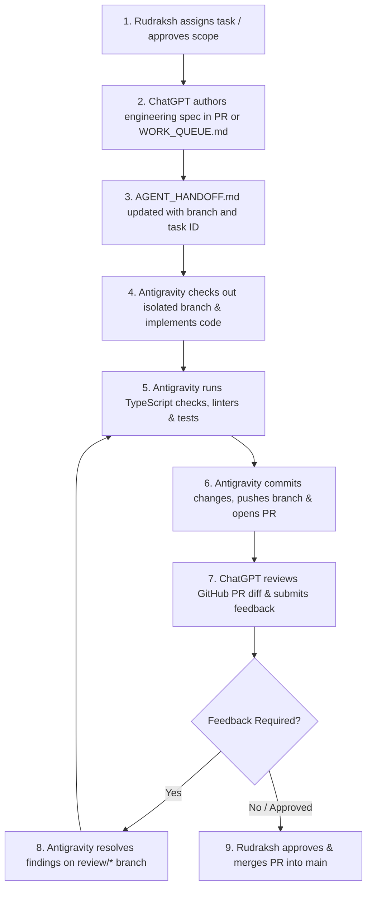

# Multi-Agent Collaboration Protocol — AgencyOS
## Google Antigravity × ChatGPT × GitHub × Rudraksh

**Document Type:** Canonical Operating Agreement for AI Agents & Project Owner  
**Repository:** `https://github.com/rudraksha127/Startup-Idea-Enhancement`  
**Status:** ACTIVE  
**Last Updated:** 2026-11-24  

---

## 1. Operating Roles & Responsibilities Matrix

| Domain | Responsible Agent | Primary Responsibilities | Boundaries & Constraints |
| :--- | :--- | :--- | :--- |
| **Project Owner & Release Authority** | **Rudraksh** | Final decision-making, production deployment approvals, destructive operation authorization, PR merging into `main`. | Retains exclusive root authority; all external spend, live emails, and migrations require explicit approval. |
| **Architecture, Strategy & Code Review** | **ChatGPT** | Product requirement analysis, technical architecture design, API contract specifications, database schema review, security audits, performance profiling guidance, QA acceptance criteria, PR reviews. | Read & review authority via GitHub; does not execute local commands directly; operates via persistent GitHub artifacts and PR comments. |
| **Local Implementation & Verification** | **Antigravity** | Local filesystem access, TypeScript/React/Next.js implementation, Express API development, test execution, local debugging, build verification, documentation maintenance, branch creation, PR drafting. | Confined to local repository workspace; must never commit directly to `main`; must never manufacture test results; must strictly follow test-driven evidence rules. |

---

## 2. Core Operational Workflow Cycle

Collaboration between ChatGPT and Antigravity operates on an asynchronous, persistent GitHub-mediated synchronization loop:

### Step-by-Step Execution Sequence

1. **Task Assignment:** Rudraksh prioritizes an item in `docs/engineering/WORK_QUEUE.md`.
2. **Technical Specification:** ChatGPT prepares the technical architecture, data model, and acceptance criteria.
3. **Local Implementation:** Antigravity creates an isolated working branch (`agent/antigravity/<task-id>-<slug>`), reviews target files and tests, and executes minimal, clean implementation changes.
4. **Deterministic Validation:** Antigravity runs local linters, unit tests, and type checks. Stale output or assumptions are never accepted as proof.
5. **PR & Handoff Synchronization:** Antigravity updates `AGENT_HANDOFF.md` and `docs/engineering/AGENT_WORK_LOG.md`, stages only relevant files, commits with structured messages, pushes to GitHub, and creates a Pull Request via `gh pr create`.
6. **Engineering Review:** ChatGPT accesses the GitHub PR, audits the diff against the specification, evaluates security and performance, and logs review comments.
7. **Resolution & Approval:** Antigravity addresses any requested changes. Rudraksh performs the final review and merges into `main`.

---

## 3. Git Branching & Synchronization Conventions

To ensure zero conflicts and maintain an immutable audit trail:

- `main`: Production-ready, fully verified branch. Direct pushes are prohibited.
- `feature/*`: Product and engineering features authored collaboratively.
- `agent/antigravity/*`: Implementation branches used exclusively by Antigravity.
- `review/*`: Dedicated branches created to resolve specific PR review findings.
- `hotfix/*`: Founder-approved critical production patches.

### Branch Rules
1. Never develop routine features directly on `main`.
2. Never force-push (`git push --force`).
3. Never overwrite another agent's work or silently resolve git merge conflicts.
4. Every PR must link to a unique Task ID in `docs/engineering/WORK_QUEUE.md`.
5. Keep commits atomic and descriptive following Conventional Commits (`feat:`, `fix:`, `refactor:`, `docs:`, `test:`).

---

## 4. File Ownership & Boundaries

| Component / Subsystem | Primary Owner | Reviewer |
| :--- | :--- | :--- |
| `frontend/src/app/`, `frontend/src/components/` | Antigravity (Frontend Lead) | ChatGPT (UI/UX & Web Perf) |
| `backend/src/modules/`, `backend/src/routes/` | Antigravity (Backend Lead) | ChatGPT (API & Systems Architect) |
| `backend/src/middleware/auth.ts`, `docs/security/` | Antigravity / ChatGPT | ChatGPT (Security Engineer) & Rudraksh |
| `database/` (Schemas, Migrations) | Antigravity (Database Engineer) | ChatGPT (Database Architect) & Rudraksh |
| `infra/`, `.github/workflows/`, `Dockerfile` | Antigravity (DevOps) | ChatGPT & Rudraksh |
| `docs/engineering/`, `AGENT_HANDOFF.md` | Antigravity & ChatGPT (Shared) | All |

---

## 5. Security & Permission Governance (Least Privilege)

Strict safeguards are enforced at all times:

1. **Zero Secret Exposure:** Never write API keys, OAuth tokens, passwords, or connection strings into source code, documentation, or Git history. Read configuration exclusively via validated environment variables (`.env.example`).
2. **Deterministic Boundaries:** State transitions, suppression checks, credit balances, and authentication must never rely on LLM heuristics. Always use deterministic validation (Zod, Mongoose constraints).
3. **Untrusted Inputs:** External web content, scraped DOMs, customer comments, and AI prompts are treated as untrusted data and sanitized.
4. **Owner-Gated Operations:** The following actions require explicit written confirmation from Rudraksh:
   - Live production deployments (`wrangler deploy`, Zoho Catalyst production push).
   - Database schema migrations on production instances.
   - Outbound marketing campaigns or live email/WhatsApp dispatches (`dryRunMode` defaults to `true`).
   - Repository permission, collaborator, or branch protection modifications.

---

## 6. Handoff & Session Recovery Protocol

To ensure seamless resumption across IDE sessions or model changes:

### Before Ending an Agent Session:
1. Update `AGENT_HANDOFF.md` with:
   - Active task ID and status.
   - Exact commit SHA and branch name.
   - Files modified.
   - Real command verification evidence.
   - Immediate next action for the incoming agent.
2. Update `docs/engineering/AGENT_WORK_LOG.md` with execution notes.
3. Commit and push the handoff checkpoint to GitHub.

### When Resuming a Session:
1. Read `AGENT_HANDOFF.md` first.
2. Verify local git state (`git status`, `git branch`, `git log -1`).
3. Check `docs/engineering/WORK_QUEUE.md` for task dependencies.
4. Continue execution directly from the recorded "Next Action" without repeating verified steps.
