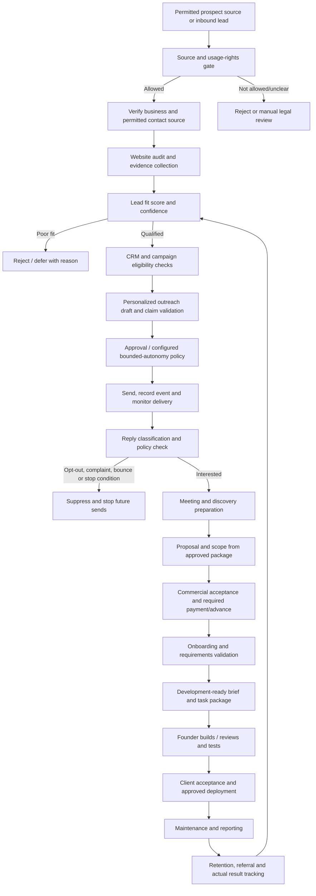

# Autonomous Agency OS — Project Master Brief

**Document type:** Canonical product and implementation brief  
**Working project name:** Autonomous Agency OS (working name; brand name is not selected)  
**Version:** 1.0  
**Prepared:** 18 October 2026  
**Initial geography:** India, beginning with Indore as a market-validation hypothesis  
**Founder / primary operator:** Solo founder; primary hands-on responsibility is website development and technical decisions  
**Product status:** Concept and intended operating model defined; commercial demand and production implementation remain to be validated  
**Document purpose:** Give an AI research/coding agent a single source of truth for progressing research, documentation, planning, implementation, testing and launch.

---

## 0. How an AI agent must use this document

Treat this file as the canonical statement of the product concept and target operating model. Do not restart discovery from zero, silently change the objective, or convert clearly stated constraints into optional suggestions.

However, **“concept finalized” does not mean every assumption is proven**. Preserve the intended product while verifying vendor capabilities, platform terms, legal applicability, current prices, technical feasibility and real customer demand.

### Agent operating rules

1. **Inspect before changing.** For an existing repository, inspect the code, framework conventions, tests, environment files by reading only `.env.example` or variable names, deployment configuration and current Git state before proposing code changes. Never print secret values.
2. **Evidence first.** Label material findings `VERIFIED`, `CORROBORATED`, `PRELIMINARY`, `INFERRED`, `UNKNOWN`, `DISPUTED` or `UNVERIFIED`. Cite official/current sources for time-sensitive platform, legal, security and pricing claims.
3. **No invented facts.** Never invent the company’s legal name, business address, registration, client testimonials, case studies, metrics, contact details, permission to use data, or successful test outcomes. Use `[FILL]` where a real owner decision or fact is required.
4. **Zero known critical release blockers.** A literal guarantee that a complex system has “zero loopholes” is not possible. The requirement is zero tolerance for knowingly shipping unresolved critical risks, along with documented residual risks, continuous testing and explicit incident/recovery procedures.
5. **Small and reversible changes.** Reuse the existing stack where practical. Do not add paid tools, new dependencies, new infrastructure, destructive migrations, API-contract changes or non-additive database changes without authorization.
6. **No uncontrolled external actions.** Use mock data/dry-run first. Never send real outreach, spend money, publish live campaigns/content, deploy to production, modify client systems, or delete/alter production data unless the configured authorization gate permits the action and the owner has explicitly approved actions requiring approval.
7. **No fake progress.** An item is complete only with evidence. An untested feature is `UNTESTED`; a partially working integration is `PARTIAL`; an unavailable verification is `UNVERIFIED`.
8. **Respect user-source restrictions.** In particular, do not use Google Maps/Places content to create or augment a cold-outreach database. Do not scrape websites or platforms in ways that violate terms, technical controls or applicable law.
9. **Separate deterministic controls from AI judgment.** Source eligibility, suppression, budgets, authentication, permission checks, approval requirements, idempotency and state transitions must not rely solely on a language model.
10. **Proceed in gates.** At each phase, deliver the stated artifacts, execute tests and report findings. Do not skip a failing test to preserve schedule. Critical unresolved issues block release.
11. **Preserve the user’s chosen workflow.** If operating under a `PLAN_THEN_BUILD` instruction, write the project-specific plan and wait for explicit `go` before implementation. If another operating mode is explicitly selected, follow that mode while retaining all safety/approval gates.
12. **End with a factual status report.** Include changed files, tests actually run, outcomes, open questions, risks, and what was not tested.

### Truth-status vocabulary

- **Locked direction:** the product objective or operating principle that must be preserved.
- **Working hypothesis:** a proposed choice to test, not a proven market or technical fact.
- **Implementation decision:** the agent may recommend a precise choice after inspecting the repository and verifying compatibility; document the rationale.
- **Owner decision:** cannot be safely invented; surface it as `[FILL]` or request a decision when necessary.

---

## 1. Executive product definition

### 1.1 The idea in one sentence

Build an internal **AI-powered agency operating system** that runs the routine business-development operations of a productized website and digital-growth agency—market research, permitted prospect discovery, website opportunity audits, marketing, outreach, reply handling, lead qualification, sales coordination, proposal/onboarding preparation, reporting and maintenance administration—so the founder can primarily focus on website development and the technical decisions that require human judgment.

### 1.2 What company this platform serves

The initial company sells practical digital services to local/service businesses. The customer purchases a business deliverable, not the internal agent platform itself:

- Conversion-oriented business websites.
- Service/course pages, enquiry and contact flows.
- Booking/appointment or WhatsApp enquiry links where appropriate and permitted.
- Basic analytics, technical SEO and website quality improvements.
- Ongoing maintenance, backups, updates, monitoring and defined support.
- Optional business workflow automation, priced and scoped separately.

### 1.3 Product positioning

**Proposed positioning:** “We help selected local businesses turn their digital presence into clearer enquiries, bookings and customer follow-ups through conversion-focused websites and ongoing digital operations.”

Do not lead with “we use AI” as the customer value proposition. AI is primarily the agency’s internal operating leverage. Sell a credible business outcome, show evidence, define deliverables and do not guarantee rankings, revenue, leads or conversion outcomes that are outside the agency’s control.

### 1.4 Initial operator model

- The founder is the first and primary user of the internal platform.
- The founder’s desired role is mainly development, technical QA and exceptional decisions.
- The system should automate routine work after it has been validated and authorized; it should not ask for approval for every harmless internal step forever.
- High-impact, irreversible, legal, financial, privacy-sensitive or reputational actions remain protected by policies and approval gates.
- This is an **internal tool first**, not a public SaaS for other agencies.

### 1.5 Product category and long-term path

Initial category: **productized digital-growth agency with an internal AI operations platform**.

Possible later path: use the proven internal workflow to inform a separate agency-facing SaaS. Do not build a public SaaS, expose the n8n workflow editor to clients, resell provider data, or add a multi-tenant customer automation product until licensing, demand, security and support obligations have been validated.

---

## 2. Strategic principles and decisions

### Locked direction

1. Automation should reduce manual sales and operations work so the founder can focus on development.
2. The platform must acquire and nurture business opportunities through multiple compliant channels, not depend on one data source or cold email alone.
3. The platform should eventually support bounded autonomy for approved routine activities.
4. It must provide an end-to-end traceable path from a prospect source to a qualified opportunity, paid/approved project and development-ready handoff.
5. Reliability, client trust, source provenance, security, privacy, deliverability and predictable costs are product requirements—not later polish.
6. Build the internal tool before considering a customer-facing SaaS.
7. Prefer repeatable niche packages over fully custom work for every client.

### Working hypotheses that must be validated

- Start in India, initially exploring the Indore market.
- First possible niche: independent coaching and skill-training institutes. This is a starting hypothesis, not a proven best niche.
- Initial core offer: website + enquiry capture + basic analytics + ongoing maintenance.
- Use n8n for workflow orchestration, Supabase/Postgres for durable business state, Next.js/TypeScript for the operator dashboard, and a configurable LLM gateway.
- Begin with permitted, independently sourced business websites, eligible directories, local associations, referrals, partner introductions and inbound leads.
- Run a small paid pilot before building an elaborate multi-agent system.

### Decisions that remain open

- Brand/company name, legal entity and owner business details: `[FILL]`.
- Exact first niche and final ICP after owner interviews: validate.
- Weekly founder development hours: `[FILL]`.
- Available repository/framework/deployment target: inspect; do not assume.
- Specific email provider and sending domain: choose only after capability, provider terms, authentication and budget review.
- LLM API provider, exact model identifiers and pricing: verify current API access/pricing and benchmark.
- Whether to self-host n8n or use a managed plan: decide based on operations/licensing/security and current cost.
- Legal/privacy counsel and approved outreach policy: arrange before production marketing.
- Approved monthly operating and advertising budgets: `[FILL]`.
- Official pricing, contracts, tax treatment and customer service levels: validate before quoting.

---

## 3. Target users and jobs-to-be-done

### 3.1 Primary internal user: founder/operator

Needs to:
- See which leads deserve attention and why.
- Trust that audit claims have evidence.
- Know what the system has sent, received, published or changed.
- Pause campaigns or all outbound activity immediately.
- See customer pipeline, upcoming work, spending, exceptions and profitability.
- Receive a complete technical brief once a client is commercially approved.
- Avoid repetitive prospect research, email composition, CRM updates, scheduling, proposal formatting and follow-up administration.

### 3.2 External buyer: local business owner/decision-maker

Potential needs (must be verified with customer interviews):
- A credible website that works on mobile.
- Clear services/course information and calls to action.
- A reliable way to capture and route enquiries.
- Better organization of leads or appointments.
- Maintenance and support from a provider who takes responsibility.
- Clear scope, price, ownership and response expectations.

### 3.3 Initial ICP hypothesis

Owner-managed service businesses with a real, observable digital gap, a clear business reason to improve the website or enquiry process, an identifiable decision-maker, feasible implementation requirements and a budget compatible with defined packages.

Reject or deprioritize prospects where:
- The alleged website gap cannot be verified.
- The business is clearly outside the chosen niche or capabilities.
- The contact source/use is not permitted or cannot be justified.
- The contact is suppressed, opted out, inappropriate or unverified.
- No meaningful improvement can be described.
- The project is unlikely to be profitable at the approved price floor.
- The prospect requests deceptive marketing, fake reviews, illegal scraping or other unacceptable work.

---

## 4. Scope: what the platform is and is not

### 4.1 In scope for the internal MVP

1. Operator authentication and a private dashboard.
2. Source register and compliant lead import/discovery pathway.
3. Lead provenance, deduplication and qualification queue.
4. Evidence-backed website audit workflow.
5. Explainable lead scoring with confidence and supporting evidence.
6. Internal CRM pipeline and activity timeline.
7. AI-assisted campaign/content drafts.
8. Personalized outreach drafts with source evidence.
9. Controlled email sending, replies, classification, opt-out handling and suppression—initially supervised.
10. Campaign and conversion tracking.
11. Proposal/scope draft from approved packages and pricing rules.
12. Meeting/onboarding checklist and project brief generation.
13. Development task/repository handoff, where authorized.
14. Cost monitoring, workflow logs, retries, alerts and emergency stop.
15. Documentation, tests and recovery procedures.

### 4.2 In scope after MVP validation

- Bounded auto-sending for narrowly defined, legally reviewed and tested campaigns.
- Inbound content calendar and publishing using approved platform integrations.
- Additional acquisition channels and referral/partner operations.
- More advanced lead scoring and campaign optimization based on real outcomes.
- Client onboarding, payment-state integration and maintenance operations.
- Client reporting and case-study preparation with permission.
- Additional niches once the first one is economically validated.

### 4.3 Out of scope initially

- Public SaaS for other agencies.
- Selling or reselling lead/contact databases.
- Scraping Google Maps or other platforms in violation of their rules.
- Fully autonomous legal contract negotiation or acceptance.
- Unrestricted ad spend, purchasing, refunds or discounts.
- Arbitrary automatic production deployments to client systems.
- Fake testimonials, reviews, business metrics, credentials or client relationships.
- Guaranteed leads, rankings, sales or revenue.
- Autonomous changes to the system’s own permissions, policies, production code or budgets.
- Building a vector database, agent swarm, fine-tuning pipeline or microservices without a demonstrated requirement.

---

## 5. End-to-end business workflow



### Detailed stages

**Stage A — Source discovery:** Search only sources whose terms and intended use permit prospect research. Store source identity, URL, timestamp, legal/contractual review status and data provenance. Do not treat public visibility as unlimited permission.

**Stage B — Verification:** Independently verify the business-owned website and business contact details on sources that allow the intended use. Do not make claims about profits, customer volume or purchasing intent from review counts or social signals alone.

**Stage C — Audit:** Run permitted, low-impact checks. Separate observable findings from interpretations. Store URLs, timestamps, test output and confidence. Do not bypass authentication, CAPTCHAs, technical controls or robots/access restrictions.

**Stage D — Qualification:** Use deterministic eligibility rules and an explainable score. Do not let an LLM override suppression or source policy.

**Stage E — Marketing/outreach:** Produce helpful content and highly relevant messages. Each material claim must have a source. Keep the message truthful, identifiable, low-pressure and aligned with the approved offer. Follow provider limits and relevant laws; no evasion or account rotation to bypass controls.

**Stage F — Reply operations:** Categorize replies into interested, meeting request, pricing question, objection, not interested, unsubscribe, bounce, complaint, out of office, auto-reply or unknown. A stop condition must be applied before any future follow-up. Escalate ambiguity.

**Stage G — Sales:** Ask qualification questions, schedule meetings and generate proposal drafts using approved packages, price floors and terms. The agent cannot accept unusual contract terms or make commitments outside policy.

**Stage H — Handoff:** Only create a “ready for development” project once the necessary commercial acceptance, scope and payment/advance conditions defined by the business have been satisfied.

**Stage I — Delivery:** Produce the brief, tasks, assets, constraints, test plan and launch checklist. The founder remains accountable for implementation, QA and deployment authorization.

**Stage J — Retention:** Run only the maintenance activities included in the contract; track changes, support limits, renewal and measurable outcomes.

---

## 6. Product UX and operator dashboard

### 6.1 UX principles

- One command centre, not seven disjointed agent chat windows.
- Clear status and next action on every object.
- Evidence and source provenance visible near AI conclusions.
- Keep the interface calm, practical and information-dense without visual clutter.
- Use progressive disclosure: show the key summary first; reveal detailed audit trails when requested.
- Display confidence, uncertainty and reasons rather than fake precision.
- Obvious pause/stop controls for campaigns and autonomous workflows.
- Accessible labels, keyboard navigation, visible focus, responsive layout and useful empty/error/loading states.
- Never represent simulated data as live business data.
- Every irreversible action should have a clear state, permission boundary and audit record.

### 6.2 Suggested main navigation

1. **Overview** — qualified opportunities, campaign health, tasks, exceptions, upcoming meetings, active projects, spending and recurring revenue.
2. **Prospects** — lead table, filters, source, verification, score, audit status, contact eligibility and next action.
3. **Research & Audits** — audit evidence, severity, confidence, recommended service and report preview.
4. **Campaigns** — channel, audience, message variant, source policy, budget/quota, send status, replies and results.
5. **Inbox & Meetings** — reply classification, conversation history, scheduled meetings and escalations.
6. **Sales Pipeline** — qualification, discovery, proposal, negotiation, won/lost/suppressed state.
7. **Content Studio** — editorial calendar, briefs, draft content, approval and channel publishing status.
8. **Clients & Projects** — scope, agreements, payments/status, requirements, tasks, QA and deployment state.
9. **Maintenance** — service-tier checklist, alerts, support tickets, included limits and renewals.
10. **Analytics & Finance** — qualified lead rate, positive reply rate, meetings, conversion, acquisition cost, project gross margin, recurring revenue and expenses.
11. **Automation Health** — runs, retries, error queues, provider status and stuck workflows.
12. **Governance & Settings** — source policy, jurisdictions, approved packages, sender configuration, user permissions, budgets, model routing, retention and emergency stop.

### 6.3 Core dashboard widgets

- Leads newly researched / qualified this period.
- Outreach drafts awaiting approval or auto-send eligibility.
- Replies requiring human review.
- Meetings and proposal status.
- Projects blocked by missing scope, content, access or payment.
- Campaign performance by source and message variant.
- Model/API usage against budget.
- Workflow failures and recovery status.
- Opt-outs, complaints and source-policy exceptions.
- Monthly recurring revenue and client-level delivery load.

### 6.4 Visual/product design direction

The desired interface is a professional operations dashboard: clean typography, strong hierarchy, restrained colors, consistent cards/tables, compact metadata, meaningful status indicators and full responsive behavior. Avoid excessive gradients, giant decorative charts, noisy animations or UI that hides the actual workflow state. Establish design tokens and reusable components after inspecting any existing design system. Do not rebuild or rebrand an existing project without an explicit reason.

---

## 7. AI organization and autonomy model

### 7.1 Responsibilities

These are logical departments; they need not be seven separately running models in the first version.

- **CEO / Strategy:** rank experiments and markets from evidence, review results, propose resource allocation within policy.
- **CMO / Marketing:** niche content, editorial planning, landing-page briefs, approved social distribution and campaign performance analysis.
- **CRO / Sales:** permitted prospect research, qualification, message drafts, reply handling, meeting coordination and proposal preparation.
- **COO / Operations:** onboarding, client task tracking, handoff completeness, delivery checklist and maintenance scheduling.
- **CTO / Delivery support:** specifications, implementation plans, code scaffolding, technical checks and test-case generation; no uncontrolled production changes.
- **CIO / Governance:** source policy, data access, retention, audits, security checks and incident reporting.
- **CFO / Economics:** spend, cost per qualified opportunity, project margin, pricing floor and budget alerts.

### 7.2 Central orchestrator

The orchestrator should:
- Accept a defined task and authorized context.
- Determine whether the operation is allowed before calling tools.
- Route to a suitable model based on task difficulty, cost and quality requirements.
- Return structured outputs validated against a schema.
- Record model, prompt/version, tool calls, cost estimate, status and evidence references.
- Apply timeout, step-count, retry and budget ceilings.
- Treat website text, emails, uploaded documents and third-party content as untrusted input.
- Never permit external input to override system instructions or grant permissions.
- Escalate uncertainty, policy conflicts and unusual commitments.

### 7.3 Model routing

Use a model gateway so the provider/model can be changed without rewriting all business logic. Candidate routing (subject to current API availability, identifiers, pricing and benchmark):
- Lightweight model: routine labels, extraction and simple classification.
- Balanced model: research summaries, common draft generation and routine planning.
- Strong reasoning/coding model: complex audits, architecture proposals, difficult exceptions and high-impact analysis.

Do not hardcode model names or assume a consumer ChatGPT plan provides API credits. Benchmark on a representative, human-labelled evaluation set before production use. Cache only where permitted and safe. Avoid sending unnecessary personal/client information to model providers.

### 7.4 Autonomy levels

1. **Simulation:** mock data; no external side effects.
2. **Supervised:** prepare outputs; humans approve outbound or consequential actions.
3. **Bounded autopilot:** routine pre-authorized actions execute within defined channels, sources, content rules, budgets, quotas and stop conditions.
4. **Emergency stop:** outbound marketing and other nonessential external effects are halted. Safe internal logging and alerting may continue.

Move between modes only after evaluation and acceptance gates. Autonomy is task-specific, not a global unchecked switch.

### 7.5 Actions that require special permission or review

- Starting a new outbound campaign or changing its target/jurisdiction.
- Spending on ads, paid data, APIs, domains or subscriptions beyond pre-approved limits.
- Offering a discount outside a set price floor.
- Accepting custom contractual terms or promising results.
- Deleting or exporting data outside established user-rights procedures.
- Publishing high-impact factual/regulated claims.
- Deploying to production or changing client systems.
- Changing security, autonomy or source-eligibility policies.
- Changing the application’s own code or permissions.

---

## 8. Data-source policy and compliance guardrails

### 8.1 Google Maps / Places restriction

**Do not build a Maps scraper or export Google Maps/Places data into the prospect CRM or mailing/telemarketing list.** Google Maps Platform terms restrict copying/exporting Maps content and using it to create or augment mailing and telemarketing lists; Places content also has storage/caching constraints with specific exceptions. Recheck current terms at implementation and launch:
- Google Maps Platform terms: https://cloud.google.com/maps-platform/terms
- Places API policies: https://developers.google.com/maps/documentation/places/web-service/policies

Use Google Maps only for a specific permitted mapping/navigation purpose; do not use it as the systematic source for the outbound prospect database. Do not copy reviews/ratings into third-party scoring or CRM unless that exact use is expressly permitted by current terms.

### 8.2 Candidate permitted-source categories (each still requires verification)

- Business-owned websites where the intended access/use is permitted.
- Direct inbound enquiries and form submissions.
- Voluntarily provided referrals and partner introductions.
- Eligible industry association/member directories where outreach use is allowed.
- Licensed B2B data providers under terms that permit the intended internal use and geography.
- Public procurement/business registries where the applicable terms and privacy rules permit the use.
- Manually submitted prospect records with source and purpose documented.

A source is not automatically permitted merely because it is public or accessible without login. Source policy must record the permitted use, limitations, retention, contact eligibility, region and review date.

### 8.3 Source registry requirements

Each connector/source must define:
- Source/provider and terms URL.
- Jurisdiction and permitted purpose.
- Allowed fields and fields prohibited from retention/export.
- Contacting/marketing permission assessment.
- Rate limits, technical access rules and attribution requirements.
- Storage/retention requirements.
- Data freshness and verification process.
- Owner/reviewer and last-checked date.
- Automated tests preventing disallowed fields or actions from entering the CRM.

### 8.4 India legal and platform review

The business begins in India, but exact obligations depend on the specific data, channel, recipients, business status and implementation date. Review current official sources and get appropriate Indian legal advice before production outreach. Do not represent this document as legal advice.

Sources to re-check at implementation:
- Digital Personal Data Protection Act, 2023: https://www.indiacode.nic.in/
- MeitY notifications and DPDP Rules: https://www.meity.gov.in/
- TRAI Unsolicited Commercial Communication information: https://www.trai.gov.in/what-spam-or-ucc
- Google Gmail sender guidelines: https://support.google.com/mail/answer/81126
- WhatsApp Business messaging policy: https://business.whatsapp.com/policy
- n8n license/use guidance: https://support.n8n.io/article/can-i-use-your-license-for-my-use-case

Design data minimization, access controls, deletion/retention, source provenance, opt-out handling, incident reporting and security safeguards now; counsel should confirm which rules are in force for the launch date and precise use case.

### 8.5 Channel-specific safeguards

**Email:** authenticate the domain with SPF/DKIM and suitable DMARC; observe provider-specific sender rules; monitor bounces, complaints and reputation; identify the sender honestly; include a practical opt-out; keep marketing and transactional communication distinct; stop follow-up on replies, opt-outs, complaints and hard bounces. Do not evade provider limits.

**WhatsApp:** do not use as a cold-spam workaround. Use only with appropriate consent/opt-in and in compliance with current policy, templates and messaging-window rules.

**SMS/voice:** do not assume ordinary business numbers can send automated promotional messages. Review current TRAI rules and use authorized routes where required.

**Social/content APIs:** use approved APIs/integrations and respect their terms, account limits, audience targeting and disclosure rules. Do not automate fake engagement.

### 8.6 Data-minimization baseline

Collect only what the agency requires to qualify and serve a business: business identity, evidence/source URLs, appropriate business contact, contact-source facts, qualification state, communications events and client-project requirements. Avoid sensitive personal data. Do not collect prospect/customer lists unrelated to the service. Define retention periods and deletion/export procedures with legal review.

---

## 9. Functional requirements

### FR-01 — Authentication and roles

Private operator login; least-privilege roles; secure session handling; protected admin actions; no public access to internal prospect/client data. Initial role can be founder/admin, but design role boundaries so adding staff later does not require a rewrite.

### FR-02 — Lead/source ingestion

- Accept prospects from approved source connectors or controlled manual imports.
- Validate schema, source identifier, timestamps and required provenance.
- Deduplicate using suitable deterministic identifiers without relying solely on fuzzy AI guesses.
- Apply source policy before storing any candidate data.
- Reject records without sufficient source provenance or with prohibited usage.

### FR-03 — Website audit

- Perform low-impact checks with timeouts, rate limits and safe URL validation.
- Avoid SSRF: block loopback, private, link-local, metadata and other restricted IP ranges; re-check redirects and DNS resolution; allow only approved protocols; cap response size and execution time.
- Do not submit forms, log in, bypass controls or make changes to third-party sites.
- Store findings with URL, timestamp, evidence excerpt/measurement, method, severity and confidence.
- Flag AI-inferred suggestions separately from automated test results.

### FR-04 — Qualification and scoring

- Configurable factors with explicit definitions.
- Explain each score component.
- Store score version and evidence used.
- Use an initial score only as a prioritization aid, not as objective evidence of profit, intent or ability to pay.
- Test for bias, stale data and incorrect claims.

### FR-05 — CRM pipeline

Suggested state machine (adapt only with a documented migration plan):
`discovered → source_review → verified → researched → qualified → draft_ready → approved_or_auto_eligible → contacted → replied → meeting_booked → proposal_sent → won/lost`

Separate terminal/special states: `rejected`, `deferred`, `suppressed`, `invalid_contact`, `source_blocked`, `do_not_contact`.

Every state change needs a timestamp, actor/system, reason and relevant event reference. Invalid transitions must be rejected.

### FR-06 — Outreach drafting and send control

- Generate drafts based on verified facts only.
- Record evidence for any material factual statement.
- Check the source/contact/channel policy before every send.
- Run suppression, reply, bounce, quota, sender-health and campaign-status checks immediately before sending.
- Use an outbox/idempotency mechanism so retries do not resend the same message.
- Store provider message ID, delivery state, errors and unsubscribe headers/links as applicable.
- No sending without an authorized operating mode and configured campaign rules.

### FR-07 — Reply handling

- Process provider webhooks securely and idempotently.
- Classify replies; store raw message access only as needed and protect it.
- An opt-out/complaint or clear negative response stops future automated outreach before any other optional AI action.
- Human escalation for unclear sentiment, legal requests, threats, sensitive information or custom negotiation.
- AI must never pretend to be a human in a deceptive way or invent facts/commitments.

### FR-08 — Marketing/content

- Maintain brand voice, niche, claims policy and source requirements.
- Content generation produces drafts with intended channel, audience, objective and source references.
- Require originality, fact-checking, accessibility, rights/licensing checks and human review for high-impact claims.
- Publish only through authorized integrations, within configured frequency and budget.
- Track content ID, publication URL, performance and resulting enquiries where attribution is available.
- Do not mass-generate thin SEO pages or fake location-specific expertise.

### FR-09 — Sales and proposals

- Qualification questions should verify need, authority, urgency, budget fit and feasibility.
- Use approved, versioned service packages and price floors.
- Generate proposal drafts with scope, exclusions, milestones, payment terms, ownership, revisions and maintenance limits.
- Escalate custom terms and out-of-policy discounts.
- Track proposal delivery, acceptance/rejection and follow-up.

### FR-10 — Project handoff

Create a development-ready handoff only after the project reaches its configured commercial gate. It must include:
- Client and business context.
- Approved business objectives and target users.
- Deliverables, pages, features and exclusions.
- Content and media assets, sources and rights status.
- Brand/design references and responsive behavior.
- Integrations and their account/credential owner (never put secrets in the brief).
- Data handling and privacy requirements.
- Acceptance criteria and QA checklist.
- Timeline assumptions/dependencies and unresolved questions.
- Price, payment/advance status and contract/reference IDs where appropriate.
- Deployment/ownership/handover plan.

### FR-11 — Client project tracking

Tasks, owners, due dates, status, blockers, time/effort tracking, QA results, client approval, deployment state and handover records. Repository creation or deployment actions require explicit authorizations and idempotent handling.

### FR-12 — Maintenance and retention

Track plans, inclusions, excluded work, renewal dates, backup/status checks, update schedules, incidents, service tickets and reports. Do not infer that a site can be changed without client permission. Keep domains and key accounts client-owned where contractually appropriate.

### FR-13 — Finance and budgets

Track estimated and actual model/API/email/hosting/service costs where data is accessible, per-campaign limits, monthly caps, project fees, maintenance MRR, fulfilment hours and margin. Use hard stops for budgets and maximum workflow cost/steps. Financial projections must clearly label assumptions and must not be reported as actuals.

### FR-14 — Observability and operations

Central logs without secrets or unnecessary personal data; correlated workflow/run IDs; state transition events; metrics; bounded retries with exponential backoff and jitter; dead-letter/error queue; alerting; circuit breakers; reconciliation jobs; pause/resume controls; documented recovery.

### FR-15 — Export/deletion/support

Provide a documented route for applicable data access/export/deletion requests. Deletion must cover the main database and relevant object storage/cache/processors within the supported and lawful policy; backups must follow a documented retention strategy. Never erase required suppression evidence in a way that permits unwanted recontact. Confirm all choices with counsel.

---

## 10. Non-functional requirements (NFRs)

- **Security:** least privilege, backend-only secrets, secure authentication, session protection, input validation, safe redirects, SSRF protections, injection-resistant database access, dependency scanning and safe error responses.
- **Privacy:** data minimization, source/consent/permission provenance, defined retention, access restriction and auditable rights handling.
- **Reliability:** no duplicate external actions on retry; retry limits, timeouts, circuit breakers, idempotent webhooks and a recoverable queue.
- **Observability:** every consequential automation has an event trail and a run status; errors are actionable, not swallowed.
- **Cost control:** model usage, tool calls, external requests, workflow duration and send volume have hard limits.
- **Accessibility:** aim for WCAG 2.2 AA for the operator UI, with automated and manual checks; exact compliance must be verified, not merely claimed.
- **Performance:** define measurable response/page-load targets after the framework and deployment are known; capture a baseline before optimization.
- **Maintainability:** modular responsibilities, validated schemas, versioned prompts/workflows, type safety and clear developer documentation.
- **Compatibility:** existing project behavior/URLs/API contracts preserved unless change is explicitly required and approved.
- **Portability:** provider integrations behind interfaces where reasonable; avoid hard-coding one model or one outreach provider into core business logic.
- **Recovery:** backup and restore exercise, incident runbook, rollback strategy and manual fallback.

---

## 11. Proposed technology architecture

This is the preferred starting direction, not a claim about an existing repository. Inspect the actual repo before locking exact versions or changing the stack.

- **Frontend/dashboard:** Next.js App Router + TypeScript, using the existing component/design conventions if present.
- **Backend/data:** Supabase/Postgres with Row Level Security and server-side access policies. Privileged keys must never be exposed to browsers.
- **Workflow orchestration:** n8n for scheduled jobs, webhooks and integrations; retain critical invariants in application code/database constraints where possible.
- **AI:** provider/model gateway, prompt registry, structured output schemas, cost logging and evaluation harness.
- **Email:** an authenticated provider with inbound webhooks/event processing, unsubscribe/suppression support and provider-compatible sender configuration.
- **Website audit:** isolated low-privilege worker or server-side service with strong URL/IP/redirect/size/time protections.
- **Repository/CI:** Git, protected production branch, lint/typecheck/test/build checks and preview/staging environment.
- **Hosting:** select after repository inspection; verify commercial terms, region, backup and cost requirements. Do not create paid resources without approval.

### Architectural boundaries

1. UI calls application/service APIs; browser never has privileged database or provider secrets.
2. Business logic lives in services/modules, not duplicated across UI and n8n nodes.
3. n8n orchestrates, but policy gates and state transitions are independently validated.
4. AI returns structured data; application validates it before side effects.
5. Outbound side effects use a queue/outbox and idempotency keys.
6. Inbound webhooks are authenticated, replay-resistant where possible, schema-validated and idempotent.
7. Every provider connector has an interface and source/policy configuration.
8. Sensitive and customer-specific data is segregated and passed to models only when necessary.

---

## 12. Suggested repository structure

**Important:** this is a target structure for a new implementation. If an existing repository is present, its framework conventions take precedence; do not move framework-required files or perform a big-bang rewrite merely to match this tree.

```text
autonomous-agency-os/
├── README.md
├── AGENTS.md                         # Project-level instructions for coding agents
├── CONVENTIONS.md                    # Code, naming, testing and architecture rules
├── ARCHITECTURE.md                   # System boundaries and data flows
├── PRODUCT_SPEC.md                   # Product requirements and user journeys
├── ROADMAP.md                        # Phases, gates and priorities
├── SECURITY.md                       # Threat model and controls
├── PRIVACY_AND_DATA_POLICY.md        # Data inventory and retention policy
├── SOURCE_POLICY.md                  # Approved source registry and restrictions
├── RUNBOOK.md                        # Operations, pause/restore/incident procedures
├── CHANGELOG.md
├── .env.example                      # Variable names/placeholders only
├── .gitignore
├── docs/
│   ├── decisions/                    # ADR-0001-*.md etc.
│   ├── research/
│   │   ├── RESEARCH_BRIEF.md
│   │   ├── SOURCE_REGISTRY.md
│   │   ├── EVIDENCE_MATRIX.md
│   │   ├── CONTRADICTIONS_AND_GAPS.md
│   │   └── RED_TEAM_REVIEW.md
│   ├── requirements/
│   ├── api/
│   ├── runbooks/
│   └── release-checklists/
├── apps/
│   └── dashboard/                   # Next.js app if the project uses monorepo structure
├── src/                              # Use only if consistent with the selected framework
│   ├── app/                           # Routes/layouts; preserve framework conventions
│   ├── components/
│   │   ├── ui/
│   │   ├── layout/
│   │   └── domain/
│   ├── features/
│   │   ├── overview/
│   │   ├── prospects/
│   │   ├── audits/
│   │   ├── campaigns/
│   │   ├── inbox/
│   │   ├── sales/
│   │   ├── content/
│   │   ├── clients/
│   │   ├── projects/
│   │   ├── maintenance/
│   │   ├── analytics/
│   │   ├── automation-health/
│   │   └── governance/
│   ├── server/
│   │   ├── auth/
│   │   ├── services/
│   │   ├── repositories/
│   │   ├── policies/
│   │   ├── connectors/
│   │   ├── orchestrator/
│   │   ├── workflows/
│   │   ├── schemas/
│   │   └── observability/
│   ├── lib/
│   └── styles/
├── packages/                         # Only if a monorepo is justified
│   ├── shared-schemas/
│   ├── prompts-and-evaluations/
│   └── ui/
├── supabase/
│   ├── migrations/
│   ├── seed.sql                      # Fake development data only
│   └── tests/
├── n8n/
│   ├── workflows/                    # Exported definitions, sanitized
│   ├── README.md
│   └── test-fixtures/
├── scripts/
│   ├── audit/
│   ├── testing/
│   └── maintenance/
├── tests/
│   ├── unit/
│   ├── integration/
│   ├── e2e/
│   ├── security/
│   ├── policy-gates/
│   ├── accessibility/
│   └── fixtures/
├── infra/                            # Only if needed; do not add unapproved services
│   ├── staging/
│   └── production/
└── _agent/                           # Local, git-ignored execution state and reports
    ├── RUN_STATE.md
    ├── COMPLIANCE_INVENTORY.md
    ├── COMPLIANCE_REPORT.md
    ├── STRUCTURE_AUDIT.md
    └── STRUCTURE_PLAN.md
```

### Structure rules

- Do not create empty abstractions just to fill folders. Add a module only when there is a real responsibility.
- For a simple repository, prefer a clean single app over an unnecessary monorepo.
- Keep business rules, source policies, suppression and budget gates testable independently of UI and LLMs.
- Version workflow exports and prompts; scrub credentials, webhooks and user data before committing.
- Add an Architecture Decision Record for meaningful stack or vendor choices.
- Never commit `.env`, access tokens, production exports or live prospect data.

---

## 13. Suggested domain model and key invariants

The exact schema must be designed after inspecting the chosen database and access model. This is the conceptual domain model.

### Main entities

- `users` / `roles` — internal operators and permissions.
- `source_registry` — source/provider terms, permitted uses, allowed fields, restrictions, review date and status.
- `prospects` — minimal business record, provenance references, verification and pipeline status.
- `contact_points` — independently sourced business contact details with origin, verification and eligibility state.
- `website_audits` — audit runs, evidence, findings, method, timestamps and confidence.
- `qualification_scores` — score components, version, evidence references and reasons.
- `campaigns` — channel, audience eligibility, objective, policy, quotas, budget and status.
- `content_assets` — brief, draft, claims/source references, approval and publication metadata.
- `message_drafts` — recipient reference, campaign, rendered content, claim evidence and approval state.
- `outbound_events` — send attempts, provider message IDs, delivery/error state and idempotency key.
- `inbound_events` — reply/webhook events, classification, action and processing state.
- `suppression_entries` — normalized suppression key, channel, reason, timestamp and minimal necessary audit fields.
- `meetings` — invitee, schedule, status and notes with access restriction.
- `service_packages` — deliverables, exclusions, price floor, revision policy and version.
- `proposals` / `agreements` — versioned scope, price, terms reference and acceptance state.
- `clients` — client record, verified contact and service relationship.
- `projects` / `tasks` — requirements, milestones, owner, dependencies, blockers and acceptance.
- `payments` — references/status only as needed; do not store payment-card data directly.
- `maintenance_plans` / `support_events` — SLA, included effort, renewals, health checks and incidents.
- `ai_runs` — model/provider, task, prompt version, cost estimate, output status and references; do not log secrets or unnecessary PII.
- `audit_events` — actor, action, target, timestamp, reason and correlation ID.

### Mandatory invariants

1. A source policy can mark a source/field/use `blocked`; downstream jobs must enforce it.
2. No outreach can send without passing source eligibility, contact eligibility, suppression, campaign, sender health, quota, budget and autonomy-policy gates.
3. Suppression must be checked immediately before every send, not merely at campaign creation.
4. Opt-outs and complaint/stop conditions take priority over other AI-generated actions.
5. Outbound event creation is idempotent; retries must not duplicate a real-world send.
6. A lead cannot become `qualified` without required evidence and score metadata.
7. A project cannot become `ready_for_development` until required scope/acceptance/payment gates are met according to the approved business rules.
8. A campaign cannot run if its jurisdiction/source policy has expired or is unreviewed.
9. A budget hard cap cannot be overridden by the model.
10. A user in one access scope cannot read another client’s private data.
11. Every relevant AI claim can be traced to evidence or marked as a hypothesis.
12. Production credentials never appear in client-side bundles, prompt inputs without need, Git, ordinary logs or generated project briefs.
13. External user content cannot grant tool permissions or override system instructions.
14. Deletion/export operations must follow the approved retention/rights policy and leave only lawful, minimal audit/suppression data as appropriate.

---

## 14. Workflow inventory for n8n/application orchestration

Build these as separate reusable workflows, not one massive graph. Workflow names below are working names.

1. `source_ingestion_review` — validate approved source, normalize fields, record provenance, deduplicate and queue review.
2. `website_audit_enqueue` — safe URL validation, limited checks, rate limits and audit records.
3. `lead_qualification` — deterministic criteria, model-supported summary, score explanation and rejection/defer handling.
4. `campaign_planning` — choose an approved audience/offer/content plan and verify channel/source policy.
5. `content_draft_and_review` — create draft, fact/claim checks, originality/accessibility checks and approval.
6. `outreach_draft` — generate personalized message referencing verified findings; validate schema and claims.
7. `pre_send_policy_gate` — fresh suppression check, source/jurisdiction eligibility, approval/auto-eligibility, quotas, sender health and budget.
8. `outbound_send_and_record` — idempotent outbox handling, provider send, event record and error reconciliation.
9. `email_webhook_ingest` — authenticate event, validate schema, deduplicate provider event, update state.
10. `reply_classify_and_route` — deterministic stop/suppression first; then classify; escalate ambiguous/high-impact replies.
11. `meeting_and_discovery_prep` — scheduling, agenda, evidence summary and required questions.
12. `proposal_generation` — approved package, scope guardrails, versioned price and terms; draft only for custom exceptions.
13. `client_onboarding` — contract/approval/payment gates, asset collection and checklist.
14. `development_handoff` — validate completeness and create approved tasks/brief/repository actions.
15. `maintenance_health` — authorized availability/link/backup/status checks and reports.
16. `campaign_analytics` — reliable event attribution, funnel metrics and cost aggregation.
17. `budget_guard` — track provider/model spend; stop nonessential execution at a hard ceiling.
18. `failure_recovery` — bounded retry, dead-letter queue, alert, safe pause and manual recovery instructions.
19. `deletion_export_request` — verified request, policy-aware propagation and auditable completion.
20. `emergency_stop` — immediately prevent new external sends/publishing/spend; provide status and require explicit authorized resume.

### Reliability rules

- Every workflow must define triggers, inputs, schema, outputs, owner, idempotency key, timeout, retry policy, failure state, alerts and recovery instructions.
- Use exponential backoff with jitter only for transient failures; do not retry policy denials or permanent invalid requests.
- Define a maximum run duration, step/call count and cost budget.
- Use provider rate limits; do not retry in a hot loop.
- A failed or uncertain send must be reconciled against provider status before retrying.
- All workflows must be testable with fake data and mock providers.
- Export workflow definitions in a sanitized, version-controlled form where permitted.

---

## 15. Security, abuse cases and risk management

### Threat model to document

Assets:
- Business/client contact data and conversation content.
- Client project briefs, source code, credentials and design assets.
- Email domain reputation and sending accounts.
- API/provider credentials and billing accounts.
- Client websites, repositories and deployment environments.
- Campaign budget and payment/sales data.
- System policy, audit logs and workflow definitions.

Trust boundaries:
- Browser to application server.
- Application to database.
- Application/n8n to external providers.
- LLM to tools and retrieved external content.
- Prospect website/email content to internal workflow.
- Internal test/staging to production.
- One client/project to another.

### Principal risks and mandatory mitigations

| Risk | Required control | Release condition |
|---|---|---|
| No demand/willingness to pay | Interviews, niche test, paid pilot | Do not overbuild before evidence |
| Prohibited source data use | Source allowlist/registry, field/use policy gate | No blocked-source route in tests |
| Unwanted outreach or noncompliant channel | jurisdiction/channel review, approval and suppression | Channel-specific review complete |
| Opt-out ignored | centralized suppression and pre-send check | Automated negative tests pass |
| Duplicate sending on retry | idempotency/outbox/reconciliation | duplicate-event tests pass |
| AI invents audit claims | evidence links, confidence, claim gate | unsupported claims blocked or labeled |
| Prompt injection in website/email | untrusted-input handling, least privilege, tool allowlist | red-team tests pass |
| Runaway LLM/tool loop | hard step/time/token/budget limits | cap tests pass |
| Secret leakage | server-only secrets, scanning, safe logs | secret scan and bundle checks pass |
| Cross-client data access | RLS/server authorization and isolation tests | allow/deny test suite passes |
| SSRF via audit URLs | restrict private IPs/protocols/redirects and revalidate DNS | dedicated tests pass |
| Data loss | backup and actual restore rehearsal | restore evidence recorded |
| Vendor terms/pricing change | vendor register/review cadence/adapter | impacted workflow can pause safely |
| SEO spam/misleading content | originality and claim review | publication policy checks pass |
| Project margin collapse | price floor, scope/effort tracking, change orders | out-of-scope work cannot silently expand |
| Legal/contract mismatch | official source review and lawyer review | launch blocker cleared |
| Provider outage/retry storm | backoff, circuit breaker, queue, manual fallback | failure simulation passes |
| Accidental production action | environment segregation and approval gate | tests prove staging cannot trigger prod |
| Unauthorized deletion/export | access policy, dual review for high-impact changes | deletion/export dry-run passes |

### Emergency stop requirements

- A visible, accessible control and a server-side kill switch.
- Stop queued/new outbound email and nonessential publication/spend.
- Cancel or pause scheduled campaign jobs where supported.
- Prevent retries from resurrecting a paused campaign.
- Record actor, timestamp, reason, affected jobs and confirmation state.
- Provide a safe resume procedure after investigation.
- Test the kill switch end-to-end; a UI toggle alone is insufficient.

---

## 16. Business packages and financial hypotheses

These figures are **initial pricing hypotheses for validation in India**, not verified market averages, price promises or final rate cards.

| Package | One-time setup hypothesis | Recurring hypothesis | Example scope |
|---|---:|---:|---|
| Launch | ₹12,000–₹18,000 | ₹2,000–₹3,000/month | Defined starter site, contact/enquiry flow, deploy/handover, bounded updates |
| Growth | ₹25,000–₹45,000 | ₹4,000–₹7,000/month | More pages, conversion-oriented structure, forms/analytics, agreed launch support |
| Automation add-on | ₹8,000–₹20,000 initial setup | Separately scoped | Simple enquiry routing, notifications, CRM/report integration |

The actual package must explicitly define pages, copy/assets responsibility, integrations, revisions, acceptance, support hours, response times, hosting, third-party fees, exclusions, cancellation, ownership and renewal. Collect advance payment and agree on scope before development. Avoid unlimited maintenance promises.

### Financial engine metrics

- Research cost per reviewed prospect.
- Qualified prospects / reviewed prospects.
- Positive reply rate (unsubscribe/negative replies excluded).
- Meetings booked / qualified prospects.
- Proposal rate and proposal-to-win rate.
- Average setup fee and realized project gross margin.
- Monthly recurring revenue (MRR), churn and overdue invoices.
- Founder/contractor hours per project and per maintenance client.
- Provider costs per campaign, per qualified opportunity and per client.
- Customer acquisition cost (CAC) when attributable data is available.
- Retention, renewal and referral rate.

The system must distinguish actual values from assumptions/forecasts. Do not use fabricated market-size or conversion figures. Do not optimize just for sends, opens, impressions or lead count; prioritize qualified conversations, profitable wins, retained clients and client outcomes.

### Pilot economics

The first pilot should measure actual labour time, expenses, reply quality, sales conversations, willingness to pay, project delivery effort and maintenance acceptance. Use those observations to update the model. A hypothetical MRR calculation is not a revenue forecast.

---

## 17. Development plan from start to launch

Estimates assume solo development with code-assistant support, a defined MVP and limited new infrastructure. Reset estimates after two weeks of measured implementation. Learning time, external approvals, unknown codebase issues and integration debugging may add time.

| Level | Scope | Planning effort | Approx. at 35 h/week | Approx. at 20 h/week |
|---|---|---:|---:|---:|
| Validation prototype | Interviews, offer, source policy, basic audit and manual workflow | 60–100 hours | 2–3 weeks | 3–5 weeks |
| Internal MVP | Source/evidence queue, audits, CRM, approval, outreach events/replies, developer handoff | 350–550 hours | 10–16 weeks | 18–28 weeks |
| Bounded-autonomy V1 | Validated routine campaigns, marketing, sales coordination, cost controls, monitoring and recovery | 600–900 hours | 17–26 weeks | 30–45 weeks |
| Mature internal platform | Multiple channels/niches, stronger analytics/support and advanced operations | 900–1,400+ hours | 26–40+ weeks | 45–70+ weeks |

### Phase 0 — Business and technical discovery

- Interview at least 10 target business owners/decision-makers as a validation target.
- Test one niche and a narrow, fixed-scope service offer.
- Review official platform terms, relevant law, provider pricing, API support and licensing.
- Inspect the actual repository and current hosting environment, if one exists.
- Define target user flows, source policy, risk register and acceptance gates.
- Deliver: `PRODUCT_SPEC.md`, `RESEARCH_BRIEF.md`, `DECISION_LOG.md`, `RISK_REGISTER.md`, `ARCHITECTURE.md`, `ROADMAP.md`.
- Gate: no extensive build until the offer/source approach is credible.

### Phase 1 — Foundation

- Git/branch discipline, CI checks, separate development/staging/production configuration.
- Database schema, auth, authorization, RLS, secrets and audit event design.
- Operator dashboard skeleton and workflow-health view.
- Deliver: working secure shell, schema/migrations, setup documentation and fake-data end-to-end test.

### Phase 2 — Research and qualification

- Approved source ingestion, source-policy checks, deduplication and evidence storage.
- Safe website audit, score explanation and rejection/defer states.
- Deliver: researched lead queue with evidence-backed report.

### Phase 3 — CRM and communication preparation

- Pipeline, activities, content/draft tools, contact eligibility and campaign rules.
- Human review queue, template versioning and suppression baseline.
- Deliver: end-to-end draft generation with no real sending.

### Phase 4 — Email and reply processing

- Authenticated provider, webhook verification, outbox/idempotency and delivery logging.
- Reply classification, stop conditions, suppression, schedule/meeting flow and sender monitoring.
- Deliver: simulation and supervised tests; production channel only after policy/legal/provider review.

### Phase 5 — Inbound and multichannel marketing

- Niche content strategy, landing pages, editorial calendar, useful content, approved social integrations and attribution.
- Deliver: one validated inbound path and channel-performance reporting. Avoid spammy automated SEO content.

### Phase 6 — Sales and onboarding

- Discovery prep, approved package/price rules, proposal drafts, contracts/payment states and onboarding checklist.
- Deliver: tested prospect-to-commercial-approval flow.

### Phase 7 — Development handoff

- Complete technical brief, assets checklist, tasks/tickets, dependencies, QA acceptance criteria and deployment plan.
- Deliver: one test project is genuinely ready for the founder to implement.

### Phase 8 — Reliability, red team and launch

- Security, access isolation, prompt injection, SSRF, duplicate-send, budgets, provider failure, restore and emergency-stop tests.
- Complete policy/legal review, sender health checks, incident runbooks and release checklist.
- Deliver: controlled pilot with no unresolved critical blocker.

### Phase 9 — Scale using observed results

- Increase volume only when deliverability, source rights, conversion and unit economics support it.
- Add a second niche/channel only when the first path is measured and delivery capacity is known.
- Consider public SaaS only after repeated internal success and separate legal/licensing/security architecture review.

---

## 18. Testing and acceptance criteria

### Required test layers

- Unit tests for scoring, state transitions, price floors, policy decisions, URL validation and event idempotency.
- Integration tests for database, source connector, model structured outputs, email provider and webhook handling using mocks/test accounts.
- End-to-end tests for prospect → audit → qualification → draft → approval/simulation → reply → meeting → proposal → project handoff.
- Policy-gate tests for blocked source, disallowed jurisdiction/channel, suppressed recipient, no approval, paused campaign, exhausted budget and provider error.
- Security tests for authentication/authorization, client data isolation, SSRF, redirect bypass, prompt injection, secret leakage, injection, rate limiting and webhook replay.
- Reliability tests for timeout, retry storm, partial send failure, duplicate event, reconciliation, dead-letter handling and recovery.
- Accessibility tests including form labels, alt text, keyboard-only navigation, focus management and contrast.
- Responsive tests at 375, 768 and 1440 px if a UI exists, plus baseline screenshots.
- Backup/restore drill and emergency-stop exercise.
- License/dependency audit and source-policy review.

### Release acceptance gates

**Commercial:** a target niche and offer have been tested with real prospective buyers; clearly report the actual evidence and outcomes.

**Source compliance:** each source has an approved use; no prohibited Maps/content export path exists; source restrictions are tested at ingestion and before outreach.

**Accuracy:** material audit/outreach claims trace to evidence or are clearly labelled as hypotheses. No invented business facts or fake social proof.

**Messaging:** provider authentication/configuration is verified; opt-outs, negative replies, complaints and bounces stop future outreach; duplicate sends are prevented; campaign and budget limits are enforced.

**Security/privacy:** secrets remain server-side; access and client separation tests pass; retention/deletion procedures are documented; no unresolved critical vulnerability is known.

**Reliability:** recovery, retries, backup/restore, logging and emergency stop have actual test evidence.

**Project handoff:** accepted test project includes complete scope, assets, dependencies, payment/contract gate state, acceptance tests and deployment plan.

**Governance:** all critical risks are resolved or the affected capability is disabled. Remaining noncritical risks have an owner, rationale, mitigation and review date. Legal review is not represented as complete unless it actually occurred.

**Launch principle:** passing unit tests alone is not proof of production readiness. A release requires integration and end-to-end evidence for the capability being launched.

---

## 19. Required documentation work package

The next AI agent must use this brief to create/update the following documents (after inspecting the repo and not duplicating existing material unnecessarily):

1. `README.md` — purpose, prerequisites, setup, run/test/build/deploy.
2. `PRODUCT_SPEC.md` — user personas, jobs-to-be-done, user stories and acceptance criteria.
3. `PRD.md` or feature specifications — prioritized MVP and later releases.
4. `ARCHITECTURE.md` — component boundaries, diagrams, data flow and trust boundaries.
5. `ROADMAP.md` — phases, tasks, dependencies, effort and gates.
6. `CONVENTIONS.md` — folders, naming, error handling, schemas, components, state and code-definition-of-done.
7. `AGENTS.md` — concise instructions ensuring future AI coding agents follow this brief and conventions.
8. `DECISION_LOG.md` or ADR directory — major decisions, alternatives, rationale and review triggers.
9. `SOURCE_POLICY.md` — source registry, allowed/prohibited uses, storage and contact rules.
10. `DATA_INVENTORY.md` / `PRIVACY_AND_DATA_POLICY.md` — fields, purpose, source, retention and access.
11. `SECURITY.md` — assets, trust boundaries, threat model, mitigations and release blocks.
12. `RISK_REGISTER.md` — risk, likelihood/impact, owner, detection, mitigation and release gate.
13. `DATA_MODEL.md` — ERD, tables, constraints, state machine and access policies.
14. `API_SPEC.md` — routes, schemas, authentication and error model, if APIs exist.
15. `WORKFLOW_CATALOG.md` — each automation’s trigger, input/output, permissions, retries, idempotency and recovery.
16. `AI_EVALUATION_PLAN.md` — quality rubric, labelled test set, prompt/model versions, cost and acceptance threshold.
17. `TEST_PLAN.md` — unit, integration, E2E, security, accessibility and failure tests.
18. `RUNBOOK.md` — deployment, monitoring, pause, recovery, incident response, restore and resume.
19. `LEGAL_REVIEW_CHECKLIST.md` — jurisdictions, channels, terms, laws and questions for qualified counsel; not legal advice.
20. `UNIT_ECONOMICS.md` — labelled assumptions, cost model and pilot metrics.
21. `RELEASE_CHECKLIST.md` — evidence required for each launch gate.
22. `CHANGELOG.md` — factual release and change history.

Where files already exist, review and improve them instead of creating duplicate conflicting documents. Cross-link the documents and keep this `PROJECT_MASTER_BRIEF.md` as the canonical idea/product brief.

---

## 20. First instructions for the next AI agent

The agent’s first assignment is **not** to generate the whole platform in one pass. It must:

1. Read this master brief fully.
2. Inspect the existing project/repository if supplied, without modifying it first.
3. Report measured facts about the stack, folders, commands, dependencies, tests, current behavior and deployment configuration.
4. Identify existing documents and avoid duplicate sources of truth.
5. Verify current official docs/terms/pricing for any vendor or legal assumptions that influence implementation.
6. Produce `DISCOVERY_REPORT.md`, a requirements traceability matrix, an architecture proposal and an implementation plan with files/modules, dependencies, risk and tests.
7. Inventory personal data, cookies/storage, third-party SDKs/APIs, outbound messages, licenses, payments and claims if a running application exists.
8. Propose a target folder structure adapted to the actual framework—not a forced reorganization.
9. Identify owner decisions as `[FILL]` and list why each is needed.
10. Wait for explicit `go` when operating in plan-first mode. Do not make edits, create paid resources or send messages before approval.

After authorization, implement one vertical slice at a time. Each slice must have a user-visible outcome, a bounded set of code changes, tests, a rollback/recovery path and a documented result.

---

## 21. Definition of “end-to-end complete”

The internal platform reaches its intended V1 when the following full loop is demonstrated through real, authorized operations—not merely mocked screens:

1. It acquires prospects through permitted sources and preserves provenance.
2. It independently verifies a meaningful business opportunity.
3. It creates a truthful, evidence-backed audit and explainable qualification result.
4. It runs an authorized campaign with correct sending/suppression/stop controls.
5. It receives and processes responses reliably without duplicate or inappropriate follow-up.
6. It coordinates meetings, captures requirements and prepares a scoped proposal using approved business rules.
7. It confirms configured commercial gates before creating a development-ready project.
8. It provides the founder with requirements, approved assets, integrations, dependencies, tests and launch checklist.
9. It tracks project delivery, maintenance, client outcomes and ongoing costs.
10. It can be paused, monitored, recovered, audited and operated safely when providers fail or inputs are adversarial.
11. It produces actual evidence on acquisition costs, conversion, margin and retention sufficient to decide whether to scale.

The platform does not need unlimited autonomy to be considered complete. It must reliably handle approved routine work, clearly escalate exceptions, protect the business and make its actions auditable.

---

## 22. Final north-star principle

**Build a dependable business operating system, not a spectacle of AI agents.**

Every module must either help acquire qualified customers, improve conversion, reduce delivery effort, increase retention, protect the business, or make results measurable. If a feature does not advance one of these goals and has no clear operational need, defer it.

First earn trust and revenue with a narrow offer. Then automate the proven process. Then expand autonomy based on measured quality, not optimism.

**Canonical status:** Product concept and desired end-to-end operating model defined. Commercial demand, final niche, legal treatment of each channel, final vendor choices and production readiness must be validated as described above.
