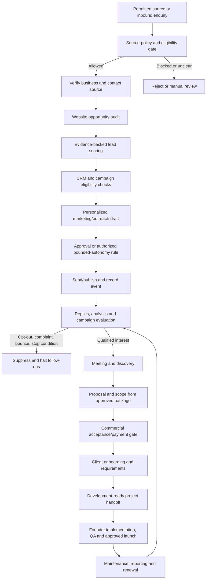
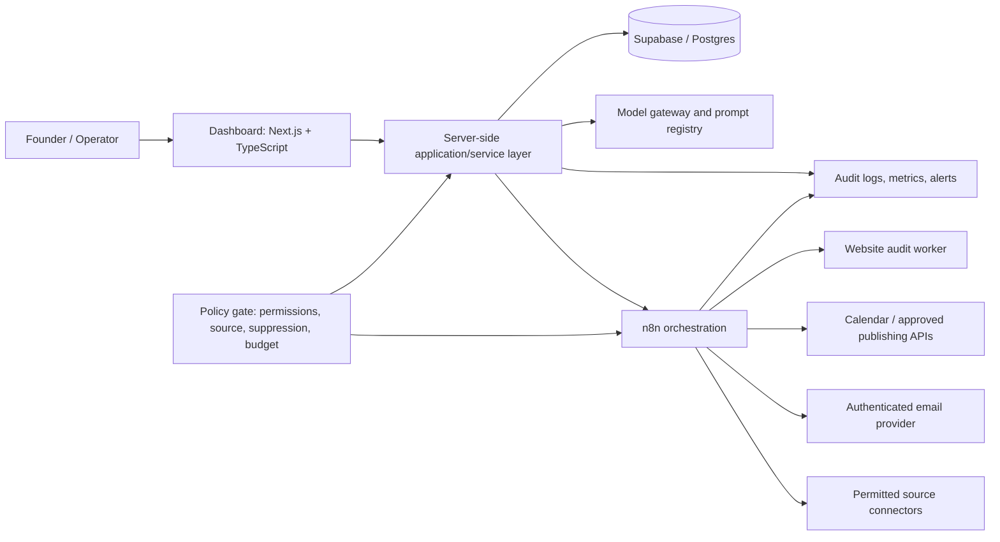
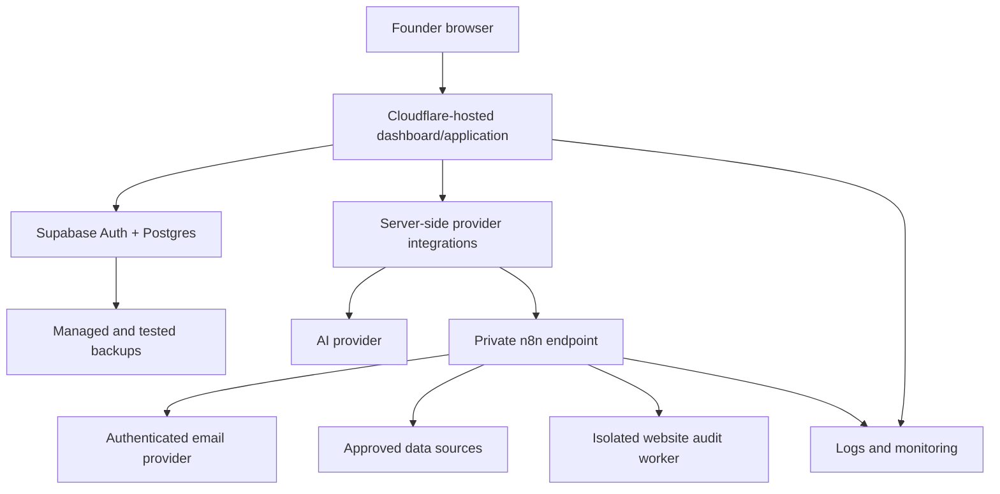

# Autonomous Agency OS

> **Internal AI-powered operating system for a productized website and digital-growth agency.**
>
> The platform is designed to automate routine market research, permitted prospect discovery, website opportunity audits, marketing operations, outreach preparation, inbox triage, sales coordination, client onboarding, project handoff and maintenance administration—so the founder can focus primarily on website development and technical decisions.

**Project status:** Product direction and requirements are defined; implementation, integrations, commercial demand and production deployment must be verified. This README describes the intended end-state and deployment model. It does not claim that unimplemented features already work.

**Working name:** Autonomous Agency OS (brand name not selected)  
**Initial market hypothesis:** India, with Indore as the first market to validate  
**Primary operator:** Founder / internal agency team  
**Product model:** Internal operating platform first; public SaaS is out of scope until separately validated

---

## Contents

- [1. Product overview](#1-product-overview)
- [2. Product principles](#2-product-principles)
- [3. End-to-end workflow](#3-end-to-end-workflow)
- [4. Product modules](#4-product-modules)
- [5. AI departments and autonomy](#5-ai-departments-and-autonomy)
- [6. Intended architecture](#6-intended-architecture)
- [7. Technology and deployment topology](#7-technology-and-deployment-topology)
- [8. Repository structure](#8-repository-structure)
- [9. Local development](#9-local-development)
- [10. Environment configuration](#10-environment-configuration)
- [11. Database, migrations and seed data](#11-database-migrations-and-seed-data)
- [12. n8n workflow operations](#12-n8n-workflow-operations)
- [13. Deployment: staging and production](#13-deployment-staging-and-production)
- [14. Security, privacy and platform-policy requirements](#14-security-privacy-and-platform-policy-requirements)
- [15. Testing and release gates](#15-testing-and-release-gates)
- [16. Monitoring, backup and incident response](#16-monitoring-backup-and-incident-response)
- [17. Development roadmap](#17-development-roadmap)
- [18. Required documentation](#18-required-documentation)
- [19. Known decisions and assumptions](#19-known-decisions-and-assumptions)
- [20. Official references](#20-official-references)

---

## 1. Product overview

### The problem

A small website and digital-growth agency spends substantial time finding suitable prospects, reviewing their online presence, writing personalized messages, managing replies, scheduling meetings, preparing proposals, collecting project requirements and maintaining client websites. These repetitive processes reduce the time available for engineering and can become inconsistent as client volume grows.

### The solution

Autonomous Agency OS is an internal command centre that coordinates deterministic business workflows and AI-assisted tasks across acquisition, marketing, sales and client delivery. The goal is not an uncontrolled “AI agent that can do anything.” It is a set of auditable workflows with bounded autonomy, explicit permissions, spending limits, source restrictions and reliable recovery paths.

### Business services supported by the platform

- Responsive business websites and landing pages.
- Service/course pages, clear calls to action and enquiry forms.
- Booking, appointment or WhatsApp enquiry flows where appropriate.
- Basic analytics, technical SEO and website quality improvements.
- Ongoing maintenance, backups, updates, monitoring and defined support.
- Additional business workflow automation, separately scoped and priced.

### Intended outcome

The founder should receive a **commercially qualified, properly scoped, evidence-backed, development-ready project**—not just a notification saying that a business may need a website.

The platform cannot guarantee replies, customers, search rankings or revenue. It must measure real outcomes and revise its targeting and campaigns using evidence.

## 2. Product principles

1. **Automate repetitive work; preserve human judgment for consequential decisions.**
2. **Use multiple permitted acquisition channels.** Do not depend on one directory, one API or cold email alone.
3. **Treat data-source permissions as part of the product.** A public page is not automatically unrestricted for reuse or marketing.
4. **Keep business state in the database.** An LLM conversation is not the CRM or the authoritative workflow state.
5. **Keep deterministic controls outside the model.** Eligibility, suppression, budgets, pricing floors, authorization, idempotency and state transitions must be enforced in application code and/or the database.
6. **Evidence-backed AI.** Material business claims must cite a traceable source or be clearly labelled as hypotheses.
7. **Bounded autonomy.** Routine actions may run automatically only within approved channels, policies, quotas and budgets.
8. **Default safe.** Simulation and supervised operation precede external side effects.
9. **No known critical release blockers.** Zero vulnerabilities cannot be guaranteed, but knowingly shipping unresolved critical risks is prohibited.
10. **Build the internal platform first.** Do not turn it into a customer-facing SaaS until business demand, licensing, security and support requirements have been reviewed separately.

## 3. End-to-end workflow



### Workflow stages

1. Discover a prospect through a source whose terms and intended use allow the activity.
2. Record source, collection date, permitted use and independent verification status.
3. Inspect the business website using permitted, low-impact checks.
4. Generate a report separating measured observations, interpretations and hypotheses.
5. Score business fit with explanations and evidence; reject duplicates and unsuitable prospects.
6. Prepare personalized content/outreach from verified observations and approved service packages.
7. Run source, contact eligibility, suppression, quota and campaign-state checks immediately before each external action.
8. Record provider event IDs, replies, errors and stop conditions; prevent duplicate sends on retries.
9. Qualify interested prospects, prepare meeting briefs and create proposal drafts using approved pricing rules.
10. Once required scope, commercial acceptance and payment/advance requirements are satisfied, prepare the development handoff.
11. Track engineering tasks, testing, deployment approval, maintenance and actual client outcomes.

## 4. Product modules

| Module | Responsibilities |
|---|---|
| **Overview** | Qualified opportunities, campaign health, exceptions, meetings, active projects, expenditure and recurring revenue |
| **Prospects** | Lead list, filters, provenance, contact eligibility, score and next action |
| **Research & Audits** | Audit runs, evidence, severity, confidence, recommendations and report previews |
| **Campaigns** | Channel, audience, message variants, policies, quotas, budgets, delivery and results |
| **Inbox & Meetings** | Reply classification, conversations, scheduling and escalations |
| **Sales Pipeline** | Qualification, discovery, proposal, negotiation, won/lost/suppressed status |
| **Content Studio** | Editorial calendar, briefs, drafts, approval and publishing status |
| **Clients & Projects** | Scope, approvals, payment state, requirements, tasks, QA and deployment state |
| **Maintenance** | Service checklists, incidents, support limits, alerts and renewal |
| **Analytics & Finance** | Qualification and conversion metrics, acquisition cost, project margin, MRR and expenses |
| **Automation Health** | Workflow runs, retries, errors, provider status and stuck jobs |
| **Governance & Settings** | Source policy, jurisdiction, packages, sender setup, permissions, budgets, models, retention and emergency stop |

### UX standards

- One coherent command centre instead of disconnected agent chat windows.
- Clear state and next action for every lead, campaign and project.
- Show evidence near AI-generated conclusions.
- Calm, accessible, responsive, information-dense UI with useful empty, loading and error states.
- Visible pause/stop controls and transparent automation status.
- Never display simulated records as live business data.
- Aim for WCAG 2.2 AA and verify it through automated and manual checks; do not claim conformance without evidence.

## 5. AI departments and autonomy

The executive departments are logical responsibilities, not a requirement to run seven separate model instances.

| Department | Role |
|---|---|
| CEO / Strategy | Prioritize experiments and markets using evidence; propose resource allocation within policy |
| CMO / Marketing | Content planning, landing-page briefs, campaigns, approved social distribution and channel analysis |
| CRO / Sales | Prospect qualification, personalized outreach, replies, meeting coordination and proposal preparation |
| COO / Operations | Client onboarding, task tracking, handoff completeness, maintenance and delivery checklist |
| CTO / Delivery support | Technical brief, task generation, implementation assistance, test-case generation and QA support |
| CIO / Governance | Data-source rules, access, retention, security, audit and incident reporting |
| CFO / Economics | API/model spend, campaign cost, project margin, pricing floor and budget alerts |

### Autonomy modes

- **Simulation:** mock data only; no real outbound side effects.
- **Supervised:** generate drafts/actions; an authorized human approves external actions.
- **Bounded autopilot:** pre-authorized routine actions execute within fixed sources, channels, content policies, budgets, quotas and stop conditions.
- **Emergency stop:** halt new outbound marketing, nonessential publishing/spending and scheduled campaign work. Safe internal logging and alerting may continue.

Move to a more autonomous mode only after quality evaluation and release gates pass. An autonomy switch must not bypass source, suppression, budget or authorization checks.

### Actions requiring explicit authorization or escalation

- Starting a new campaign or changing its target jurisdiction/source/channel.
- Spend beyond an explicitly approved budget.
- Discounts below price floor, refunds or nonstandard commercial terms.
- Signing/accepting custom contracts or promising outcomes.
- Data export/deletion outside the established process.
- Publishing high-impact or regulated claims.
- Production deployment or changes to a client's live system.
- Changes to source policies, model permissions, budgets, security settings or the platform's own code.

## 6. Intended architecture



### Architectural boundaries

- The browser must not receive privileged database, email, model or workflow secrets.
- UI routes call service/API modules; business rules must not be duplicated in components or buried only in n8n nodes.
- n8n orchestrates tasks; code/database constraints enforce the critical invariants.
- AI output is structured and schema-validated before it can trigger a side effect.
- Outbound side effects use an outbox/queue and idempotency key.
- Webhooks are authenticated, schema-validated and idempotent, with replay protection where feasible.
- External web pages, inbound emails and uploaded files are untrusted inputs and cannot change system permissions.
- Website-audit workers require SSRF protections, redirect and DNS/IP checks, bounded response sizes/timeouts and no access to private/internal network destinations.
- Sensitive data passed to models is minimized; prompts, logs and outputs must not unnecessarily expose PII or secrets.

## 7. Technology and deployment topology

The stack below is the **target reference architecture**, subject to repository inspection and compatibility tests. Do not claim any service is already configured or deployed.

| Layer | Intended choice | Deployment responsibility |
|---|---|---|
| Operator dashboard/application | Next.js App Router + TypeScript | Cloudflare Workers is the preferred hosting direction to evaluate; select the Next.js adapter only after compatibility tests |
| Database and authentication | Supabase/Postgres | Hosted project, migrations, authentication settings, RLS policies, backups and access restrictions |
| Workflow engine | n8n | Managed n8n or self-hosted container on a supported host; keep the editor/admin surface private |
| AI | Configurable provider/model gateway | Server-side API calls, model routing, structured outputs, usage and cost logging |
| Email | Authenticated provider with inbound events/webhooks | Verified sending domain, sending policy, replies, suppression and deliverability monitoring |
| Website audit | Isolated server-side worker/service | Low-privilege runtime, egress restrictions and resource limits |
| Source control and CI | Git + CI provider | Pull-request review and lint/typecheck/test/build/release gates |
| Observability | Application logs, provider dashboards and alerting | Redaction, actionable alerts, workflow trace IDs and cost/health metrics |

### Deployment selection rule

Cloudflare's current documentation recommends **vinext** for new Next.js applications on Workers and documents OpenNext as an alternate/maintenance path. Because this recommendation and feature compatibility may change, validate application dependencies, SSR/ISR, server actions, route handlers, image handling and required runtime APIs before locking the adapter. For an existing Next.js app, do not migrate adapters without a measured compatibility assessment.

References:
- [Cloudflare: Next.js on Workers](https://developers.cloudflare.com/workers/framework-guides/web-apps/nextjs/)
- [Cloudflare: OpenNext adapter](https://developers.cloudflare.com/workers/framework-guides/web-apps/opennext/)
- [Supabase: Production checklist](https://supabase.com/docs/guides/deployment/going-into-prod)
- [Supabase: Row Level Security](https://supabase.com/docs/guides/database/postgres/row-level-security)
- [n8n: Deployment documentation](https://docs.n8n.io/hosting/)

### Production environment separation

At minimum maintain distinct **development**, **staging** and **production** configurations. Use separate provider credentials/projects where practical. Staging must use fake or specifically authorized test data and must not send real marketing email or trigger production deployments by default.

## 8. Repository structure

This is the suggested target layout. Adapt it to the actual repository/framework; do not reorganize a working project just to match this tree.

```text
autonomous-agency-os/
├── README.md
├── PROJECT_MASTER_BRIEF.md
├── AGENTS.md
├── CONVENTIONS.md
├── ARCHITECTURE.md
├── PRODUCT_SPEC.md
├── ROADMAP.md
├── SECURITY.md
├── PRIVACY_AND_DATA_POLICY.md
├── SOURCE_POLICY.md
├── RUNBOOK.md
├── CHANGELOG.md
├── .env.example
├── docs/
│   ├── decisions/
│   ├── requirements/
│   ├── api/
│   ├── research/
│   ├── runbooks/
│   └── release-checklists/
├── apps/
│   └── dashboard/                 # Only if a monorepo is justified
├── src/                           # Use if consistent with selected framework
│   ├── app/
│   ├── components/
│   ├── features/
│   │   ├── overview/
│   │   ├── prospects/
│   │   ├── audits/
│   │   ├── campaigns/
│   │   ├── inbox/
│   │   ├── sales/
│   │   ├── content/
│   │   ├── clients/
│   │   ├── projects/
│   │   ├── maintenance/
│   │   ├── analytics/
│   │   ├── automation-health/
│   │   └── governance/
│   ├── server/
│   │   ├── auth/
│   │   ├── services/
│   │   ├── repositories/
│   │   ├── policies/
│   │   ├── connectors/
│   │   ├── orchestrator/
│   │   ├── workflows/
│   │   ├── schemas/
│   │   └── observability/
│   ├── lib/
│   └── styles/
├── packages/                      # Only if a monorepo is justified
│   ├── shared-schemas/
│   ├── prompts-and-evaluations/
│   └── ui/
├── supabase/
│   ├── migrations/
│   ├── seed.sql                   # Fake development data only
│   └── tests/
├── n8n/
│   ├── workflows/                 # Sanitized exports only
│   ├── test-fixtures/
│   └── README.md
├── scripts/
├── tests/
│   ├── unit/
│   ├── integration/
│   ├── e2e/
│   ├── security/
│   ├── policy-gates/
│   ├── accessibility/
│   └── fixtures/
├── infra/                         # Only approved infrastructure
└── _agent/                        # Local, git-ignored execution state
```

**Repository rules:** do not create empty abstractions just to fill folders; don't commit `.env`, production exports, API keys, webhook URLs, real prospect records or client data; sanitize n8n workflow exports and keep credential values outside Git.

## 9. Local development

### Prerequisites

Install the tools required by the actual repository and chosen deployment method. The intended stack normally requires:

- Git.
- A currently supported Node.js LTS release and the repository's selected package manager.
- Access to a Supabase development project or local Supabase tooling.
- A development n8n instance or safe mock workflow runner.
- Test credentials for any provider integration being exercised.
- A browser and the project's test tooling.

Versions must be pinned and recorded in the repository; do not use floating versions in production builds where reproducibility matters.

### Clone and install

```bash
git clone <YOUR_REPOSITORY_URL>
cd <YOUR_PROJECT_DIRECTORY>

# Use the package manager indicated by the lockfile.
# Example only; do not run a different package manager against the same lockfile.
npm install

cp .env.example .env.local
```

Fill `.env.local` with **development-only credentials**. Never paste secrets into source files, issue comments, prompts or screenshots. `.env.local` must be git-ignored.

### Start application services

The exact scripts must match the checked-in `package.json`, lockfile, migrations and deployment adapter. Once implemented, the expected developer interface should be similar to:

```bash
npm run dev
npm run lint
npm run typecheck
npm run test
npm run test:e2e
npm run build
```

These commands are the **target script contract**, not a claim that all scripts already exist. The project agent must reconcile them with the real repository and document the exact working commands.

### Recommended development workflow

1. Create a feature branch.
2. Read `PROJECT_MASTER_BRIEF.md`, `AGENTS.md` and relevant module documentation.
3. Use mock/fake prospect data and simulated external actions first.
4. Implement one vertical slice at a time.
5. Run the relevant tests plus lint, typecheck and build.
6. Update documentation and the change log.
7. Review the diff for secrets, accidental data, source-policy violations and unrelated changes.
8. Merge only after checks and required approvals pass.

## 10. Environment configuration

The agent must create and maintain `.env.example` with variable **names and safe placeholders only**. Exact names should follow the selected SDKs and hosting platform. Example categories include:

```dotenv
# Application
NODE_ENV=development
APP_BASE_URL=http://localhost:3000
APP_ENV=development

# Supabase — public URL/key may be browser-exposed only with proper RLS
NEXT_PUBLIC_SUPABASE_URL=
NEXT_PUBLIC_SUPABASE_ANON_KEY=
# Server-only privileged key; never prefix with NEXT_PUBLIC_
SUPABASE_SERVICE_ROLE_KEY=

# AI provider (server-side)
AI_PROVIDER=
AI_MODEL_ROUTINE=
AI_MODEL_BALANCED=
AI_MODEL_REASONING=
AI_API_KEY=
AI_MONTHLY_BUDGET_INR=

# n8n integration — server-side only
N8N_BASE_URL=
N8N_WEBHOOK_SIGNING_SECRET=

# Email provider — exact variables depend on selected provider
EMAIL_PROVIDER=
EMAIL_API_KEY=
EMAIL_FROM_ADDRESS=
EMAIL_FROM_NAME=
INBOUND_WEBHOOK_SECRET=

# Operational controls
OUTBOUND_MODE=simulation
OUTBOUND_DAILY_LIMIT=0
OUTBOUND_MONTHLY_BUDGET_INR=0
EMERGENCY_STOP=true
LOG_LEVEL=info
```

This is a **conceptual template**. The final `.env.example` must be generated from the actual implementation and provider SDKs. Do not set production limits by copying the example values. The example intentionally disables external outreach by default.

### Secret-handling requirements

- Keep the Supabase service-role key, AI key, email credentials, n8n signing secrets and webhook secrets server-side.
- Never expose secrets in frontend bundles, browser logs, error pages, workflow exports or CI output.
- `NEXT_PUBLIC_` variables are considered public/browser-exposed. Never place privileged keys under this prefix.
- Rotate any credential that may have been exposed.
- Use platform secret stores for deployment; restrict who can read or change production secrets.

## 11. Database, migrations and seed data

- Use reviewed, version-controlled migrations.
- Production migrations must be reviewed before application and should be additive/reversible where feasible.
- Back up production data before risky schema changes; test restore procedures.
- Enable and verify Row Level Security on exposed tables and define least-privilege policies.
- Keep source provenance, consent/eligibility state, suppression, audit history and idempotency records durable.
- Seed data must be synthetic/fake. Never seed production leads or actual client information into shared development environments.
- Do not store payment-card details directly. Store only necessary payment references/status when an authorized payment provider is integrated.
- Document deletion, export and retention behavior, including backups and downstream processors.

Suggested checks before schema release:

1. Migration applies cleanly to a fresh test database.
2. Migration works against a realistic prior schema snapshot.
3. RLS policy tests prove both permitted and forbidden access.
4. Rollback/recovery path is documented.
5. No production data was copied to development.

## 12. n8n workflow operations

n8n coordinates scheduled tasks, webhooks, provider integration and workflow retries. Core invariants—permissions, source eligibility, suppression, approved price floors, budgets and external-action authorization—must also be enforced in the application/database.

Workflow catalog should include:

1. Approved source ingestion and review queue.
2. Website audit and evidence capture.
3. Qualification, scoring and deduplication.
4. Content planning and draft generation.
5. Outreach draft and policy checks.
6. Outbound send and delivery-event ingestion.
7. Reply classification and suppression handling.
8. Meeting scheduling and sales-pipeline updates.
9. Proposal and onboarding preparation.
10. Development handoff creation.
11. Maintenance checks and renewal reminders.
12. Error queue, alerts, reconciliation and daily reporting.

### Workflow reliability rules

- Every external action needs a stable correlation ID and idempotency key where supported.
- Retries must use backoff and hard retry limits; no infinite retry loops.
- A paused campaign must not be revived by queued retries.
- Check suppression immediately before sending, not only when drafting.
- Validate/authenticate incoming webhooks and handle duplicates safely.
- Keep n8n editor/admin access private; expose only necessary authenticated endpoints.
- Do not commit credentials or unsanitized exports.
- Back up the n8n instance's persistent data and its database. Workflow JSON exports alone do not constitute a complete instance backup.
- Test restore into a separate environment and record the result.

Internal workflow usage and offering customer-configurable workflow functionality have different licensing implications. Review [n8n's current license and usage guidance](https://docs.n8n.io/sustainable-use-license/) before changing the product model.

## 13. Deployment: staging and production

### Reference production topology



This topology is the proposed deployment target—not proof of a deployed system. Provider selection and adapter compatibility must be checked against the actual code and requirements before creating billable infrastructure.

### One-time deployment prerequisites

- Confirm the legal/business details and privacy/outreach policies required for launch.
- Choose the production domain and configure DNS/TLS.
- Create separate development, staging and production projects/credentials.
- Enable database security controls and verify RLS policies.
- Configure production secrets in the host's secret manager, not a committed file.
- Configure authenticated business email, SPF/DKIM and the applicable DMARC policy.
- Verify the email provider's use case, rate limits, unsubscribe mechanisms and webhook signature support.
- Configure n8n authentication, private admin access, encryption key persistence, durable storage and backups.
- Configure provider budgets/quotas and alerts before enabling any paid APIs.
- Build the release pipeline with required test gates and protected production branch.

### Deployment procedure

1. **Prepare:** inspect package scripts, runtime compatibility, lockfile, database migrations, webhook routes and required environment variables.
2. **Validate adapter:** for a new Next.js application targeting Cloudflare Workers, evaluate the currently recommended Cloudflare route (currently documented as vinext); for an existing Next.js app, compare compatibility before selecting vinext/OpenNext or another host. Do not migrate adapters blindly.
3. **Test locally:** lint, typecheck, unit/integration tests, E2E, build and runtime preview.
4. **Deploy staging:** use staging provider accounts, fake/sanitized data and outbound simulation mode.
5. **Apply migrations:** use the approved migration workflow; never improvise production schema edits in the dashboard without recording them.
6. **Verify staging:** authentication/permissions, dashboard routes, data isolation, source gate, suppression, webhook verification, retry/idempotency, budget limit and emergency-stop tests.
7. **Run security and recovery checks:** review dependencies, secret exposure, RLS, logs, backups and restore evidence.
8. **Authorize release:** verify every required gate and ensure no unresolved critical risk remains. Legal review must be marked complete only if an actual qualified review occurred.
9. **Deploy production:** deploy an immutable reviewed commit through the configured production pipeline.
10. **Smoke test:** verify login, key dashboard routes, database connectivity, healthy workflows, emergency stop and logs without initiating unapproved outreach.
11. **Enable bounded autonomy gradually:** enable only the tested, approved workflows/channels with low initial quotas and spending limits.
12. **Monitor and rollback:** watch errors, costs, provider status, deliverability and workflow idempotency. Use a documented rollback if a critical regression appears.

### Deployment rollback requirements

- Keep the last known-good application release identifiable.
- Preserve migration rollback/recovery notes and verified database backups.
- Provide an immediate campaign/automation stop that works server-side.
- Roll back code if the release violates a critical invariant; do not resume external actions until the cause is understood.
- Never depend only on a dashboard toggle that the workflow engine can ignore.

## 14. Security, privacy and platform-policy requirements

### Data-source policy

**Do not scrape Google Maps or export Google Maps/Places content into the prospect CRM or a mailing/telemarketing list.** Google Maps Platform and Places API terms impose restrictions on copying/exporting content, storage and list creation. Recheck the applicable official terms before every material change in source use:

- [Google Maps Platform Terms](https://cloud.google.com/maps-platform/terms)
- [Places API policies](https://developers.google.com/maps/documentation/places/web-service/policies)

Potential alternative source categories—each requiring independent review—include business-owned websites, inbound enquiries, referrals, associations, eligible directories, licensed B2B sources and public business registries where terms permit the intended use.

### Privacy and communication

- Public availability does not automatically grant unrestricted marketing permission.
- Record origin, purpose, allowed use, review date and eligibility for each source/contact.
- Minimize personal data and restrict access based on business need.
- Maintain a suppression list and check it before every send/retry.
- Provide appropriate unsubscribe/opt-out and privacy processes.
- Separate transactional communications from marketing messages.
- Review Indian privacy, consumer, telecom and platform rules with qualified counsel before production use; this README is not legal advice.
- Do not create or publish fake testimonials, ratings, case studies or unsupported claims.

### Security checklist

- Server-side secret handling and least-privilege access.
- MFA for administrative/provider accounts where supported.
- RLS on every exposed Supabase table, plus policy tests.
- Input validation, rate limits and safe error responses.
- SSRF protection for website-audit URL fetches, including redirects and private IP ranges.
- Webhook authentication, replay resistance and idempotency.
- Prompt-injection defenses for untrusted websites, email and uploaded content.
- Redacted logs; no secrets or unnecessary personal data in prompts/logs.
- Dependency/license scans and patch process.
- Retention, deletion/export requests and incident-response workflow.
- Tested backups, restore and production rollback.
- No critical release blocker left unresolved. If a risky capability cannot be made safe, disable it until fixed.

## 15. Testing and release gates

### Required test layers

- **Unit:** scoring, source eligibility, state transitions, price floors, URL/IP checks, idempotency and budget logic.
- **Integration:** database/auth, model schema outputs, provider webhooks, email, calendar and n8n interactions using test accounts/mocks.
- **End-to-end:** prospect → audit → qualification → draft → approval/simulation → reply → meeting → proposal → project handoff.
- **Policy gates:** blocked source, suppressed contact, missing approval, paused campaign, disallowed channel, exhausted budget and provider failure.
- **Security:** auth/authorization, RLS, client data isolation, SSRF, prompt injection, secret leakage, webhook replay and rate limiting.
- **Reliability:** timeouts, partial failures, retries, duplicate events, reconciliation, dead-letter queue and recovery.
- **Accessibility:** labels, contrast, keyboard operation, focus management, alt text and responsive layouts.
- **Operations:** backup/restore drill, emergency-stop exercise, staged deployment and rollback test.
- **Supply chain:** dependency, license and secret scan.

### Mandatory launch gates

- The first niche and offer have real validation evidence; assumptions are labelled honestly.
- Every source used for live acquisition has an approved use and date-stamped review.
- Material audit/outreach claims have evidence or are labelled as hypotheses.
- No unauthorized live email or publication can be triggered from staging.
- Suppression, opt-out, complaint, bounce and stop conditions reliably prevent further sends.
- Duplicate external actions are prevented through idempotency/reconciliation.
- Budget and quota limits are enforced server-side.
- Authentication, RLS and client-data isolation tests pass.
- Critical recovery and emergency-stop tests have actual evidence.
- Deployment rollback is documented and viable.
- No unresolved critical security/privacy/data-loss/unauthorized-action risk is knowingly shipped; residual noncritical risks have an owner, mitigation and review date.
- Legal review is described accurately and is not claimed without evidence.

## 16. Monitoring, backup and incident response

Monitor at least:

- Application error rate, latency and route health.
- n8n workflow failures, duration, retries and stuck executions.
- Email delivery failures, bounce/complaint signals, replies and opt-outs.
- AI model/tool usage, spend and output-validation failures.
- Source-policy rejections and compliance exceptions.
- Qualified prospects, positive responses, meetings, proposals, wins/losses and conversion rates.
- Project delivery hours, gross margin, monthly recurring revenue and retention.
- Backup completion, restore-test date and provider availability.

Every alert should indicate severity, affected workflow, correlation/run ID, safe next action and recovery/rollback path. Avoid alert messages containing prospect PII or secrets.

### Emergency stop

The stop must be enforced server-side and honored by scheduled jobs and retries. It should pause queued/new outbound email, nonessential publication and spend; record who activated it and why; prevent retries from restarting work; and offer a safe resume procedure after investigation. Test it end-to-end before live campaigns.

## 17. Development roadmap

| Phase | Main deliverable | Release gate |
|---|---|---|
| 0. Discovery | Requirements, research, source policy, risks, architecture and decisions | Offer and source approach are credible; repository inspected |
| 1. Foundation | Auth, RLS, database migrations, secure dashboard shell and CI | Security baseline and fake-data workflow pass |
| 2. Research | Permitted ingestion, evidence-backed audits, scoring and deduplication | Findings are traceable; restricted data is blocked |
| 3. CRM and drafts | Pipeline, campaign configuration, drafts and suppression baseline | No real sending; policy checks pass |
| 4. Communication | Authenticated email, events, replies and stop handling | Sending and reply simulations pass; live use separately authorized |
| 5. Marketing | Content studio, permitted publishing integrations and attribution | Content quality and attribution are verified |
| 6. Sales | Meetings, approved proposals, scope and onboarding | Prospect-to-commercial-approval flow passes |
| 7. Handoff | Full brief, assets, tasks, tests and launch checklist | A test client project is development-ready |
| 8. Hardening | Security/red-team, recovery, monitoring, emergency stop and staging pilot | No unresolved critical blocker |
| 9. Scale | Additional channels/niches based on measured outcomes | Unit economics and delivery capacity support expansion |

Planning estimates from the product brief: **350–550 engineering hours for an internal MVP**, **600–900 hours for a more reliable bounded-autonomy V1**, and **900–1,400+ hours for a mature internal platform**. These are estimates, not promises. Reset the schedule after measuring actual implementation velocity and integration risks.

## 18. Required documentation

The repository should progressively maintain these documents, updating existing files rather than creating contradictory copies:

- `PROJECT_MASTER_BRIEF.md` — canonical product intent.
- `PRODUCT_SPEC.md` — personas, user stories and requirements.
- `ARCHITECTURE.md` — modules, trust boundaries and data flow.
- `ROADMAP.md` — work items, dependencies, gates and estimates.
- `CONVENTIONS.md` and `AGENTS.md` — engineering and coding-agent rules.
- `SOURCE_POLICY.md` — sources, allowed/prohibited uses and review dates.
- `PRIVACY_AND_DATA_POLICY.md` — data inventory, purpose, access, retention and rights handling.
- `SECURITY.md` and `RISK_REGISTER.md` — threat model, risk ownership and mitigations.
- `DATA_MODEL.md` and `API_SPEC.md` — schema, invariants, API contracts and errors.
- `WORKFLOW_CATALOG.md` — triggers, inputs/outputs, permissions, retries and recovery per workflow.
- `AI_EVALUATION_PLAN.md` — model/prompt tests, quality rubric and cost evaluation.
- `TEST_PLAN.md` and `RELEASE_CHECKLIST.md` — verification and launch evidence.
- `RUNBOOK.md` — deployment, monitoring, stop, incident, backup, restore and resume.
- `LEGAL_REVIEW_CHECKLIST.md` — jurisdiction/channel/terms review and questions for qualified counsel.
- `UNIT_ECONOMICS.md` — actuals and clearly labelled assumptions.
- `CHANGELOG.md` — factual changes and releases.

## 19. Known decisions and assumptions

### Locked product direction

- Internal autonomous agency operating platform first.
- Founder focuses primarily on development and exceptional technical decisions.
- Multi-channel acquisition, evidence-backed qualification and a traceable sales-to-development workflow.
- Bounded autonomy with source, budget, security and authorization controls.
- No knowingly unresolved critical release blockers.

### Working hypotheses

- Indore as the initial geography.
- Coaching/skill-training institutes as the first niche to test.
- Next.js + TypeScript, Supabase/Postgres, n8n and a configurable LLM gateway as the starting architecture.
- Cloudflare Workers as the preferred hosting direction to evaluate for the dashboard.
- Monthly operating-cost planning range, pricing packages and acquisition funnel assumptions require actual usage and customer validation.

### Decisions still requiring validation

- Legal company name, address, contact and other required business details: `[FILL]`.
- Exact niche/ICP and offer, based on customer interviews.
- Repository state, exact framework versions and package-manager commands.
- Final Cloudflare adapter/host compatibility decision.
- Production email provider, sender domain and approved jurisdictions/channels.
- Current LLM API provider/model identifiers and pricing.
- Managed vs self-hosted n8n, licensing, storage and backup model.
- Hosting/data region, budgets and monitoring vendors.
- Lawyer-reviewed privacy/outreach/contract policies.
- Exact business packages, prices, payment gates, maintenance SLA and cancellation terms.

## 20. Official references

These are starting points and must be rechecked for the exact implementation version and jurisdiction before launch.

### Application and hosting
- [Cloudflare: Next.js on Workers](https://developers.cloudflare.com/workers/framework-guides/web-apps/nextjs/)
- [Cloudflare: OpenNext adapter](https://developers.cloudflare.com/workers/framework-guides/web-apps/opennext/)
- [Next.js environment variables](https://nextjs.org/docs/pages/guides/environment-variables)

### Database and workflows
- [Supabase production checklist](https://supabase.com/docs/guides/deployment/going-into-prod)
- [Supabase Row Level Security](https://supabase.com/docs/guides/database/postgres/row-level-security)
- [n8n hosting documentation](https://docs.n8n.io/hosting/)
- [n8n Sustainable Use License](https://docs.n8n.io/sustainable-use-license/)

### Data sources, privacy and email
- [Google Maps Platform Terms](https://cloud.google.com/maps-platform/terms)
- [Places API policies](https://developers.google.com/maps/documentation/places/web-service/policies)
- [India Code — legislation portal](https://www.indiacode.nic.in/)
- [MeitY — notifications and policies](https://www.meity.gov.in/)
- [Google email sender guidelines](https://support.google.com/a/answer/81126)
- [W3C Web Content Accessibility Guidelines (WCAG)](https://www.w3.org/TR/WCAG22/)

---

## Final release principle

**A capability is not production-ready because the UI exists or the unit tests pass.** It is ready only when its integration behavior, security/policy gates, failure handling, observability and recovery have been demonstrated with recorded evidence. If a critical risk cannot yet be controlled, disable that capability rather than shipping it unsafely.

This README describes the intended end product. Update it as implementation decisions are verified, commands are tested and deployment configuration becomes real. Never turn a plan, estimate, vendor claim or untested feature into a statement of fact.
