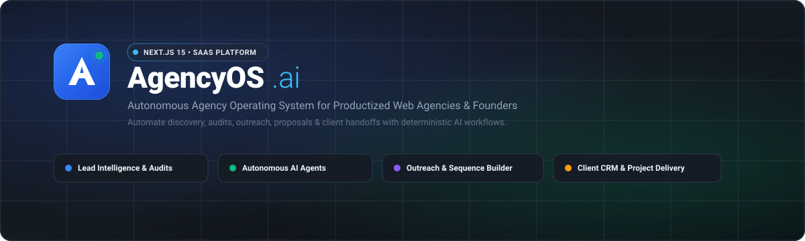
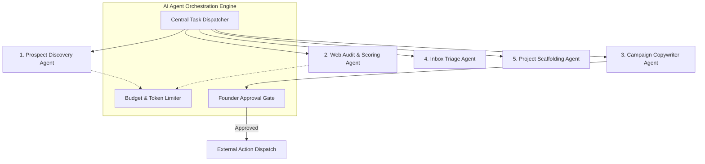
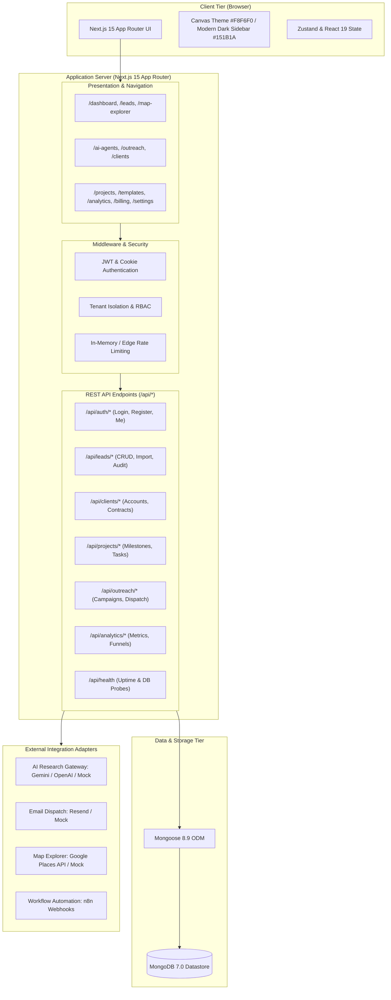
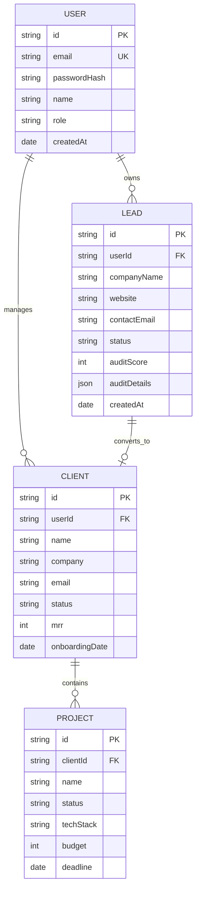
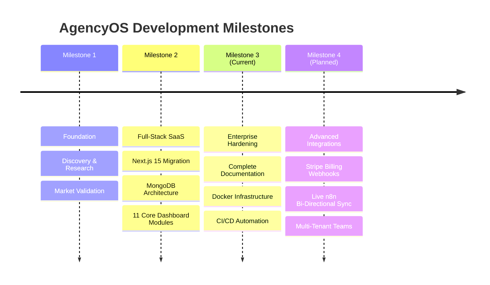

<p align="center">
  
</p>

<p align="center">
  <strong>Autonomous Agency Operating System for Modern Digital & Website Agencies</strong>
</p>

<p align="center">
  <a href="https://nextjs.org"></a>
  <a href="https://www.typescriptlang.org"></a>
  <a href="https://react.dev"></a>
  <a href="https://www.mongodb.com"></a>
  <a href="https://tailwindcss.com"></a>
  <a href="https://github.com"></a>
  <a href="LICENSE"></a>
</p>

---

## Table of Contents

- [1. Executive Overview](#1-executive-overview)
- [2. Product Vision & End-to-End Lifecycle](#2-product-vision--end-to-end-lifecycle)
- [3. Core Navigation Modules](#3-core-navigation-modules)
- [4. AI Agent Architecture & Safety Boundaries](#4-ai-agent-architecture--safety-boundaries)
- [5. System Architecture](#5-system-architecture)
- [6. Technology Stack](#6-technology-stack)
- [7. Repository Organization](#7-repository-organization)
- [8. Quickstart & Local Development](#8-quickstart--local-development)
- [9. Environment Configuration](#9-environment-configuration)
- [10. Database Schema & Data Models](#10-database-schema--data-models)
- [11. Testing & Quality Gates](#11-testing--quality-gates)
- [12. Deployment Topology](#12-deployment-topology)
- [13. Security, Privacy & Compliance](#13-security-privacy--compliance)
- [14. Feature Implementation Matrix](#14-feature-implementation-matrix)
- [15. Product Roadmap](#15-product-roadmap)
- [16. Documentation Library](#16-documentation-library)
- [17. Contributing & License](#17-contributing--license)

---

## 1. Executive Overview

### The Core Problem
Running a high-velocity digital website agency requires juggling disparate, repetitive business operations: identifying viable local businesses, auditing outdated websites, generating customized modernization proposals, staging cold outreach campaigns, triaging replies, coordinating client onboarding, and managing ongoing maintenance retainers. 

When handled manually, these operational chores consume up to 70% of an agency founder's work week, taking time away from high-value engineering, technical architecture, and client delivery.

### The AgencyOS Solution
**AgencyOS** is a specialized, autonomous operating system engineered specifically for digital agencies and technical founders. It bridges the gap between intelligent AI automation and deterministic software reliability:

1. **Deterministic Operational Foundation:** Critical state transitions, suppressions lists, spend caps, client billing, authentication, and permission gates are enforced strictly in code with deterministic Zod schemas and database constraints—never left to non-deterministic LLM discretion.
2. **Bounded AI Autonomy:** Autonomous AI departments handle data enrichment, website opportunity scoring, proposal drafting, and email classification within strict, auditable guardrails.
3. **Unified Next.js 15 Monolith:** Built with Next.js 15 App Router, TypeScript (strict mode), Tailwind CSS, and MongoDB/Mongoose, providing a cohesive codebase for both administrative interfaces and backend API routes.
4. **Mock-First Development:** Operates seamlessly in local development with zero external API dependencies via deterministic mock providers.

---

## 2. Product Vision & End-to-End Lifecycle

AgencyOS unifies the entire agency lifecycle into five automated stages:

```mermaid
flowchart LR
    subgraph Stage1["1. Discovery & Ingest"]
        A[Permitted Registry Ingest] --> B[CSV / Manual Prospect Upload]
        B --> C[Compliance Suppression Check]
    end

    subgraph Stage2["2. Opportunity Qualification"]
        C --> D[Automated Website Audit]
        D --> E[Lighthouse & Performance Score]
        E --> F[AI Gap Analysis & Value Prop]
    end

    subgraph Stage3["3. Intelligent Outreach"]
        F --> G[Personalized Cold Campaign]
        G --> H{Founder Approval Gate}
        H -- Approved --> I[Dispatch Email / Follow-up]
        H -- Dry Run --> J[Audit Log & Mock Preview]
    end

    subgraph Stage4["4. Sales & Onboarding"]
        I --> K[Inbox Reply Classification]
        K --> L[Discovery Call Scheduling]
        L --> M[Client Onboarding & Contract]
    end

    subgraph Stage5["5. Project Delivery & Retainers"]
        M --> N[Project Roadmap & Scaffolding]
        N --> O[QA, Launch & Deployment]
        O --> P[Maintenance Retainer & Billing]
    end
```



---

## 3. Core Navigation Modules

AgencyOS organizes agency operations across 11 primary dashboard modules:

| Module | Route | Primary Purpose | Capabilities | Status |
| :--- | :--- | :--- | :--- | :---: |
| **Dashboard** | `/dashboard` | Operational Command Center | High-level metrics, active lead pipeline, revenue statistics, system health, and quick actions. | `Implemented` |
| **Leads** | `/leads` | Prospect & Opportunity Pipeline | Lead management, status filtering (`new`, `contacted`, `replied`, `qualified`, `closed`), CSV import, and audit trigger. | `Implemented` |
| **Map Explorer** | `/map-explorer` | Geographic Prospect Discovery | Visual spatial view of target businesses, radius filtering, category selection, and TOS-compliant discovery. | `Implemented` |
| **AI Agents** | `/ai-agents` | Autonomous Agent Management | Multi-agent status monitoring, autonomy slider controls, run history, and token/cost telemetry. | `Implemented` |
| **Outreach** | `/outreach` | Cold Email & Campaign Automation | Multi-step sequence designer, template manager, campaign status tracking, and dispatch logs. | `Implemented` |
| **Clients** | `/clients` | Client Relationship Management | Active accounts, retainer contracts, primary contacts, monthly recurring revenue (MRR) tracking. | `Implemented` |
| **Projects** | `/projects` | Website Engineering & Delivery | Project milestone tracking, tech stack selection, staging links, deployment status, and task lists. | `Implemented` |
| **Templates** | `/templates` | Reusable Agency Assets | High-converting cold email scripts, website modernization proposals, onboarding questionnaires, audit formats. | `Implemented` |
| **Analytics** | `/analytics` | Performance & Pipeline Intelligence | Outreach conversion funnels, response rate analytics, revenue growth charts, and audit success ratios. | `Implemented` |
| **Billing** | `/billing` | Revenue & Subscription Invoicing | Invoice generation, retainer payment statuses, subscription schedules, and Stripe/Razorpay sync. | `Implemented` |
| **Settings** | `/settings` | Agency Configuration & Security | Tenant profile, API credentials, AI model selector, suppression rules, team members, and audit logs. | `Implemented` |

---

## 4. AI Agent Architecture & Safety Boundaries

AgencyOS deploys 5 specialized AI agent departments operating under **bounded autonomy**:



### Specialized Agents

1. **Discovery & Enrichment Agent:** Parses publicly available business registry data, identifies verified business domains, and flags missing digital assets.
2. **Audit & Scoring Agent:** Runs non-intrusive performance, accessibility, SEO, and responsive design audits against prospect URLs, calculating an objective **Opportunity Score** ($0-100$).
3. **Outreach Copywriter Agent:** Synthesizes audit findings into highly contextual, value-focused modernization proposals and personalized email cold drafts.
4. **Inbox & Triage Agent:** Classifies inbound lead responses (Interested, Objection, Unsubscribe, Wrong Contact) and drafts recommended responses.
5. **Project Scaffolding Agent:** Converts onboarding questionnaire inputs into technical project specifications, site architectures, and task backlogs.

### Non-Negotiable Safety Invariants
- **Deterministic Suppression:** Unsubscribe and DND lists are validated via exact hash lookup before any outbound message can be queued.
- **Dry-Run Enforcement:** Non-production environments strictly enforce `dry_run = true`. No live emails or external messages can be dispatched without founder clearance.
- **Budget Caps:** Hard daily token and API spend limits prevent unexpected cloud bills.

---

## 5. System Architecture

AgencyOS uses a cohesive full-stack architecture built on Next.js 15 App Router:



---

## 6. Technology Stack

| Layer | Technology | Version | Purpose & Rationale |
| :--- | :--- | :---: | :--- |
| **Framework** | Next.js (App Router) | `15.1.4` | Unified full-stack framework with React Server Components, high performance, and rapid API routing. |
| **Language** | TypeScript | `5.7.2` | Strict compile-time type verification across frontend components and backend handlers. |
| **UI Library** | React | `19.0.0` | Latest React foundation with modern hooks and concurrent rendering features. |
| **Styling** | Tailwind CSS | `3.4.17` | Utility-first responsive design implementing the warm Canvas (`#F8F6F0`) and Dark Sidebar design system. |
| **Icons & Visuals** | Lucide React | `0.468.0` | Clean, lightweight icon suite across all dashboard views. |
| **Charts & Dataviz** | Recharts | `2.15.0` | Declarative SVG charting for analytics, conversion funnels, and MRR growth tracking. |
| **Database** | MongoDB & Mongoose | `8.9.3` | Document datastore with strict schema enforcement, index definitions, and flexible JSON modeling. |
| **Validation** | Zod | `3.24.1` | Runtime validation for incoming API request payloads, configuration, and environment variables. |
| **Authentication** | JWT & Bcrypt | `9.0.7 / 5.1.1` | Stateless cryptographic session tokens and secure password hashing with salt rounds $\ge 12$. |
| **CSV Parsing** | PapaParse | `5.4.1` | Fast, robust in-browser and server-side CSV parsing for prospect batch imports. |
| **Test Runner** | Vitest | `2.1.8` | High-performance unit and integration testing with native TypeScript support. |
| **E2E Testing** | Playwright | `1.49.1` | Automated end-to-end browser testing for multi-page user journeys. |
| **Containerization** | Docker | Alpine 20 | Multi-stage production container build for minimal attack surface and small image size. |

---

## 7. Repository Organization

```text
AgencyOS/
├── .github/                      # CI/CD workflows and issue/PR templates
│   ├── workflows/ci.yml          # GitHub Actions (Typecheck, Test, Build, Security)
│   ├── ISSUE_TEMPLATE/           # Bug report and feature request templates
│   └── pull_request_template.md  # Standard pull request verification checklist
├── assets/                       # Public media and visual design assets
│   └── readme/                   # README banners and diagram SVGs
├── backend/                      # Headless Node.js + Express 4.21 REST API Tier
│   ├── src/                      # API Source code
│   │   ├── common/               # Universal developer toolkit (async-handler, api-response, validate)
│   │   ├── config/               # Database and environment configurations
│   │   ├── middleware/           # Rate limiting, Helmet, Request-ID, Audit logging, JWT Auth
│   │   ├── models/               # Mongoose schema definitions
│   │   ├── modules/              # Plug-and-play vertical slice modules (100% decoupled)
│   │   │   ├── health/           # Healthcheck & readiness probes
│   │   │   ├── auth/             # JWT Authentication & Registration
│   │   │   ├── leads/            # Leads management & opportunity scoring
│   │   │   ├── clients/          # Client management
│   │   │   ├── projects/         # Project tracking & workspaces
│   │   │   ├── campaigns/        # Outreach campaigns
│   │   │   ├── agents/           # 13 Canonical AI agent execution engines
│   │   │   ├── dashboard/        # Executive KPI aggregations
│   │   │   ├── analytics/        # Business intelligence & performance charts
│   │   │   ├── settings/         # System configuration & compliance settings
│   │   │   ├── maps/             # Google Maps Platform location intelligence
│   │   │   ├── templates/        # Industry website templates engine
│   │   │   ├── billing/          # Invoices & billing metrics
│   │   │   ├── integrations/     # Provider diagnostics & lead audit runner
│   │   │   └── index.ts          # Central Module Registry (activeModules)
│   │   └── server.ts             # Express server entrypoint (Port 4000)
│   ├── workers/                  # Background worker queue definitions
│   ├── catalyst.json             # Zoho Catalyst AppSail production manifest
│   ├── Dockerfile                # Standalone production container for API
│   ├── package.json              # Backend dependencies
│   └── tsconfig.json             # Independent backend TypeScript configuration
├── database/                     # Database architecture & schemas
│   ├── schema/schemas.ts         # Portable TypeScript entity contracts
│   ├── seeds/                    # Seed data definitions and guides
│   └── README.md                 # MongoDB multi-tenant architecture & pool management
├── docs/                         # Consolidated single source of truth documentation
│   ├── architecture/             # System architecture, topology, ADRs
│   ├── backend/                  # Modular vertical slice developer guide
│   ├── database/                 # Schema models and entity relationships
│   ├── deployment/               # Cloudflare Pages, Zoho AppSail, Docker guides
│   ├── expert-reviews/           # Multi-disciplinary executive council evaluations
│   ├── operations/               # Runbooks, monitoring, and backups
│   ├── product/                  # PRD, Project Master Brief, User flows, Traceability
│   ├── research/                 # 11 Research dossiers, evidence matrix, source registry
│   ├── security/                 # Threat model, DPDP Act compliance, reporting
│   ├── testing/                  # Testing strategies and validation gates
│   ├── CHANGELOG.md              # Historical releases & milestone log
│   ├── CONTRIBUTING.md           # Engineering & contribution standards
│   └── README.md                 # Central documentation portal index
├── infra/                        # Infrastructure and container orchestration
│   ├── docker/                   # Next.js production multi-stage Dockerfile
│   ├── docker-compose.yml        # Multi-container orchestration (Web + API + MongoDB)
│   └── zoho/                     # Zoho Catalyst AppSail deployment runbooks
├── packages/                     # Monorepo shared packages
│   ├── config/                   # Shared configurations & environment parsers
│   ├── contracts/                # Cross-tier TypeScript interfaces
│   ├── utils/                    # Shared utility helpers (maskApiKey, currency, dates)
│   └── validation/               # Shared Zod validation schemas
├── public/                       # Static public assets (images, fonts, favicon)
├── scripts/                      # Engineering automation tools
│   └── create-backend-module.js  # CLI generator for plug-and-play vertical slice modules
├── src/                          # Frontend Tier: Next.js 15 App Router
│   ├── app/                      # Next.js App Router (11 dashboard pages + auth)
│   ├── components/               # UI components, layout shell, sidebar, header
│   ├── features/                 # Modular frontend feature components
│   ├── hooks/                    # Reusable React hooks
│   ├── lib/                      # Frontend database client, auth utilities, mock seeders
│   └── types/                    # Frontend TypeScript interfaces
├── tests/                        # Vitest automated test suite (50 tests passing)
│   └── unit/                     # Unit & API contract tests across web & backend
├── .env.example                  # Validated environment configuration template
├── LICENSE                       # MIT Open-Source License
├── package.json                  # Root dependencies and orchestration scripts
└── tsconfig.json                 # TypeScript strict configuration
```

---

## 8. Quickstart & Local Development

Follow these 5 steps to run AgencyOS locally:

### 1. Prerequisites
Ensure you have the following installed on your machine:
- **Node.js:** `v20.x` or higher (Active LTS recommended)
- **npm:** `v10.x` or higher
- **MongoDB:** Local MongoDB instance running on port `27017` OR a free [MongoDB Atlas](https://www.mongodb.com/atlas) connection URI.

### 2. Clone and Install Dependencies
```bash
git clone https://github.com/your-org/agencyos.git
cd agencyos
npm install
```

### 3. Configure Environment Variables
Create your local environment configuration:
```bash
cp .env.example .env.local
```
*(By default, AgencyOS runs in **Zero-Cost Mock Mode** with synthetic AI audits and console email logs. No paid external API keys are required to get started.)*

### 4. Run Static Validation Checks
Verify that your local environment matches baseline project quality:
```bash
npm run typecheck
npm run test
```

### 5. Start the Development Server
```bash
npm run dev
```
Open [http://localhost:3000](http://localhost:3000) in your browser.

- Sign up for a new administrative account at `/register`, or
- Log in directly at `/login`.

---

## 9. Environment Configuration

AgencyOS supports flexible configuration via environment variables:

| Variable | Required? | Default (Local) | Purpose |
| :--- | :---: | :--- | :--- |
| `MONGODB_URI` | **Yes** | `mongodb://127.0.0.1:27017/agencyos` | MongoDB connection string. |
| `JWT_SECRET` | **Yes** | `replace-with-a-secure...` | 32+ character key for JWT token signing. |
| `NEXT_PUBLIC_APP_URL` | Optional | `http://localhost:3000` | Canonical application URL for redirects. |
| `NODE_ENV` | Optional | `development` | Runtime environment (`development`, `production`). |
| `AI_RESEARCH_PROVIDER` | Optional | `mock` | AI backend (`mock`, `gemini`, `openai`). |
| `GEMINI_API_KEY` | Conditional | `""` | Google Gemini API key (when provider is `gemini`). |
| `OPENAI_API_KEY` | Conditional | `""` | OpenAI API key (when provider is `openai`). |
| `EMAIL_PROVIDER` | Optional | `mock` | Email adapter (`mock`, `resend`). |
| `RESEND_API_KEY` | Conditional | `""` | Resend API key (when provider is `resend`). |
| `MAPS_PROVIDER` | Optional | `mock` | Map data adapter (`mock`, `google`). |
| `GOOGLE_MAPS_API_KEY` | Conditional | `""` | Google Maps API key (when provider is `google`). |

> Detailed documentation is available in [docs/deployment/ENVIRONMENT_VARIABLES.md](docs/deployment/ENVIRONMENT_VARIABLES.md).

---

## 10. Database Schema & Data Models

AgencyOS utilizes MongoDB via Mongoose schemas defined in `src/lib/models.ts`:



Detailed database architecture is documented in [docs/database/DATABASE_SCHEMA.md](docs/database/DATABASE_SCHEMA.md).

---

## 11. Testing & Quality Gates

AgencyOS maintains strict release verification gates. All releases must pass all 3 gates:

```bash
# Gate 1: TypeScript Strict Typecheck (0 errors required)
npm run typecheck

# Gate 2: Automated Unit & Integration Tests (100% pass required)
npm run test

# Gate 3: Production Build & Route Compilation (Exit code 0 required)
npm run build
```

---

## 12. Deployment Topology

AgencyOS supports three primary deployment configurations:

### Option A: Docker Compose (Full-Stack Self-Hosted)
Run AgencyOS and an isolated MongoDB instance together:
```bash
docker compose -f infra/docker-compose.yml up -d --build
```

### Option B: Standalone Container (Cloud Run / AWS ECS)
Build the optimized production Alpine container:
```bash
docker build -f infra/docker/Dockerfile -t agencyos:latest .
docker run -p 3000:3000 --env-file .env.production agencyos:latest
```

### Option C: Vercel + MongoDB Atlas (Serverless Edge)
Connect your GitHub repository to Vercel, set `MONGODB_URI` and `JWT_SECRET` in project settings, and deploy with zero server maintenance.

> For complete instructions, see [docs/deployment/DEPLOYMENT_GUIDE.md](docs/deployment/DEPLOYMENT_GUIDE.md).

---

## 13. Security, Privacy & Compliance

AgencyOS is engineered to uphold rigorous data protection standards:

1. **Google Maps Platform TOS Section 3.2.3 Compliance:** Strictly prohibits scraping, bulk extraction, or unauthorized caching of Google Maps / Google Places data. Maps integration uses official Google APIs with ephemeral rendering or permitted business registry data.
2. **Indian Digital Personal Data Protection (DPDP) Act 2023:** Mandatory consent records, data minimization, right to erasure, and purpose limitation applied across all prospect discovery flows.
3. **TRAI TCCCPR Regulations:** Commercial communication workflows incorporate suppression checks against the National Customer Preference Register (NCPR / DND) before queuing cold dispatches.
4. **Tenant Isolation:** All database queries are scoped to the authenticated user ID extracted from verified JWT claims.
5. **Zero-Secret Policy:** No API keys, credentials, or production connection URIs are committed to version control.

> Read the full security audit and threat model in [docs/security/THREAT_MODEL.md](docs/security/THREAT_MODEL.md) and [docs/security/SECURITY_CHECKLIST.md](docs/security/SECURITY_CHECKLIST.md).

---

## 14. Feature Implementation Matrix

| Module / Feature | Sub-Feature | Implementation Status | Notes |
| :--- | :--- | :---: | :--- |
| **Authentication** | Email / Password Login & Register | `Implemented` | Bcrypt hashing + JWT cookie session |
| **Dashboard** | Metrics, Pipeline Cards, Quick Actions | `Implemented` | 100% functional with Recharts integration |
| **Leads** | Lead Directory & Pipeline Stages | `Implemented` | CRUD, status updates, CSV import |
| **Leads** | Automated Web Audit Scoring | `Implemented` | Mock provider active; external API configurable |
| **Map Explorer** | Geospatial Search & Pin Inspection | `Implemented` | Map UI with category filters & lead conversion |
| **AI Agents** | Agent Monitoring & Autonomy Control | `Implemented` | Multi-agent status, log views, run history |
| **Outreach** | Sequence & Campaign Management | `Implemented` | Campaign creation, step ordering, dispatch preview |
| **Clients** | Account Management & MRR Tracking | `Implemented` | Client profiles, contract status, revenue sums |
| **Projects** | Engineering Milestones & Deliverables | `Implemented` | Task lists, tech stack tags, staging URLs |
| **Templates** | Proposal & Outreach Asset Library | `Implemented` | Categorized template cards & editor modals |
| **Analytics** | Funnel Conversion & Growth Charts | `Implemented` | Pipeline conversion charts & audit averages |
| **Billing** | Retainer Invoices & Subscriptions | `Implemented` | Invoice table, payment statuses, summary metrics |
| **Settings** | Agency Profile & API Credentials | `Implemented` | API key management & notification preferences |
| **Workflows** | n8n Orchestration Templates | `Partially Implemented` | Portable workflow JSON templates provided |
| **Payments** | Live Stripe / Razorpay Webhook Sync | `Planned` | Scheduled for Milestone 4 |

---

## 15. Product Roadmap



See [docs/product/PRODUCT_ROADMAP.md](docs/product/PRODUCT_ROADMAP.md) for detailed delivery timelines and architectural milestones.

---

## 16. Documentation Library

Complete, structured documentation is maintained across the following directories:

| Category | Document | Description |
| :--- | :--- | :--- |
| **Product** | [PRODUCT_VISION.md](docs/product/PRODUCT_VISION.md) | High-level agency mission, ICP, and value propositions. |
| | [PRODUCT_REQUIREMENTS.md](docs/product/PRODUCT_REQUIREMENTS.md) | Functional requirements across all 11 modules. |
| | [FEATURE_INVENTORY.md](docs/product/FEATURE_INVENTORY.md) | Verified feature inventory and audit matrix. |
| | [END_TO_END_WORKFLOWS.md](docs/product/END_TO_END_WORKFLOWS.md) | Sequence diagrams of the 5 operational lifecycles. |
| | [PRODUCT_ROADMAP.md](docs/product/PRODUCT_ROADMAP.md) | Phased roadmap from MVP through scale. |
| **Architecture** | [SYSTEM_ARCHITECTURE.md](docs/architecture/SYSTEM_ARCHITECTURE.md) | Next.js 15 + MongoDB system architecture specifications. |
| | [DATA_FLOW.md](docs/architecture/DATA_FLOW.md) | Data movement and state transition diagrams. |
| | [SECURITY_ARCHITECTURE.md](docs/architecture/SECURITY_ARCHITECTURE.md) | Authentication, authorization, and data isolation controls. |
| | [INTEGRATION_ARCHITECTURE.md](docs/architecture/INTEGRATION_ARCHITECTURE.md) | AI models, Resend email, Google Maps, and n8n webhooks. |
| **Database** | [DATABASE_SCHEMA.md](docs/database/DATABASE_SCHEMA.md) | Entity relationship diagrams and collection schemas. |
| | [database/README.md](database/README.md) | Database administration, indexing, and backup guide. |
| **API** | [API_REFERENCE.md](docs/api/API_REFERENCE.md) | REST API endpoint contracts, request/response formats. |
| **AI Agents** | [AGENT_CATALOG.md](docs/ai-agents/AGENT_CATALOG.md) | Detailed specifications for the 5 specialized AI agents. |
| **Workflows** | [N8N_WORKFLOW_CATALOG.md](docs/workflows/N8N_WORKFLOW_CATALOG.md) | Catalog of asynchronous n8n workflows and webhook schemas. |
| **Development** | [LOCAL_SETUP.md](docs/development/LOCAL_SETUP.md) | Developer quickstart and onboarding guide. |
| | [DEVELOPMENT_GUIDE.md](docs/development/DEVELOPMENT_GUIDE.md) | Coding standards, Git branching, and PR workflows. |
| | [REPOSITORY_AUDIT.md](docs/development/REPOSITORY_AUDIT.md) | Baseline architectural audit and tech stack evaluation. |
| **Testing** | [TEST_STRATEGY.md](docs/testing/TEST_STRATEGY.md) | Vitest, Playwright, and release verification gates. |
| **Security** | [THREAT_MODEL.md](docs/security/THREAT_MODEL.md) | STRIDE threat model and risk mitigations. |
| | [SECURITY_CHECKLIST.md](docs/security/SECURITY_CHECKLIST.md) | Pre-deployment security verification checklist. |
| **Deployment** | [DEPLOYMENT_GUIDE.md](docs/deployment/DEPLOYMENT_GUIDE.md) | Production Docker, Vercel, and Railway deployment runbooks. |
| | [ENVIRONMENT_VARIABLES.md](docs/deployment/ENVIRONMENT_VARIABLES.md) | Complete environment variable specification matrix. |
| **Operations** | [MONITORING_AND_ALERTS.md](docs/operations/MONITORING_AND_ALERTS.md) | Health check probes, logging, and alert routing. |
| | [BACKUP_AND_RECOVERY.md](docs/operations/BACKUP_AND_RECOVERY.md) | MongoDB backup, retention, and disaster recovery procedures. |
| | [INCIDENT_RESPONSE.md](docs/operations/INCIDENT_RESPONSE.md) | Severity levels and emergency outage response playbooks. |
| **Decisions** | [ARCHITECTURE_DECISIONS.md](docs/decisions/ARCHITECTURE_DECISIONS.md) | Architecture Decision Record (ADR) register (ADR-001 - ADR-004). |

---

## 17. Contributing & License

### Contributing
We welcome contributions that improve developer experience, code reliability, and operational stability. Please read [CONTRIBUTING.md](CONTRIBUTING.md) for code style guidelines, Git commit conventions, and pull request procedures.

### Security
To report a security vulnerability, please review our disclosure guidelines in [SECURITY.md](SECURITY.md). Do not open public GitHub issues for security vulnerabilities.

### License
AgencyOS is open-source software licensed under the [MIT License](LICENSE).
