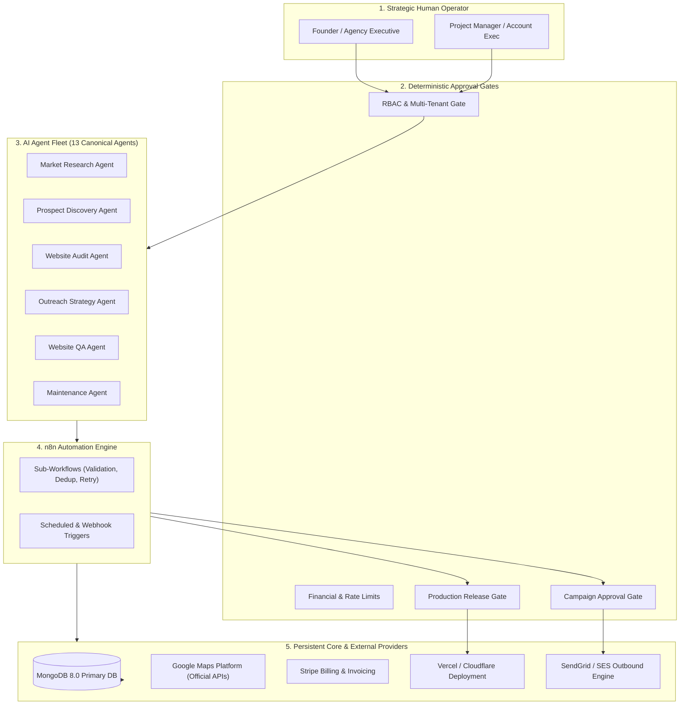

# AgencyOS — Agency Operating Model

**Document Version:** 1.0.0  
**Status:** Approved Architecture Standard  
**Published:** 30 October 2026  
**Target Audience:** Agency Founders, Operations Directors, Lead Engineers  

---

## 1. Operating Model Overview

AgencyOS implements a **Bounded-Autonomous Agency Operating Model**. Unlike purely autonomous "black-box" agent architectures that risk catastrophic mistakes (sending unintended emails, executing unauthorized ad spend, or deploying broken code), AgencyOS enforces deterministic human-in-the-loop governance around AI intelligence.



---

## 2. Operational Autonomy Classification

Every operational responsibility in the agency is strictly classified into one of four execution tiers:

| Tier | Autonomy Level | Description | Example Operations in AgencyOS |
| :--- | :--- | :--- | :--- |
| **Tier 1: Fully Automated** | High (Bounded) | Runs automatically on schedule or webhook trigger with deterministic failure fallbacks. | • Nightly database health audits<br>• Lead deduplication & indexing<br>• Website uptime polling<br>• Inbound webhook idempotency verification |
| **Tier 2: AI-Assisted** | Collaborative | AI generates high-fidelity artifacts; human operator reviews and refines. | • Target niche competitive reports<br>• Website audit analysis & issue scoring<br>• Hyper-personalized cold outreach drafts<br>• Proposal & scope of work synthesis |
| **Tier 3: Human-Approved** | Mandatory Gate | Actions with real-world financial, legal, or reputational consequences require explicit cryptographic/UI confirmation. | • Outbound email/WhatsApp broadcast dispatch<br>• Proposal approval & contract conversion<br>• Staging to production website deployment<br>• Refunding or deleting client invoices |
| **Tier 4: Manual** | Human Only | High-touch strategic, relational, or legal tasks performed exclusively by agency personnel. | • High-stakes founder closing calls<br>• Custom enterprise MSA negotiations<br>• Strategic creative direction workshops<br>• In-person partner dinners |

---

## 3. The 4 Mandatory Human-In-The-Loop Approval Gates

AgencyOS programmatically enforces four unbreakable operational gates:

### Gate 1: Outbound Outreach Dispatch Gate
* **Risk Mitigated:** AI generating inaccurate claims, hallucinating pricing, or spamming prospects in violation of TRAI / CAN-SPAM / GDPR.
* **Mechanism:** The Outreach Strategy Agent creates personalized campaign drafts in `status: "PENDING_APPROVAL"`. The campaign **cannot be dispatched** by the email provider worker until an `admin` or `owner` clicks **"Approve & Send"** on `/outreach`.
* **Safe Fallback:** All outbound connectors default to `dry_run = true` in non-production environments.

### Gate 2: Proposal & Scope Conversion Gate
* **Risk Mitigated:** Committing agency engineering resources to unsustainable deliverable scopes or underpriced contracts.
* **Mechanism:** The Proposal Generation Agent drafts the proposal based on detected website audit deficits. The proposal remains in draft state until approved by the Agency Principal, upon which a deterministic transaction converts the lead into an active `Client` and `Project`.

### Gate 3: Staging-to-Production Deployment Gate
* **Risk Mitigated:** Shipping unverified code or broken customer websites to public internet domains.
* **Mechanism:** The Website QA Agent runs Playwright automated tests, Lighthouse accessibility audits, and SSL validation on the staging preview URL. Even after a 100% QA pass, the production DNS/hosting deployment requires explicit operator confirmation.

### Gate 4: Financial & Billing Release Gate
* **Risk Mitigated:** Invoicing errors, unapproved discounts, or uncontrolled API credit burn.
* **Mechanism:** Invoices generated from project milestones require administrator review. Outbound Stripe/Zoho payment links are stamped with tenant-level rate and spending ceilings.

---

## 4. Multi-Tenant Role & Responsibility Matrix (RACI)

AgencyOS enforces strict role-based access control (RBAC) across five organizational tiers:

```text
Owner (Founder) > Admin (Ops Director) > Project Manager > Specialist (Engineer/Designer) > Viewer (Auditor/Client)
```

| Agency Role | Market Discovery | Audit & Scoring | Campaign Dispatch | Proposal Approval | Project Delivery | Production Deploy | Billing & Teams |
| :--- | :---: | :---: | :---: | :---: | :---: | :---: | :---: |
| **Owner** | Accountable | Accountable | Approver | Approver | Informed | Approver | Accountable |
| **Admin** | Responsible | Responsible | Approver | Approver | Accountable | Approver | Responsible |
| **Project Manager** | Responsible | Responsible | Consulted | Consulted | Responsible | Consulted | Informed |
| **Specialist** | Support | Responsible | No Access | No Access | Responsible | No Access | No Access |
| **Viewer** | Informed | Informed | No Access | No Access | Informed | No Access | No Access |

---

## 5. Daily Operating Cadence

A typical operational day in an agency powered by AgencyOS follows this workflow:

1. **08:30 AM — Automated Morning Sweep:**
   * n8n Scheduled Workflow `daily-summary.json` executes.
   * Uptime and maintenance agents report 0 overnight incidents.
   * Inbound replies overnight are parsed, classified, and sorted into the `/outreach` inbox.
2. **09:00 AM — Founder & PM 15-Minute Standup:**
   * Review `/dashboard` KPI cards (New Leads, Qualified Opportunities, Active Campaigns, Projected Revenue).
   * Review 12 incoming prospect replies: 4 positive meeting requests automatically queued for calendar coordination.
3. **10:00 AM — Outreach Approval:**
   * Founder reviews 25 AI-generated outreach drafts tailored to local medical and legal practices in Indore and Mumbai.
   * Modifies 2 drafts, clicks **"Approve Batch"** $\rightarrow$ dispatched through SendGrid with verified rate limits.
4. **02:00 PM — Project Delivery Check:**
   * Website QA Agent runs automated checks on 2 newly completed customer websites on staging.
   * QA report indicates 98/100 performance, 0 broken links, full WCAG 2.1 AA compliance.
   * PM triggers production deployment to Cloudflare Pages $\rightarrow$ Client receives automated notification.
5. **05:00 PM — Revenue & Analytics Review:**
   * Stripe webhooks reconcile 2 milestone invoice payments (\$3,500 total).
   * Team performance and lead-to-client pipeline velocity reviewed on `/analytics`.

