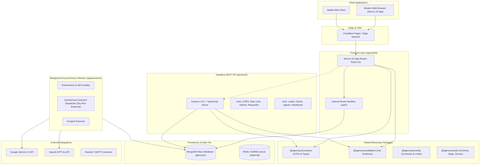

# AgencyOS — Architecture Specification

**System:** AgencyOS — Autonomous Agency Operating System  
**Version:** 1.0.0  
**Status:** Active  

---

## 1. High-Level System Architecture

AgencyOS is architected as a modular, full-stack SaaS platform partitioned across frontend presentation, headless backend REST services, background workers, and shared type contracts.



---

## 2. Directory & Package Partitioning

The repository is partitioned into clear boundaries:

```text
agencyos/
├── apps/
│   ├── web/                    # Next.js 15 App Router Frontend
│   │   ├── src/app/            # Routes & Layouts ((dashboard), (auth), api)
│   │   ├── src/components/     # UI primitives & theme controls
│   │   ├── src/features/       # Domain modules (leads, projects, etc.)
│   │   └── src/models/         # Mongoose ODM schemas
│   ├── api/                    # Express 4.21 Headless Backend
│   │   ├── src/controllers/    # Route controllers
│   │   ├── src/middleware/     # Auth, validation, error handlers
│   │   ├── src/routes/         # Express API router (/api/v1/*)
│   │   └── src/models/         # Replicated Mongoose schemas
│   └── workers/                # Background job workers & queues
├── packages/
│   ├── contracts/              # DTOs, interfaces, and API responses
│   ├── validation/             # Zod input/output schemas
│   ├── config/                 # System constants and safety flags
│   └── utils/                  # Currency formatting, slugs, scoring
├── infra/
│   ├── cloudflare/             # Cloudflare Pages deployment configuration
│   ├── zoho/                   # Zoho Catalyst AppSail deployment configuration
│   └── docker/                 # Container definitions & compose manifests
└── docs/                       # Specifications, ADRs, and execution logs
```

---

## 3. Core Architectural Invariants

1. **Zero Dead Controls:** Every visible button, modal, form input, filter, and tab performs real client-side state mutation or asynchronous backend persistence. No non-functional placeholder handlers.
2. **Deterministic Safety Boundaries:** All outbound communication (emails, SMS, WhatsApp, ad spends) enforces `dry_run = true` by default. Real dispatches require explicit operator gate approval.
3. **Strict Compliance Policy:** Scraping Google Maps / Places endpoints is prohibited per Section 3.2.3 of Google Maps TOS and the Indian DPDP Act 2023. Lead acquisition uses compliant APIs and explicit data sources.
4. **Shared Contract Validation:** Data exchanged between frontend forms, API route handlers, and backend controllers is strictly validated via `@agencyos/validation` Zod schemas.

