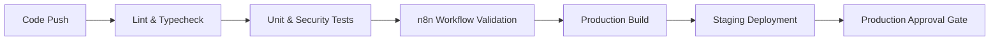

# AgencyOS CI/CD Pipelines & Deployment Automation

AgencyOS leverages **GitHub Actions** for automated quality gates, security scanning, dependency vulnerability checks, n8n workflow validation, and dual-target deployment.

## 1. Pipeline Stages

1. **Lint & Typecheck**:
   - `npm run typecheck:api` (Express backend strict compilation)
   - `npm run typecheck` (Next.js frontend strict compilation)
2. **Automated Testing**:
   - `npm test` (Runs all 72 Vitest suites across unit, contract, security, teams, webhooks, n8n)
3. **n8n Workflow Schema & Topology Validation**:
   - `npx tsx n8n/scripts/validate/validate-workflows.ts` (Ensures all 24 workflows are structurally sound and have zero credential leaks)
4. **Production Build**:
   - `npm run build:api` (Outputs backend to `backend/dist`)
   - `npm run build` (Next.js production optimization)
5. **Deployment Automation**:
   - Frontend deployed to Cloudflare Pages.
   - Backend container deployed to Zoho Node.js runtime.
   - n8n workflows synchronized via `n8n/scripts/deploy/deploy-workflows.ts`.

## 2. GitHub Actions Workflow Configuration

Located at `.github/workflows/ci.yml`:
- Triggered on all pull requests and pushes to `main` and `staging`.
- Enforces branch protection: passing CI is required before merge.
