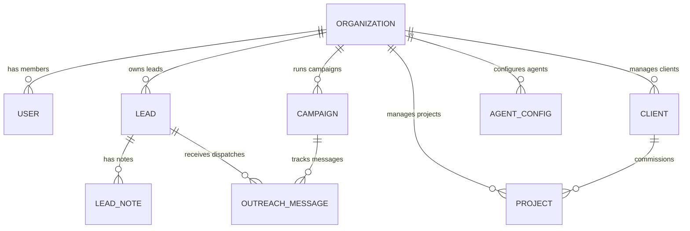

# AgencyOS — MongoDB Database Schema Specification

**Database Engine:** MongoDB 7.0+ (Atlas / Local Docker)  
**Object Document Mapper:** Mongoose 8.9+  
**Target Database Name:** `agencyos`  

---

## 1. Entity-Relationship Model

---

## 2. Collections & Field Specifications

### 2.1. `organizations` Collection
Represents tenant agency workspaces.

| Field | Type | Required | Constraints / Default | Description |
|---|---|---|---|---|
| `_id` | ObjectId | Yes | Auto | Unique identifier |
| `name` | String | Yes | Trimmed, min 2 chars | Business name of agency |
| `slug` | String | Yes | Unique, index | URL-safe slug identifier |
| `plan` | String | Yes | `Starter` \| `Pro` \| `Agency` | Subscription tier |
| `credits` | Number | Yes | Default: `250` | AI execution credits |
| `settings` | Object | No | `{ dryRunMode: true }` | Global safety flags |
| `createdAt` | Date | Yes | Auto timestamp | Creation timestamp |
| `updatedAt` | Date | Yes | Auto timestamp | Last updated timestamp |

### 2.2. `users` Collection
Represents agency team members and system operators.

| Field | Type | Required | Constraints / Default | Description |
|---|---|---|---|---|
| `_id` | ObjectId | Yes | Auto | Unique identifier |
| `organizationId` | ObjectId | Yes | Ref: `Organization` | Tenant boundary |
| `name` | String | Yes | Trimmed | User's full name |
| `email` | String | Yes | Unique, lowercase | Primary login email |
| `passwordHash` | String | Yes | Bcrypt hash | Encrypted password |
| `role` | String | Yes | `owner` \| `admin` \| `member` | Access control role |
| `isActive` | Boolean | Yes | Default: `true` | Account active state |

### 2.3. `leads` Collection
Discovered business prospects undergoing research, outreach, or qualification.

| Field | Type | Required | Description |
|---|---|---|---|
| `organizationId` | ObjectId | Yes | Tenant reference |
| `businessName` | String | Yes | Name of target business |
| `category` | String | Yes | Business vertical (Restaurant, Clinic, Cafe, etc.) |
| `location` | String | Yes | City, State or Address |
| `rating` | Number | No | Google rating (e.g. 4.6) |
| `reviewCount` | Number | No | Total review count |
| `hasWebsite` | Boolean | Yes | Whether business currently has an active website |
| `websiteUrl` | String | No | Existing website URL if applicable |
| `opportunityScore`| Number | Yes | Computed score 1.0 - 10.0 |
| `status` | String | Yes | `New` \| `Audited` \| `Contacted` \| `Replied` \| `Converted` \| `Archived` |
| `phone` | String | No | Business phone number |
| `email` | String | No | Contact email address |

### 2.4. `clients` Collection
Converted local businesses with signed retainers and active services.

| Field | Type | Required | Description |
|---|---|---|---|
| `organizationId` | ObjectId | Yes | Tenant reference |
| `businessName` | String | Yes | Client business name |
| `contactPerson` | String | Yes | Primary representative |
| `email` | String | Yes | Official email address |
| `phone` | String | Yes | Phone / WhatsApp number |
| `address` | String | Yes | Physical business location |
| `status` | String | Yes | `Active` \| `Onboarding` \| `Retainer` \| `Past` |
| `monthlyRetainer`| Number | Yes | Monthly recurring fee in INR |
| `plan` | String | Yes | Service package description |

### 2.5. `projects` Collection
Active and completed client deliverable engagements.

| Field | Type | Required | Description |
|---|---|---|---|
| `organizationId` | ObjectId | Yes | Tenant reference |
| `title` | String | Yes | Project name / scope |
| `clientName` | String | Yes | Associated client name |
| `budget` | Number | Yes | Total budget in INR |
| `deadline` | String | Yes | Expected completion date |
| `status` | String | Yes | `Discovery` \| `In Progress` \| `Review` \| `Delivered` |
| `features` | [String]| No | Scope items & deliverables |
| `tasks` | [Object]| No | Task breakdown items with completion status |

### 2.6. `campaigns` Collection
Multi-channel automated outreach sequences.

| Field | Type | Required | Description |
|---|---|---|---|
| `organizationId` | ObjectId | Yes | Tenant reference |
| `name` | String | Yes | Campaign campaign identifier |
| `channel` | String | Yes | `Email` \| `WhatsApp` \| `Multi-channel` |
| `status` | String | Yes | `Active` \| `Paused` \| `Draft` \| `Completed` |
| `sentCount` | Number | Yes | Dispatched counter |
| `openedCount` | Number | Yes | Opened counter |
| `repliedCount` | Number | Yes | Replied counter |
| `dryRunMode` | Boolean | Yes | Safety flag (default: true) |

### 2.7. `agent_configs` Collection
Configurations and execution telemetry for AI agent workers.

| Field | Type | Required | Description |
|---|---|---|---|
| `organizationId` | ObjectId | Yes | Tenant reference |
| `agentId` | String | Yes | Agent type (`researcher`, `auditor`, `outreach`, `followup`) |
| `name` | String | Yes | Human-readable title |
| `status` | String | Yes | `active` \| `paused` |
| `model` | String | Yes | Model identifier (`gemini-2.5-flash`, etc.) |
| `processedToday` | Number | Yes | Daily action count |
| `dailyCap` | Number | Yes | Maximum allowed runs per day |
| `lastRunAt` | Date | No | Timestamp of most recent execution |

---

## 3. Database Indexes

- `organizations.slug`: Unique index
- `users.email`: Unique index
- `leads.organizationId_1_status_1`: Compound index for fast tenant filtering
- `clients.organizationId_1_status_1`: Compound index
- `campaigns.organizationId_1_status_1`: Compound index
- `projects.organizationId_1_status_1`: Compound index
- `agent_configs.organizationId_1_agentId_1`: Unique compound index

