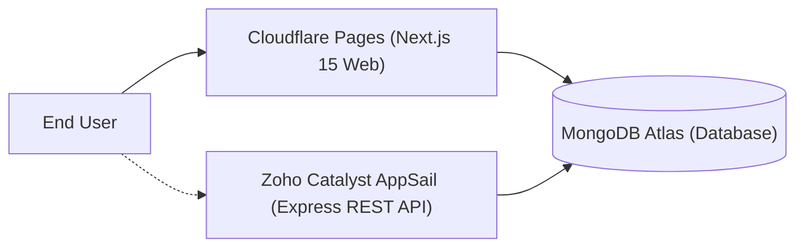

# AgencyOS — Production Deployment Playbook

**Target Environments:** Cloudflare Pages (Frontend) + Zoho Catalyst AppSail (Backend) + MongoDB Atlas  
**Architecture:** Monorepo Hybrid Partitioning  

---

## 1. Deployment Topology



---

## 2. Pre-Deployment Verification Gate

Before initiating a production release, run the local verification suite:

```bash
# 1. Verify frontend types
npm run typecheck

# 2. Verify backend types
npm run typecheck:api

# 3. Run all unit & integration tests
npm test

# 4. Verify Next.js production build
npm run build
```

Release Criteria: **0 TypeScript errors, 100% test pass rate, 0 critical lint errors.**

---

## 3. Deployment Procedures

### 3.1. Database Setup (MongoDB Atlas)
1. Provision a MongoDB 7.0+ M10+ cluster in region `AWS / ap-south-1 (Mumbai)` for Indian data residency compliance.
2. Configure IP Access List to allow Cloudflare Pages and Zoho Catalyst egress IPs.
3. Obtain connection URI and store in secret vault:
   ```text
   mongodb+srv://<username>:<password>@cluster0.mongodb.net/agencyos?retryWrites=true&w=majority
   ```
4. Run initial database seed if provisioning a fresh environment:
   ```bash
   npm run seed
   ```

### 3.2. Frontend Deployment (Cloudflare Pages)
1. Link GitHub repository `rudraksha127/Startup-Idea-Enhancement` to Cloudflare Pages.
2. Set Build Command: `npm run build`
3. Set Output Directory: `.next`
4. Add Environment Variables:
   - `NODE_ENV`: `production`
   - `MONGODB_URI`: `<your-atlas-uri>`
   - `JWT_SECRET`: `<64-character-hex-secret>`
   - `NEXT_PUBLIC_APP_URL`: `https://app.agencyos.in`
   - `DEFAULT_DRY_RUN`: `true`
5. Trigger initial deployment.

### 3.3. Backend API Deployment (Zoho Catalyst)
1. Navigate to `apps/api`:
   ```bash
   cd apps/api
   npm run build
   ```
2. Deploy via Catalyst CLI:
   ```bash
   catalyst deploy --only appsail:agencyos-api
   ```
3. Set environment variables in Catalyst console as defined in `infra/zoho/README.md`.

---

## 4. Post-Deployment Smoke Verification

Execute the following checks against the production deployment:

1. **Health Probe:** Verify `GET https://api.agencyos.in/api/v1/health` returns HTTP 200 with `database: "connected"`.
2. **Authentication Flow:** Sign in with default or seeded credentials at `https://app.agencyos.in/login`.
3. **Leads Management:** Verify `/leads` loads the seeded lead records and filtering operates with zero latency.
4. **Agent Telemetry:** Run an agent on `/ai-agents` and verify execution counter increments with real database persistence.
5. **Campaign Safety:** Ensure test sequence dispatch on `/outreach` logs safe dry-run message.
