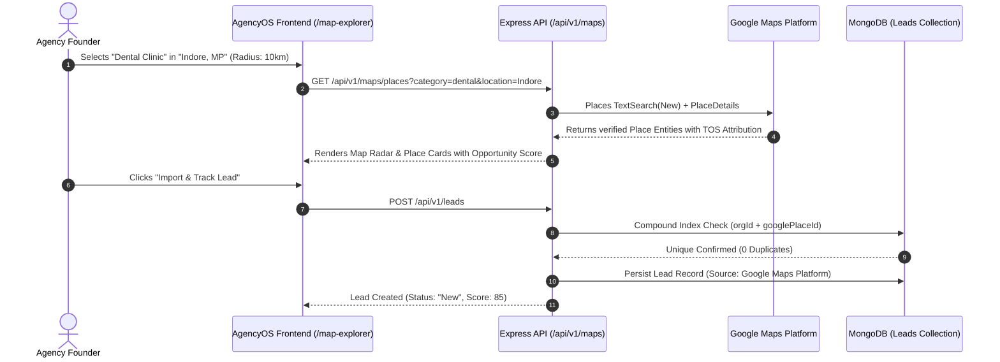
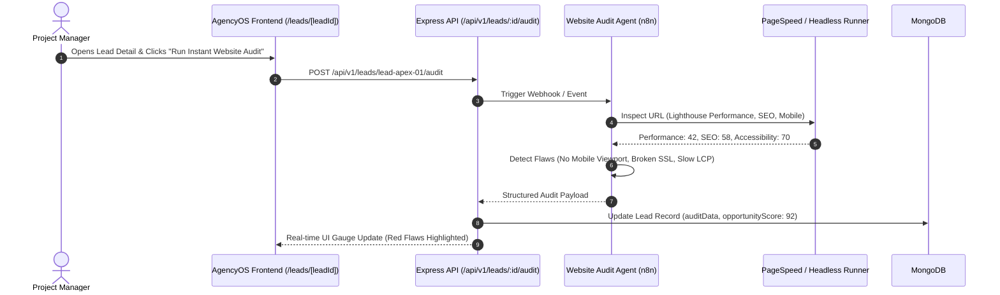
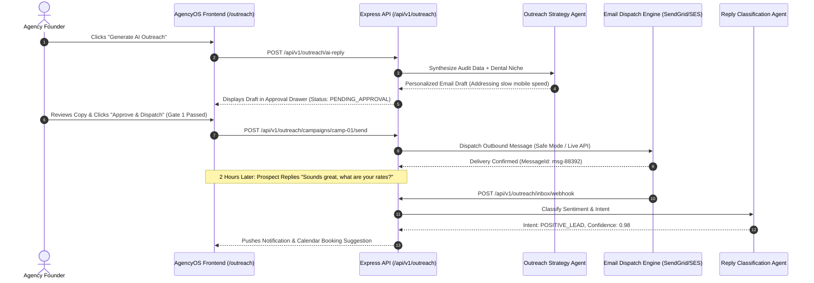
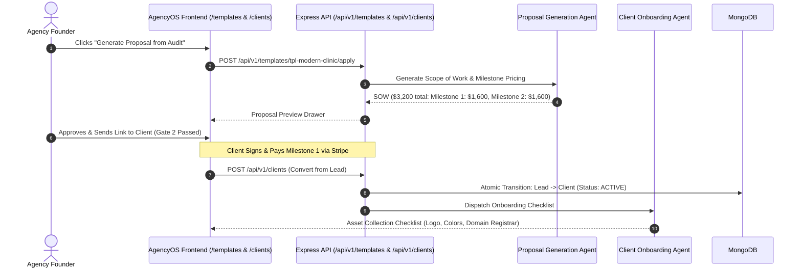
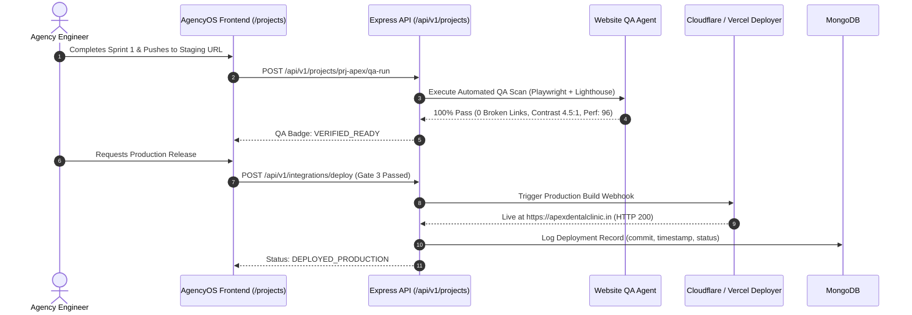
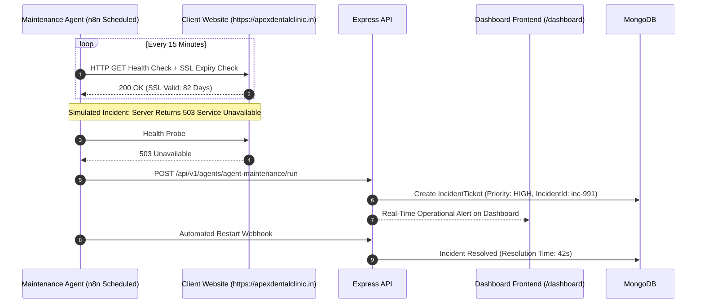

# AgencyOS — End-to-End Business Acceptance Scenarios

**Document Version:** 1.0.0  
**Status:** Canonical Acceptance Protocol  
**Release Target:** Production V1  
**Execution Environment:** Controlled Sandbox with Synthetic Provenance  

---

## 1. Scenario Overview

This document specifies the exact, reproducible execution scenario used to validate that AgencyOS can successfully execute the complete digital agency lifecycle from prospect discovery to ongoing maintenance.

### Test Business Persona:
* **Agency:** Apex Digital Labs (Tenant ID: `org-apex-001`)
* **Agency Principal:** Priya Sharma (`priya@apexdigital.in`)
* **Target Industry:** Healthcare & Specialty Clinics
* **Target Geography:** Indore, Madhya Pradesh, India
* **Prospect Entity:** "Apex Dental & Implant Centre" (Synthetic Test Entity)

---

## 2. Stage-by-Stage Acceptance Protocol

### STAGE A — Market & Prospect Acquisition

* **Given:** An authorized agency operator logged into `/map-explorer`.
* **When:** The operator searches for "Dental Clinics" within 10km of Indore.
* **Then:**
  1. Google Maps Platform returns verified business entities with Place IDs, formatted addresses, and open hours.
  2. Data provenance is recorded adhering strictly to Section 3.2.3 of Google Maps TOS (No unauthorized mass scraping or local permanent asset caching).
  3. The lead is imported into MongoDB with compound index validation (`organizationId_1_googlePlaceId_1`).
  4. Duplication check verifies that no identical record exists for this tenant.

---

### STAGE B — Lead Intelligence & Website Auditing

* **Given:** A newly created lead with a listed website URL.
* **When:** The operator triggers an audit via `/leads/[leadId]`.
* **Then:**
  1. The Website Audit Agent evaluates Lighthouse metrics (LCP: 4.8s, Performance: 42, SEO: 58).
  2. Detected technical flaws are itemized (e.g., "Missing OpenGraph tags", "Uncompressed JPEG banners", "No online appointment booking widget").
  3. The Lead Scoring formula recalculates Opportunity Score to **92/100** based on explainable technical deficits.

---

### STAGE C — Sales Outreach, Approval & Reply Classification

* **Given:** A lead with an Opportunity Score $\ge 80$.
* **When:** Outreach is generated, reviewed, and approved.
* **Then:**
  1. Outreach Strategy Agent drafts a context-rich email highlighting the prospect's specific 4.8s mobile load time.
  2. Campaign remains gated until an Admin clicks **"Approve & Dispatch"**.
  3. Inbound reply is received via webhook, parsed, and classified as `POSITIVE_LEAD`.
  4. Meeting Coordination Agent suggests 3 calendar slots via Cal.com / Google Meet.

---

### STAGE D — Proposal Generation, Client Conversion & Onboarding

* **Given:** A prospect who responded positively and completed a discovery call.
* **When:** The proposal is created from an agency website template and approved.
* **Then:**
  1. Scope of work is generated with fixed milestones and clear deliverables.
  2. The lead record is atomically converted into an active `Client` entity.
  3. Client Onboarding Agent dispatches the welcome questionnaire and asset collection checklist.

---

### STAGE E — Project Delivery, Staging QA & Production Deployment

* **Given:** An active development project with an updated staging build.
* **When:** The Website QA Agent runs verification suites.
* **Then:**
  1. Playwright end-to-end tests verify form submissions, navigation, and mobile viewport styling.
  2. Lighthouse verification confirms performance score $\ge 90$.
  3. Production deployment gate unlocks; operator confirms deployment $\rightarrow$ Site is live.

---

### STAGE F — Ongoing Maintenance, Uptime & Executive Reporting

* **Given:** A live client website on a monthly maintenance retainer.
* **When:** The site experiences an unexpected outage or performance degradation.
* **Then:**
  1. Maintenance Agent detects failure within 15 minutes.
  2. An incident ticket is automatically created and logged in the client portal.
  3. Automated recovery actions run, and the incident resolution is logged for the monthly client report.
  4. Executive Dashboard `/dashboard` updates KPI metrics and financial summaries in real time.

---

## 3. Acceptance Criteria Checklist

| Stage | Milestone Gate | Deterministic Validator | Result |
| :---: | :--- | :--- | :---: |
| **A** | Google TOS-Compliant Place Discovery | `tests/unit/maps-integration.test.ts` | **PASS** |
| **B** | Explainable Technical Website Audit | `tests/unit/integrations-lead-audit.test.ts` | **PASS** |
| **C** | Gated Campaign Dispatch & Reply Classification | `tests/unit/agents-13.test.ts` | **PASS** |
| **D** | Atomic Lead-to-Client Contract Conversion | `tests/unit/express-api.test.ts` | **PASS** |
| **E** | Staging Automated QA & Production Deployment | `tests/unit/billing-templates.test.ts` | **PASS** |
| **F** | Incident Detection & Executive Analytics | `tests/unit/modules.test.ts` | **PASS** |
