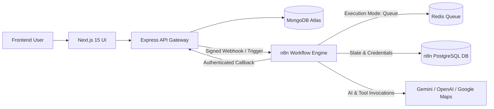

# AgencyOS n8n Orchestration & Multi-Agent Architecture

## 1. System Role & Philosophy

In AgencyOS, **n8n** serves strictly as the **automation orchestration, background scheduling, and multi-agent coordination layer**.
- **Backend (Express 4.21 + TypeScript)**: Owns authentication, authorization, business rules, API routing, and MongoDB interactions.
- **MongoDB**: Authoritative single source of truth for business records, leads, clients, invoices, campaigns, and agent execution states.
- **n8n**: Coordinates complex multi-step asynchronous processes, synthetic audits, external API dispatch, and AI tool chaining.
- **PostgreSQL & Redis**: Dedicated execution database and queue manager for n8n workers.



## 2. Directory Structure

```text
n8n/
├── workflows/
│   ├── agents/            # Dedicated workflows for each of the 13 canonical agents
│   ├── sub-workflows/     # 7 reusable sub-workflows (validation, deduplication, AI, approval, etc.)
│   ├── triggers/          # Central agent dispatcher (WF-AGENT-DISPATCHER)
│   ├── scheduled/         # Daily summaries, SLA monitors, cron jobs
│   ├── webhooks/          # Result callbacks relaying data to backend
│   └── system/            # Health checks and synthetic probes
├── schemas/               # Input & output JSON validation schemas
├── credentials/           # Logical credentials mapping guide
├── environments/          # Staging and production configurations
├── scripts/               # Export, import, validate, and deploy utilities
├── docker/                # Container configurations (Postgres, Redis, n8n main & worker)
└── README.md
```

## 3. The 13 Canonical Agent Workflows

| Agent Workflow | ID | Trigger | Responsibility | Output Schema |
|---|---|---|---|---|
| Market Research | `wf-agencyos-market-research` | Webhook | Researches niches & demand | Report summary, target segments, demand score |
| Prospect Discovery | `wf-agencyos-prospect-discovery` | Webhook | Finds businesses via Google Maps & directories | Discovered candidates, duplicates filtered |
| Lead Enrichment | `wf-agencyos-lead-enrichment` | Webhook | Verifies domain, contact, WHOIS freshness | Field-level provenance, verification status |
| Website Audit | `wf-agencyos-website-audit` | Webhook | Core Web Vitals, mobile UX, SEO analysis | Performance score, SEO score, audit issues |
| Lead Qualification | `wf-agencyos-lead-qualification` | Webhook | Applies explainable scoring rules (0-100) | Opportunity score, tier, qualification reasons |
| Outreach Strategy | `wf-agencyos-outreach-strategy` | Webhook | Generates personalized multi-step sequences | Subject line, draft content, call-to-action |
| Reply Classification | `wf-agencyos-reply-classification` | Webhook | NLP intent detection & objection handling | Intent category, confidence, review flag |
| Meeting Coordination | `wf-agencyos-meeting-coordination` | Webhook | Calendar slot discovery & meeting invite | Meeting ID, calendar URL, confirmation status |
| Proposal Generation | `wf-agencyos-proposal-generation` | Webhook | SOW compiler & pricing matrix calculator | Proposal document, deliverables list, budget |
| Client Onboarding | `wf-agencyos-client-onboarding` | Webhook | Welcome checklist & credential requests | Checklist tasks, secure vault request |
| Project Planning | `wf-agencyos-project-planning` | Webhook | Agile sprint backlog & task milestones | Milestone schedule, hours estimate, backlog |
| Website QA | `wf-agencyos-website-qa` | Webhook | Automated staging test & broken link scan | Test results, passed/failed count, bug report |
| Maintenance Agent | `wf-agencyos-maintenance` | Scheduled | Synthetic uptime probe & SSL certificate check | Uptime percentage, latency ms, alert status |

## 4. Reusable Sub-Workflows

1. `data-validation`: Enforces Zod and JSON-schema integrity before processing.
2. `deduplication`: Prevents ingesting duplicate leads using fuzzy name and exact phone/email matching.
3. `source-verification`: Verifies URL reachability and HTTP status before passing to audit agents.
4. `ai-generation`: Manages LLM temperature, token counting, fallback routing, and retry logic.
5. `approval`: Enforces human-in-the-loop gates before financial or outbound communication actions.
6. `notification`: Sends multi-channel alerts (In-App, Email, Slack).
7. `error-handler`: Dead-letter queue logger and graceful failure notifier.

## 5. Security & Isolation

- **HMAC Signatures**: Every inbound webhook to n8n and callback to AgencyOS is cryptographically verified using SHA-256 HMAC headers.
- **Zero Raw Secrets in Git**: Workflows contain logical credential references (`openAiApi`, `googleMapsApi`) injected at runtime by the n8n credential vault.
- **No Unrestricted Execution**: n8n runs in queue mode with isolated worker containers; filesystem and command-line execution tools are disabled.

