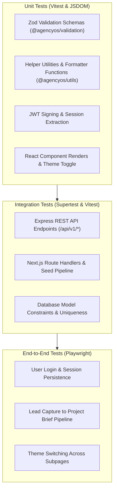

# AgencyOS — Automated Testing Strategy & Verification Guide

**Framework:** Vitest 2.1+, React Testing Library, Supertest 7.0+, Playwright  
**Execution Command:** `npm test`  
**Typecheck Command:** `npm run typecheck && npm run typecheck:api`  

---

## 1. Testing Pyramid Overview

AgencyOS maintains strict test coverage across every architectural tier:



---

## 2. Test Execution Commands

### Run All Unit & Integration Tests:
```bash
npm test
```

### Run Tests in Watch Mode:
```bash
npm run test:watch
```

### Run Full Static Typecheck Verification:
```bash
npm run typecheck       # Next.js App Router & Client Components
npm run typecheck:api   # Express Backend & Controllers
```

---

## 3. Test Suites Inventory

1. **`tests/unit/packages.test.ts`**:
   - Currency formatting (`₹75,000`, `₹12,00,000`)
   - URL slug generation
   - Opportunity score calculation (1.0 to 10.0 scale)
   - API key masking
   - Client, Campaign, Project, and Settings Zod schemas
   - Application configuration constants and safety locks
2. **`tests/unit/validations.test.ts`**:
   - Lead creation validation and defaults
   - User login and registration validations
   - Pagination query parameter parsers
3. **`tests/unit/auth.test.ts`**:
   - Password hashing with bcrypt
   - JWT token generation and verification
4. **`tests/unit/express-api.test.ts`**:
   - Health probe response and request ID generation
   - Service info endpoint
   - Login format rejection
   - Registration validation
   - Lead payload validation
5. **`tests/unit/components.test.tsx`**:
   - Theme toggle rendering
   - Active state and selector dropdowns
