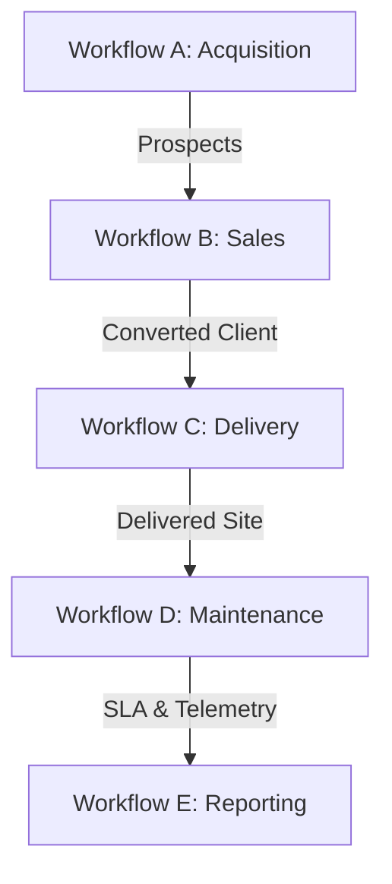

# AgencyOS Workflow Catalog

This catalog documents all **24 version-controlled n8n workflows** powering AgencyOS's multi-agent automation mesh.

## 1. Primary End-to-End Business Workflows

AgencyOS automates five connected lifecycle paths:

### Workflow A — Acquisition Pipeline
`Market Research → Prospect Discovery → Google Maps Platform → Deduplication → Lead Verification → Website Audit → Qualification → Lead Scoring → MongoDB Lead Persistence`

### Workflow B — Sales & Client Conversion
`Lead Selected → Outreach Strategy → Approval Gate → Resend Dispatch → Reply Webhook Ingest → Reply Classification → Meeting Coordination → Proposal Generation → Founder Signoff → Client Created`

### Workflow C — Delivery & QA
`Client Onboarding → Asset Collection Checklist → Project Planning → Agile Backlog → Milestone Tasks → Development → Website QA Automated Audit → Final Release Gate`

### Workflow D — Retainer SLA & Maintenance
`Synthetic Monitor → Ping Latency & SSL Expiry → Incident Detection → Maintenance Task Auto-Created → Slack/Email Alert`

### Workflow E — Continuous Reporting
`Application Audit Logs → Aggregated Analytics Service → Daily Midnight Executive Briefing → Dashboard Refresh`

---

## 2. Directory Layout & Workflow Registry

| Workflow File Path | Workflow Name | Trigger |
|---|---|---|
| `n8n/workflows/triggers/agent-dispatcher.json` | `WF-AGENT-DISPATCHER` | Inbound Webhook (`/webhook/agent-dispatcher`) |
| `n8n/workflows/scheduled/daily-summary.json` | `WF-DAILY-SUMMARY` | Cron (`0 0 * * *`) |
| `n8n/workflows/webhooks/result-callback.json` | `WF-AGENT-RESULT-CALLBACK` | Inbound Webhook (`/webhook/agent-callback`) |
| `n8n/workflows/system/health-check.json` | `WF-INTEGRATION-HEALTH-CHECK` | Interval (Every 15m) |
| `n8n/workflows/agents/market-research/workflow.json` | `WF-AGENT-MARKET-RESEARCH` | Webhook Trigger |
| `n8n/workflows/agents/prospect-discovery/workflow.json` | `WF-AGENT-PROSPECT-DISCOVERY` | Webhook Trigger |
| `n8n/workflows/agents/lead-enrichment/workflow.json` | `WF-AGENT-LEAD-ENRICHMENT` | Webhook Trigger |
| `n8n/workflows/agents/website-audit/workflow.json` | `WF-AGENT-WEBSITE-AUDIT` | Webhook Trigger |
| `n8n/workflows/agents/lead-qualification/workflow.json` | `WF-AGENT-LEAD-QUALIFICATION` | Webhook Trigger |
| `n8n/workflows/agents/outreach-strategy/workflow.json` | `WF-AGENT-OUTREACH-STRATEGY` | Webhook Trigger |
| `n8n/workflows/agents/reply-classification/workflow.json` | `WF-AGENT-REPLY-CLASSIFICATION` | Webhook Trigger |
| `n8n/workflows/agents/meeting-coordination/workflow.json` | `WF-AGENT-MEETING-COORDINATION` | Webhook Trigger |
| `n8n/workflows/agents/proposal-generation/workflow.json` | `WF-AGENT-PROPOSAL-GENERATION` | Webhook Trigger |
| `n8n/workflows/agents/client-onboarding/workflow.json` | `WF-AGENT-CLIENT-ONBOARDING` | Webhook Trigger |
| `n8n/workflows/agents/project-planning/workflow.json` | `WF-AGENT-PROJECT-PLANNING` | Webhook Trigger |
| `n8n/workflows/agents/website-qa/workflow.json` | `WF-AGENT-WEBSITE-QA` | Webhook Trigger |
| `n8n/workflows/agents/maintenance/workflow.json` | `WF-AGENT-MAINTENANCE` | Schedule Trigger |
| `n8n/workflows/sub-workflows/data-validation/workflow.json` | `WF-SUB-DATA-VALIDATION` | Execute Subworkflow |
| `n8n/workflows/sub-workflows/deduplication/workflow.json` | `WF-SUB-DEDUPLICATION` | Execute Subworkflow |
| `n8n/workflows/sub-workflows/source-verification/workflow.json` | `WF-SUB-SOURCE-VERIFICATION` | Execute Subworkflow |
| `n8n/workflows/sub-workflows/ai-generation/workflow.json` | `WF-SUB-AI-GENERATION` | Execute Subworkflow |
| `n8n/workflows/sub-workflows/approval/workflow.json` | `WF-SUB-APPROVAL` | Execute Subworkflow |
| `n8n/workflows/sub-workflows/notification/workflow.json` | `WF-SUB-NOTIFICATION` | Execute Subworkflow |
| `n8n/workflows/sub-workflows/error-handler/workflow.json` | `WF-SUB-ERROR-HANDLER` | Execute Subworkflow |
