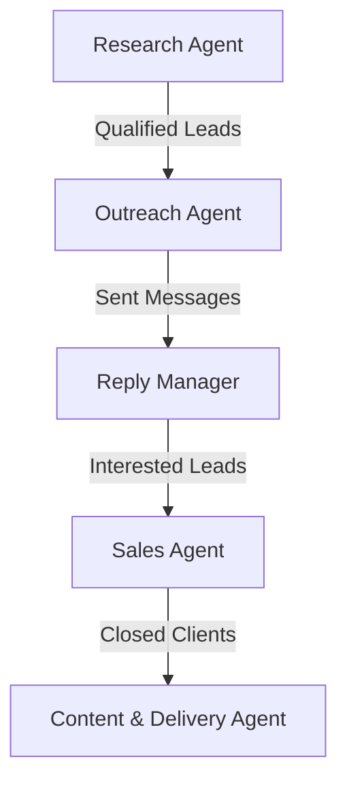

# AgencyOS Autonomous Agent Catalog

---

## Agent Fleet Overview

AgencyOS orchestrates five specialized AI agents. Each agent operates under bounded autonomy, deterministic spend limits, and human-in-the-loop approval gates.

---

## 1. Research Agent
- **Category:** Market Discovery & Technical Auditing
- **Default Model:** `Gemini 2.5 Flash` / `GPT-4o`
- **Temperature:** `0.3` (High consistency)
- **Max Tokens:** `4,000`
- **Responsibilities:**
  - Evaluates local business websites for responsive design, SSL, and PageSpeed.
  - Computes Opportunity Score (1.0 - 10.0).
  - Synthesizes 2-sentence developer briefs highlighting conversion gaps.
- **Guardrails:** Cannot trigger live outbound communications; read-only web inspection.

---

## 2. Outreach Agent
- **Category:** Communication & Copywriting
- **Default Model:** `Claude 3.5 Sonnet` / `GPT-4o`
- **Temperature:** `0.5`
- **Max Tokens:** `2,500`
- **Responsibilities:**
  - Generates personalized cold email sequences based on technical audit findings.
  - Adapts tone to specific local business verticals (Cafes vs. Medical Clinics).
- **Guardrails:** Operates in `dry_run = true` mode by default. Live dispatch requires founder approval.

---

## 3. Reply Manager
- **Category:** Communication & Triage
- **Default Model:** `GPT-4o`
- **Temperature:** `0.2`
- **Max Tokens:** `1,500`
- **Responsibilities:**
  - Analyzes inbound replies and classifies intent: `Interested`, `Objection`, `Pricing Inquiry`, or `Unsubscribe`.
  - Instantly flags unsubscribe requests and triggers suppression list rules.

---

## 4. Sales Agent
- **Category:** Sales Coordination
- **Default Model:** `Claude 3.5 Sonnet`
- **Responsibilities:**
  - Provides Cal.com booking links and handles scheduling coordination.
  - Prepares discovery call briefing dossiers for the agency founder.

---

## 5. Content & Delivery Agent
- **Category:** Engineering Handoff
- **Default Model:** `GPT-4o`
- **Responsibilities:**
  - Maps client requirements to appropriate website template variations.
  - Generates initial SEO page structures, meta tags, and hero copy.

