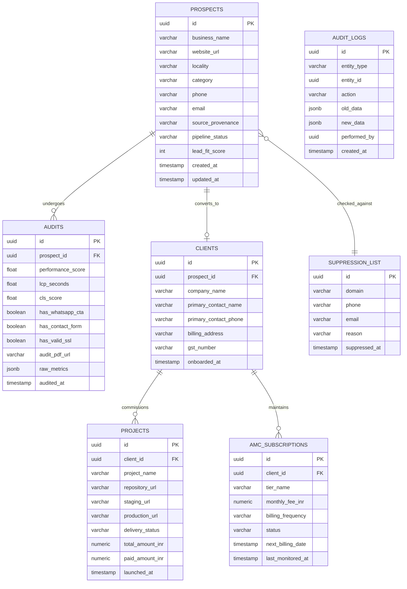

# Database Design & Schema Specification — Autonomous Agency OS

**Database Engine:** PostgreSQL 16 (via Supabase)  
**Security Model:** Row Level Security (RLS) on all tables  
**Status:** PROPOSED (Pending Gate 5 Approval)  

---

## 1. Entity Relationship Diagram (ERD)



---

## 2. SQL Schema Definitions & DDL

```sql
-- Enable UUID extension
CREATE EXTENSION IF NOT EXISTS "uuid-ossp";

-- 1. System Settings & Emergency Kill Switch
CREATE TABLE system_settings (
    key VARCHAR(64) PRIMARY KEY,
    value JSONB NOT NULL,
    updated_at TIMESTAMP WITH TIME ZONE DEFAULT NOW()
);

-- Seed Emergency Kill Switch (Enabled = Operating normally; Disabled = All stopped)
INSERT INTO system_settings (key, value) 
VALUES ('emergency_kill_switch', '{"is_active": false, "reason": "Normal operations"}');

-- 2. Suppression List
CREATE TABLE suppression_list (
    id UUID PRIMARY KEY DEFAULT uuid_generate_v4(),
    domain VARCHAR(255) UNIQUE,
    phone VARCHAR(32) UNIQUE,
    email VARCHAR(255) UNIQUE,
    reason VARCHAR(255) NOT NULL,
    suppressed_at TIMESTAMP WITH TIME ZONE DEFAULT NOW()
);

CREATE INDEX idx_suppression_domain ON suppression_list(domain);
CREATE INDEX idx_suppression_phone ON suppression_list(phone);

-- 3. Prospects Registry
CREATE TYPE pipeline_status_type AS ENUM (
    'DISCOVERED', 'AUDITED', 'QUALIFIED', 'OUTREACH_STAGED', 
    'IN_DISCUSSION', 'PROPOSAL_SENT', 'WON', 'LOST', 'SUPPRESSED'
);

CREATE TABLE prospects (
    id UUID PRIMARY KEY DEFAULT uuid_generate_v4(),
    business_name VARCHAR(255) NOT NULL,
    website_url VARCHAR(512) NOT NULL,
    locality VARCHAR(128) NOT NULL,
    category VARCHAR(64) NOT NULL DEFAULT 'SKILL_TRAINING',
    phone VARCHAR(32),
    email VARCHAR(255),
    source_provenance VARCHAR(255) NOT NULL,
    pipeline_status pipeline_status_type DEFAULT 'DISCOVERED',
    lead_fit_score INTEGER CHECK (lead_fit_score >= 0 AND lead_fit_score <= 100),
    notes TEXT,
    created_at TIMESTAMP WITH TIME ZONE DEFAULT NOW(),
    updated_at TIMESTAMP WITH TIME ZONE DEFAULT NOW()
);

CREATE INDEX idx_prospects_status ON prospects(pipeline_status);
CREATE INDEX idx_prospects_locality ON prospects(locality);

-- 4. Technical Audits
CREATE TABLE audits (
    id UUID PRIMARY KEY DEFAULT uuid_generate_v4(),
    prospect_id UUID NOT NULL REFERENCES prospects(id) ON DELETE CASCADE,
    performance_score NUMERIC(5,2),
    lcp_seconds NUMERIC(5,2),
    cls_score NUMERIC(5,3),
    has_whatsapp_cta BOOLEAN DEFAULT FALSE,
    has_contact_form BOOLEAN DEFAULT FALSE,
    has_valid_ssl BOOLEAN DEFAULT TRUE,
    audit_pdf_url VARCHAR(512),
    raw_metrics JSONB,
    audited_at TIMESTAMP WITH TIME ZONE DEFAULT NOW()
);

CREATE INDEX idx_audits_prospect ON audits(prospect_id);

-- 5. Clients
CREATE TABLE clients (
    id UUID PRIMARY KEY DEFAULT uuid_generate_v4(),
    prospect_id UUID REFERENCES prospects(id) ON DELETE SET NULL,
    company_name VARCHAR(255) NOT NULL,
    primary_contact_name VARCHAR(128) NOT NULL,
    primary_contact_phone VARCHAR(32) NOT NULL,
    billing_address TEXT,
    gst_number VARCHAR(32),
    onboarded_at TIMESTAMP WITH TIME ZONE DEFAULT NOW()
);

-- 6. Projects
CREATE TYPE project_status_type AS ENUM (
    'INITIALIZED', 'IN_DEVELOPMENT', 'STAGING_REVIEW', 'PAYMENT_PENDING', 'DEPLOYED', 'MAINTENANCE'
);

CREATE TABLE projects (
    id UUID PRIMARY KEY DEFAULT uuid_generate_v4(),
    client_id UUID NOT NULL REFERENCES clients(id) ON DELETE CASCADE,
    project_name VARCHAR(255) NOT NULL,
    repository_url VARCHAR(512),
    staging_url VARCHAR(512),
    production_url VARCHAR(512),
    delivery_status project_status_type DEFAULT 'INITIALIZED',
    total_amount_inr NUMERIC(10,2) NOT NULL,
    paid_amount_inr NUMERIC(10,2) DEFAULT 0.00,
    launched_at TIMESTAMP WITH TIME ZONE
);

-- 7. AMC Subscriptions
CREATE TYPE amc_status_type AS ENUM ('ACTIVE', 'PAUSED', 'CANCELLED', 'OVERDUE');

CREATE TABLE amc_subscriptions (
    id UUID PRIMARY KEY DEFAULT uuid_generate_v4(),
    client_id UUID NOT NULL REFERENCES clients(id) ON DELETE CASCADE,
    tier_name VARCHAR(64) DEFAULT 'Growth & Uptime Retainer',
    monthly_fee_inr NUMERIC(10,2) NOT NULL DEFAULT 3500.00,
    billing_frequency VARCHAR(32) DEFAULT 'QUARTERLY_ADVANCE',
    status amc_status_type DEFAULT 'ACTIVE',
    next_billing_date DATE NOT NULL,
    last_monitored_at TIMESTAMP WITH TIME ZONE
);

-- 8. Immutable Audit Trail
CREATE TABLE audit_logs (
    id UUID PRIMARY KEY DEFAULT uuid_generate_v4(),
    entity_type VARCHAR(64) NOT NULL,
    entity_id UUID NOT NULL,
    action VARCHAR(64) NOT NULL,
    old_data JSONB,
    new_data JSONB,
    performed_by UUID,
    created_at TIMESTAMP WITH TIME ZONE DEFAULT NOW()
);

CREATE INDEX idx_audit_logs_entity ON audit_logs(entity_type, entity_id);
```

---

## 3. Row Level Security (RLS) Policies

```sql
-- Enable RLS on all tables
ALTER TABLE system_settings ENABLE ROW LEVEL SECURITY;
ALTER TABLE suppression_list ENABLE ROW LEVEL SECURITY;
ALTER TABLE prospects ENABLE ROW LEVEL SECURITY;
ALTER TABLE audits ENABLE ROW LEVEL SECURITY;
ALTER TABLE clients ENABLE ROW LEVEL SECURITY;
ALTER TABLE projects ENABLE ROW LEVEL SECURITY;
ALTER TABLE amc_subscriptions ENABLE ROW LEVEL SECURITY;
ALTER TABLE audit_logs ENABLE ROW LEVEL SECURITY;

-- Allow authenticated operator full access to all agency records
CREATE POLICY "Operator full access" ON system_settings 
    FOR ALL TO authenticated USING (true) WITH CHECK (true);

CREATE POLICY "Operator full access" ON suppression_list 
    FOR ALL TO authenticated USING (true) WITH CHECK (true);

CREATE POLICY "Operator full access" ON prospects 
    FOR ALL TO authenticated USING (true) WITH CHECK (true);

CREATE POLICY "Operator full access" ON audits 
    FOR ALL TO authenticated USING (true) WITH CHECK (true);

CREATE POLICY "Operator full access" ON clients 
    FOR ALL TO authenticated USING (true) WITH CHECK (true);

CREATE POLICY "Operator full access" ON projects 
    FOR ALL TO authenticated USING (true) WITH CHECK (true);

CREATE POLICY "Operator full access" ON amc_subscriptions 
    FOR ALL TO authenticated USING (true) WITH CHECK (true);

CREATE POLICY "Operator full access" ON audit_logs 
    FOR ALL TO authenticated USING (true) WITH CHECK (true);
```


---

## 7. MongoDB & Mongoose Schema Specification (Full-Stack SaaS Migration)

Per the SaaS Migration specification, the operational application implements MongoDB via Mongoose with multi-tenancy (`organizationId`), indexing, and typed schemas:

### 7.1 Mongoose Collections & Models

1. **`organizations` (`src/models/Organization.ts`)**
   - Fields: `name` (String), `slug` (String, unique index), `plan` ('free' | 'starter' | 'pro' | 'enterprise'), `credits` (Number), `settings` (Object), `createdAt`, `updatedAt`.
2. **`users` (`src/models/User.ts`)**
   - Fields: `name` (String), `email` (String, unique index), `passwordHash` (String), `role` ('admin' | 'operator' | 'viewer'), `organizationId` (ObjectId ref Organization), `avatarInitials` (String).
3. **`leads` (`src/models/Lead.ts`)**
   - Multi-tenant model indexed by `organizationId`, `status`, `category`, `createdAt`, and compound text index on `businessName`, `category`, `address`.
   - Rich intelligence fields:
     - `performanceScores`: `website`, `seo`, `performance`, `mobile`, `accessibility`, `security` (0-100 integers).
     - `painPoints`: `string[]` (concrete issues identified during analysis).
     - `competitors`: `Array<{ name: string; rating: number; price: string; note: string }>`
     - `actionPlan`: `Array<{ phase: string; title: string; description: string; timeEstimate: string }>`
     - `websiteAudit`: Core Web Vitals (`lcp`, `cls`, `fid`, `inp`, `fcp`, `ttfb`, `sslValid`, `mobileFriendly`, `hasForms`, `hasWhatsappCta`).
     - `aiInsights`: `summary`, `angle`, `recommendedOffer`, `elevatorPitch`, `riskFactors`.
4. **`leadnotes` (`src/models/LeadNote.ts`)**
   - Audit trail and operator notes linked to `leadId` and `organizationId`.
   - Fields: `leadId`, `organizationId`, `author`, `authorRole`, `content`, `type` ('note' | 'call' | 'email' | 'meeting' | 'audit').
5. **`projects` (`src/models/Project.ts`)**
   - Delivery projects with `title`, `clientName`, `leadId`, `organizationId`, `status` ('Briefing' | 'In Progress' | 'Review' | 'Delivered' | 'On Hold'), `budget`, `deadline`, `tasks` checklist with completed status.
6. **`outreachmessages` (`src/models/OutreachMessage.ts`)**
   - Outbound campaign tracking with `leadId`, `organizationId`, `toEmail`, `channel` ('Email' | 'WhatsApp'), `subject`, `body`, `status` ('Draft' | 'Scheduled' | 'Sent' | 'Delivered' | 'Replied' | 'Bounced'), `sentAt`.
7. **`agentconfigs` (`src/models/AgentConfig.ts`)**
   - Autonomous agent fleet configuration (`name`, `role`, `status` 'Running' | 'Idle' | 'Paused', `dailyTarget`, `processedToday`, `accuracyRate`, `lastRunAt`).
