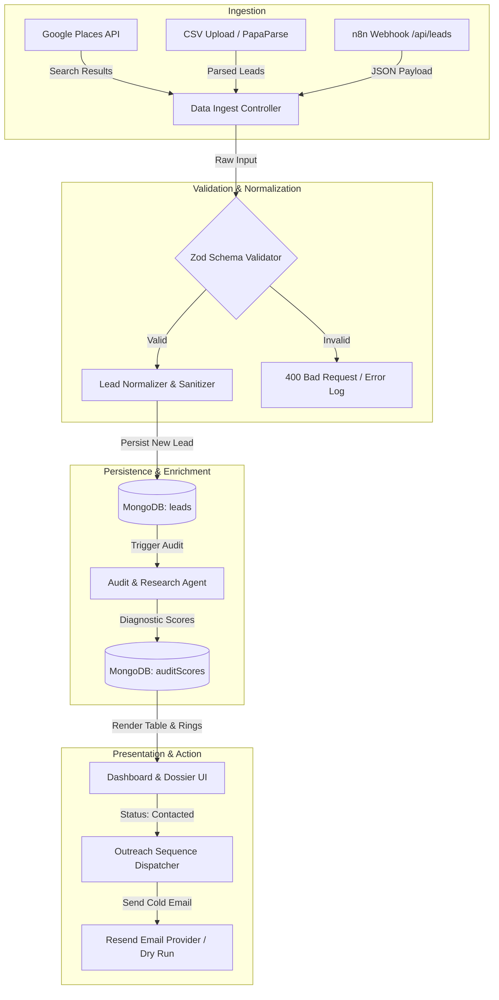
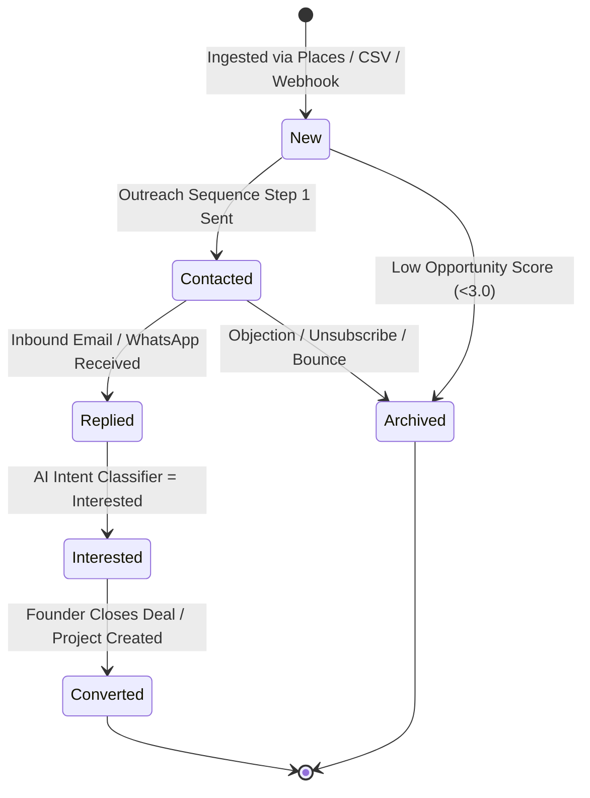

# AgencyOS Data Flow & Information Architecture

This document describes how data enters, transitions, and is persisted across the AgencyOS platform.

---

## 1. High-Level Data Flow Architecture

---

## 2. Lead Lifecycle State Machine

A lead transitions through 6 deterministic states:

### State Transition Invariants:
1. `New` to `Contacted`: Requires valid email/phone and passed suppression list check.
2. `Contacted` to `Replied`: Triggered automatically by webhook from email/messaging provider.
3. `Replied` to `Archived`: Instant transition if message contains unsubscribe keywords ("stop", "remove", "unsubscribe").
4. `Interested` to `Converted`: Creates a corresponding record in `projects` collection with initial status `Active`.

