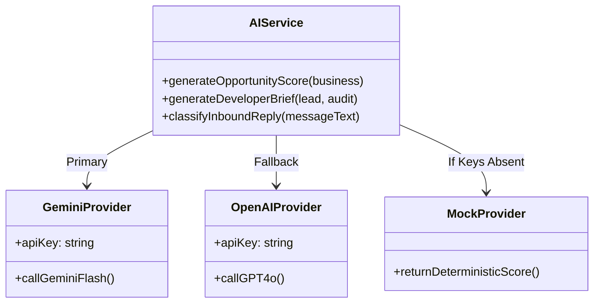

# AgencyOS Integration Architecture

---

## 1. External Integration Overview

AgencyOS interfaces with five external systems via pluggable adapter patterns:

| Service Category | Primary Provider | Fallback / Simulation | Integration Pattern |
|---|---|---|---|
| **AI Reasoning** | Google Gemini (`gemini-2.5-flash`) | Deterministic Mock Engine | REST SDK / Async Stream |
| **Email Gateway** | Resend API | Local Dry-Run Logger | REST HTTPS POST |
| **Places / Map Data**| Google Places API | Synthetic City Dataset | REST HTTPS GET |
| **Workflow Engine** | n8n (Self-hosted or Cloud) | Next.js API Trigger | Webhook Ingest / Egest |
| **Payment Gateway** | Stripe / Razorpay | Mock Billing Engine | Webhook Signature Verification |

---

## 2. Pluggable AI Gateway Pattern

Located in `src/lib/providers/ai-service.ts`, the AI gateway decouples the business logic from specific LLM providers:

### Fallback Guarantee:
If `GEMINI_API_KEY` is not present in `.env.local`, the platform automatically activates `MockProvider`. This guarantees that development, CI testing, and evaluation proceed without breaking or incurring API billing.

