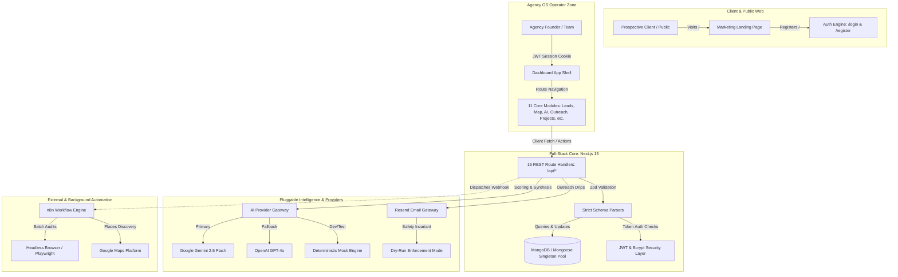

# System Architecture Specification — Autonomous Agency OS

**Document ID:** ARCH-001  
**Status:** Approved & Canonical  
**Architecture Model:** Next.js 15 Full-Stack SaaS (Modular Monolith)  

---

## 1. Architectural Vision & Core Principles

Autonomous Agency OS is structured as a **modular monolith** with decoupled asynchronous workflow orchestration. The architecture prioritizes:
1. **Deterministic Business Gates:** Source eligibility, suppression lists, credit/spend budgets, auth checks, and state transitions execute inside TypeScript backend route handlers with Zod validation—never delegating state control to non-deterministic LLM agents.
2. **Inward-Focused Technical Leverage:** Heavy automation is applied to **analytical, quality, and preparation workflows** (PageSpeed audits, conversion gap detection, proposal generation, uptime monitoring) to give a solo founder or small engineering team the operational capacity of a full agency.
3. **Pluggable Intelligence:** Multi-provider LLM gateway supporting Google Gemini (`gemini-2.5-flash`), Anthropic Claude, and OpenAI (`gpt-4o`) with automatic mock fallback when API keys are absent.

---

## 2. Component Topology & System Context

---

## 3. Subsystem Breakdown

### 3.1 Operator Dashboard (Frontend Tier)
- **Framework:** Next.js 15 (App Router), React 19, TypeScript strict mode.
- **Styling & Design Tokens:** Tailwind CSS with custom design tokens:
  - Canvas: `#F8F6F0` (warm off-white)
  - Card: `#FFFFFF`
  - Sidebar: `#151B1A` (charcoal dark)
  - Text Primary: `#171918`
  - Text Secondary: `#68717D`
  - Primary Accent: `#3568E8` (restrained B2B blue)
  - Success Accent: `#25835B` / `#10B981` (emerald green)
- **Components:** Modular features in `src/features/` (`dashboard`, `landing`, `leads`, `lead-intelligence`, `projects`), Lucide React icons, and Recharts visualization.

### 3.2 Backend & API Tier
- **Route Handlers:** 15 authenticated Next.js endpoints located in `src/app/api/`.
- **Validation Engine:** Strict Zod validation on external query parameters, request bodies, and webhook events (`src/lib/validations/`).
- **Response Format:** Standardized `{ success: boolean, data?: any, error?: string }` payload structure.

### 3.3 Data Layer
- **Mongoose ORM:** Multi-tenant document models in `src/models/` (`Organization`, `User`, `Lead`, `LeadNote`, `Project`, `AgentConfig`, `OutreachMessage`).
- **Connection Caching:** Global connection pooling in `src/lib/db/mongodb.ts` preventing connection exhaustion across Next.js Serverless / Edge execution environments.

### 3.4 Security & Compliance Boundaries
- **Stateless Tokens:** Signed JWT cookies with expiration checks.
- **TOS & DPDP Safety:** Never scrape Google Maps; strictly adhere to Section 3.2.3 of Google Maps TOS, Indian DPDP Act 2023, and TRAI regulations.
