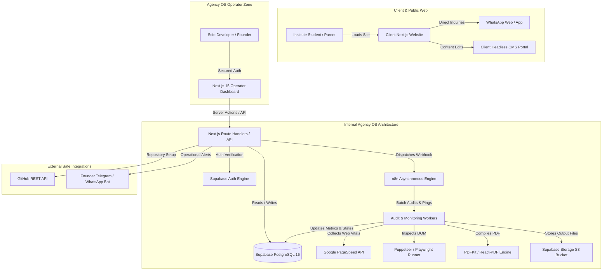

# System Architecture Specification — Autonomous Agency OS

**Document ID:** ARCH-001  
**Status:** PROPOSED (Pending Gate 5 Approval)  
**Author:** Principal Software Architect & Staff Systems Engineer  

---

## 1. Architectural Vision & Core Principles

Autonomous Agency OS is structured as a **modular monolith** with decoupled asynchronous workflow orchestration. The architecture prioritizes:
1. **Deterministic Business Gates:** Critical state transitions, data suppression, and access rules execute inside PostgreSQL triggers and TypeScript backend APIs—never delegating state control to non-deterministic LLM agents.
2. **Inward-Focused Automation:** Heavy automation is applied to **analytical, quality, and preparation workflows** (PageSpeed audits, conversion gap detection, proposal generation, uptime monitoring) rather than risky, unconsented outbound messaging.
3. **Low-Overhead Solo Maintenance:** Zero unnecessary microservices, vector databases, or complex agent swarms. The entire stack runs efficiently on standard modern infrastructure.

---

## 2. Component Topology & System Context



---

## 3. Subsystem Breakdown

### 3.1 Operator Dashboard (Frontend Tier)
- **Framework:** Next.js 15 (App Router), React 19, TypeScript strict mode.
- **Styling & Components:** Tailwind CSS, Shadcn/UI primitives, Lucide icons.
- **State & Data Fetching:** React Server Components (RSC) for initial page loads; TanStack Query for dynamic client-side filtering; Supabase Realtime subscriptions for live audit job progress updates.
- **Responsiveness:** Optimized for desktop (primary workstation) and mobile/tablet (on-the-go lead inspection during field meetings).

### 3.2 Data Tier & Access Control
- **Database Engine:** PostgreSQL 16 managed via Supabase.
- **Security Perimeter:** Row Level Security (RLS) enabled on 100% of tables. Operator queries run under authenticated session JWTs.
- **Data Integrity:** Strict foreign keys, cascade protections, and immutable audit logs capturing every status mutation.

### 3.3 Asynchronous Workflow Engine (n8n)
- **Deployment:** Containerized n8n instance (Docker on a cheap VPS or managed n8n cloud).
- **Responsibilities:**
  - Scheduled 6-hour HTTP status and SSL expiration checks for client websites.
  - Asynchronous execution of website speed audits and PDF dossier rendering.
  - Retry logic with exponential backoff on external API rate limits.
  - Emergency Kill Switch integration: evaluates a single global boolean flag before executing any workflow node.

### 3.4 Client Delivery Architecture (The "Ad-Ready Funnel")
- **Frontend:** Next.js static export / serverless hosted on Vercel or Netlify.
- **CMS Layer:** Sanity.io or Supabase Studio configured with tightly restricted editor permissions for client administrative staff (batch dates, notices, syllabus downloads).
- **Conversion Endpoints:** Direct WhatsApp click-to-chat links pre-filled with UTM parameters and course tags; lightweight contact form posting to a dedicated Supabase Edge Function.

---

## 4. Security Perimeters & Trust Boundaries

```
[Public Internet] 
       │ 
       ▼ (HTTPS / TLS 1.3)
┌────────────────────────────────────────────────────────┐
│ Boundary 1: Supabase API Gateway / Cloudflare          │
│ - Rate Limiting, DDoS Protection, SSL Termination      │
└───────────────────────┬────────────────────────────────┘
                        │
                        ▼ (Signed JWT / Session Cookie)
┌────────────────────────────────────────────────────────┐
│ Boundary 2: Next.js Admin & Route Handlers             │
│ - Zod Input Validation, Role Verification              │
└───────────────────────┬────────────────────────────────┘
                        │
                        ▼ (PostgreSQL Wire Protocol / RLS)
┌────────────────────────────────────────────────────────┐
│ Boundary 3: Supabase PostgreSQL Database               │
│ - Row Level Security, Encrypted Secrets at Rest        │
└────────────────────────────────────────────────────────┘
```
