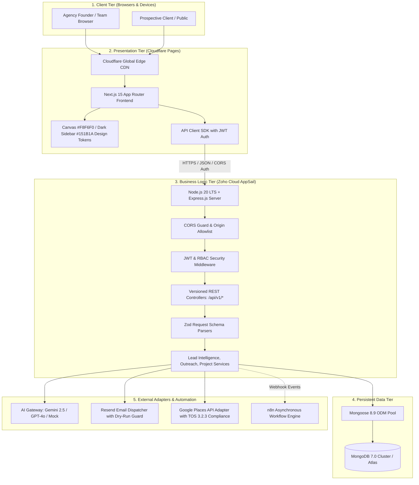
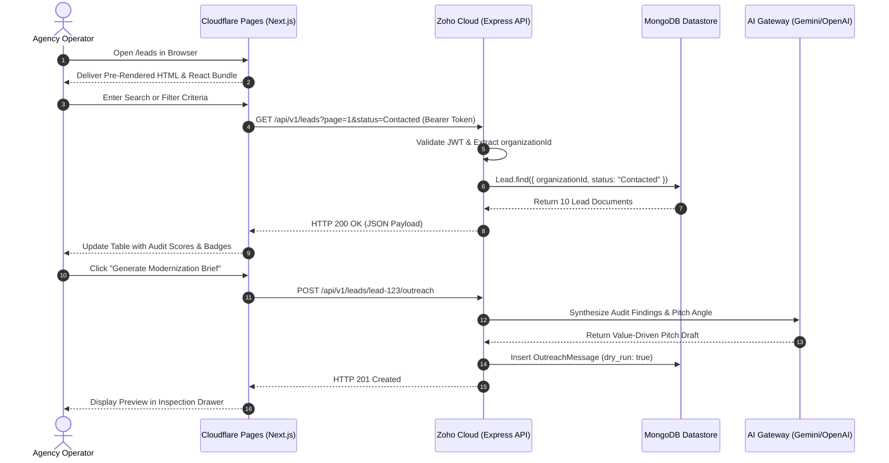

# System Architecture Specification — Autonomous Agency OS

**Document ID:** ARCH-002  
**Status:** Canonical & Approved  
**Architecture Model:** Dual-Tier Decoupled SaaS (Next.js on Cloudflare Pages + Express on Zoho Cloud)  
**Governing Decision:** [ADR-005](decisions/ADR-005-cloudflare-pages-zoho-express-topology.md)  

---

## 1. Architectural Vision & Core Principles

Autonomous Agency OS is an enterprise-grade Autonomous Agency Operating System engineered with strict separation of concerns between presentation and business execution:

1. **Deterministic Business Gates:** Source eligibility, suppression lists, credit/spend budgets, authentication checks, and entity state transitions execute inside TypeScript backend route handlers with Zod validation—never delegating state control to non-deterministic LLM agents.
2. **Inward-Focused Technical Leverage:** Automation is focused on **analytical, quality, and preparation workflows** (PageSpeed audits, conversion gap detection, proposal generation, uptime monitoring) to give a solo founder or small engineering team the operational capacity of a full agency.
3. **Dual-Tier Cloud Topology:** 
   - **Frontend:** Next.js 15 App Router running on **Cloudflare Pages** for global edge CDN distribution and sub-millisecond asset caching.
   - **Backend:** High-performance Node.js + Express.js API deployed on **Zoho Cloud (Catalyst AppSail)** with dedicated Mongoose connection pooling and secure environment isolation.
4. **Pluggable Intelligence Gateway:** Multi-provider LLM gateway supporting Google Gemini (`gemini-2.5-flash`), Anthropic Claude, and OpenAI (`gpt-4o`) with automatic mock fallback when external API keys are absent.

---

## 2. Component Topology & System Context

---

## 3. Subsystem Breakdown

### 3.1 Operator Dashboard (Frontend Tier on Cloudflare Pages)
- **Framework:** Next.js 15 (App Router), React 19, TypeScript strict mode.
- **Styling & Design Tokens:** Tailwind CSS with custom design tokens:
  - Canvas: `#F8F6F0` (warm off-white)
  - Card: `#FFFFFF`
  - Sidebar: `#151B1A` (charcoal dark)
  - Text Primary: `#171918`
  - Text Secondary: `#68717D`
  - Primary Accent: `#3568E8` (restrained B2B blue)
  - Success Accent: `#25835B` / `#10B981` (emerald green)
- **Core Modules:**
  - `/` (Marketing Landing Page)
  - `/login`, `/register` (Authentication)
  - `/dashboard` (Operational Command Center)
  - `/leads`, `/leads/[leadId]` (Leads Pipeline & Intelligence Dossier)
  - `/map-explorer` (Spatial Discovery with Density Radar)
  - `/ai-agents` (Autonomous Department Controls & History)
  - `/outreach` (Email Campaign & Step Sequence Designer)
  - `/clients` (Client Relationship Management & Retainers)
  - `/projects` (Deliverable Sprints & Scaffolding)
  - `/templates` (Proposal & Email Script Catalog)
  - `/analytics` (Funnel Analytics & Recharts Dashboards)
  - `/billing` (Retainer Invoices & Subscriptions)
  - `/settings` (Agency Security, Keys & Suppression Lists)

### 3.2 Express API Backend (Zoho Cloud AppSail)
- **Runtime:** Node.js 20 LTS.
- **Framework:** Express.js with TypeScript (`apps/api`).
- **Architecture:** Layered Controller-Service-Repository pattern:
  - `routes/`: Versioned route definitions (`/api/v1/auth`, `/api/v1/leads`, etc.).
  - `controllers/`: HTTP request/response handlers with typed payloads.
  - `services/`: Core agency business logic, audit computations, sequence automation.
  - `middleware/`: JWT verification, CORS origins, rate limiting, request tracing, error handling.
  - `validators/`: Strict Zod input parsers.

### 3.3 Data Layer (MongoDB & Mongoose)
- **Database:** MongoDB 7.0 document datastore.
- **Connection:** Cached Mongoose singleton connection with connection pooling (`maxPoolSize: 10`).
- **Collections:** `organizations`, `users`, `leads`, `leadnotes`, `projects`, `agentconfigs`, `outreachmessages`.
- **Multi-Tenant Scoping:** All queries enforce `{ organizationId: orgId }`.

---

## 4. Cross-Tier Communication & Security Model

---

## 5. Deployment Topology Summary

| Tier | Component | Hosting Environment | URL / Protocol |
| :--- | :--- | :--- | :--- |
| **Frontend** | Next.js 15 App Router | **Cloudflare Pages** | `https://agencyos.pages.dev` |
| **Backend** | Express.js REST API | **Zoho Cloud (Catalyst AppSail)** | `https://api-agencyos.catalyst.zoho.com` |
| **Database** | MongoDB 7.0 | **MongoDB Atlas / Cloud** | `mongodb+srv://...` (TLS 1.3) |
| **Automation** | n8n Workflow Engine | **Docker / Managed n8n** | `https://n8n.youragency.com` |
| **Gateway** | AI & Email Providers | **Google Gemini, OpenAI, Resend** | Outbound HTTPS via Zoho API |
