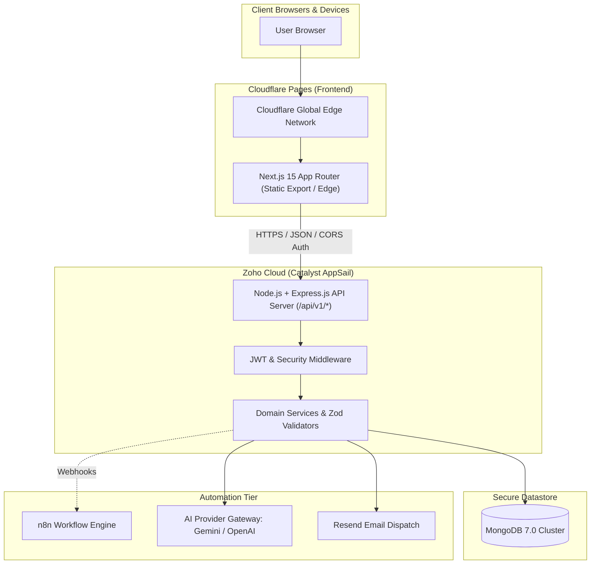

# ADR-005: Dual-Tier Topology — Cloudflare Pages (Frontend) & Zoho Cloud (Express API)

**Status:** Accepted  
**Date:** 30 October 2026  
**Deciders:** Principal Software Architect, Full-Stack Lead, DevOps & Infrastructure Specialist  
**Supersedes:** ADR-004 (Monolithic Next.js Deployment Model)  

---

## 1. Context and Problem Statement

ADR-004 unified the application into Next.js 15 App Router running both presentation routes and API route handlers in a single process. 

While effective for containerized single-host deployments (such as Docker or Railway), the target enterprise production deployment requires:
1. **Frontend Hosting:** Global high-speed distribution on **Cloudflare Pages**.
2. **Backend Hosting:** Enterprise Node.js hosting on **Zoho Cloud (Catalyst AppSail)**.
3. **Database:** Secure managed **MongoDB (Atlas / Enterprise)**.
4. **Automation:** Background orchestration on **n8n**.

Deploying Next.js 15 with dynamic route handlers that utilize heavy Node.js libraries (`mongoose`, `bcryptjs`, `crypto`) to Cloudflare Pages via edge workers creates runtime incompatibilities with Node.js primitives and increases edge cold start overhead.

---

## 2. Decision

We will implement a **Dual-Tier Decoupled Architecture**:

1. **Frontend (`apps/web` / Next.js 15 App Router):**
   - Runs on **Cloudflare Pages**.
   - Employs static export (`output: 'export'`) or lightweight Edge SSR.
   - All presentation logic, UI components, Tailwind CSS styling, Recharts visualization, and client-side route navigation execute at the edge on Cloudflare CDN.
   - Communicates with the backend exclusively via HTTPS/JSON REST API calls using `NEXT_PUBLIC_API_URL`.

2. **Backend (`backend/` / Node.js + Express.js + TypeScript):**
   - Runs on **Zoho Cloud (Catalyst AppSail)** in Node.js 20 LTS runtime.
   - Hosts all REST API endpoints under `/api/v1/...` and legacy `/api/...`.
   - Manages Mongoose connection pooling, schema validation, Zod request parsers, JWT authentication, bcrypt password hashing, and business logic.
   - Enforces strict CORS policy allowing trusted frontend origins (`https://agencyos.pages.dev`, `http://localhost:3000`).

3. **Database (MongoDB):**
   - Cloud MongoDB instance connected directly to the Zoho Cloud Express server over TLS.
   - Completely inaccessible to the public frontend; credentials remain strictly on the backend.

---

## 3. Consequences

### Positive
- **Optimal Cloudflare Performance:** Frontend is served from hundreds of Cloudflare edge locations with sub-20ms asset latency and zero server cold-start.
- **Node.js Runtime Reliability:** Backend executes on dedicated Zoho Cloud Node.js 20 LTS environment with full access to native Node.js APIs (`net`, `crypto`, Mongoose connection pooling).
- **Security Boundary:** Frontend never touches database drivers or privileged API secrets.
- **Independent Scalability:** Frontend and backend can be scaled and deployed independently without coupled build steps.

### Negative / Trade-offs
- Cross-origin communication requires explicit CORS configuration and handling of preflight `OPTIONS` requests.
- Local development requires running both web and api services (orchestrated smoothly via `npm run dev` with concurrent runners or unified dev script).

