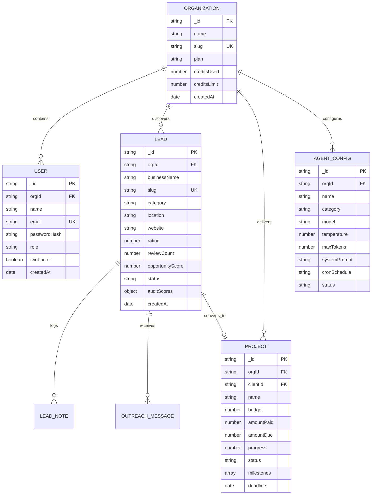

# AgencyOS Database Schema Specification

**Engine:** MongoDB 6.0+ / Mongoose ODM (Relational-compatible)  
**Multi-Tenant Model:** Strict `orgId` isolation across all collections  

---

## 1. Entity Relationship Diagram

---

## 2. Collection Definitions & Indexes

### `leads` Collection
- **Indexes:**
  - `{ orgId: 1, status: 1 }` (Status tab filtering)
  - `{ orgId: 1, opportunityScore: -1 }` (Score sorting)
  - `{ orgId: 1, businessName: "text", category: "text", location: "text" }` (Search)
- **Validation Constraints:**
  - `opportunityScore`: Number between 1.0 and 10.0
  - `status`: Enum (`['New', 'Contacted', 'Interested', 'Replied', 'Converted', 'Archived']`)

### `projects` Collection
- **Indexes:**
  - `{ orgId: 1, status: 1 }`
  - `{ orgId: 1, deadline: 1 }`
- **Fields:**
  - `budget`, `amountPaid`, `amountDue` (in INR currency units)
  - `progress` (0 to 100 percentage)

