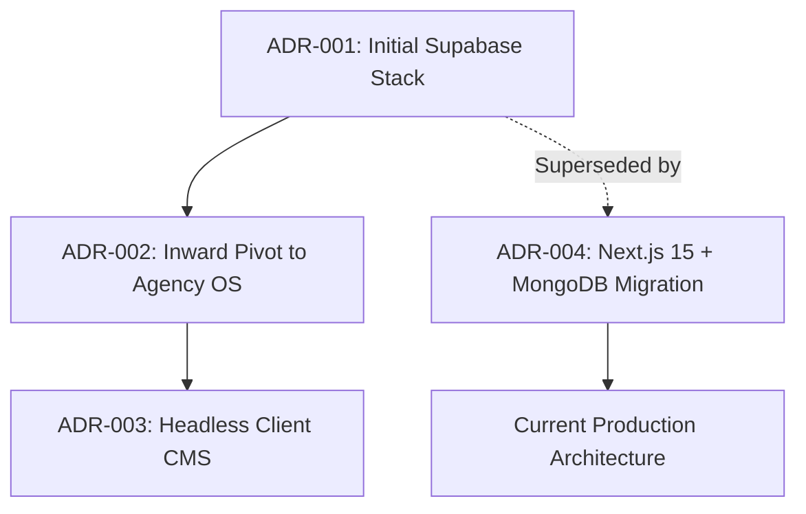

# Architecture Decision Records (ADR) Index

This document provides a consolidated register of all formal Architecture Decision Records (ADRs) governing AgencyOS design, tech stack choices, data layer migration, and operational boundaries.

---

## Architecture Decision Register

| ADR ID | Title | Status | Date | Primary Impact |
| :---: | :--- | :---: | :---: | :--- |
| [ADR-001](../architecture/decisions/ADR-001-core-tech-stack.md) | Core Technology Stack Definition | **Superseded by ADR-004** | 2026-10-18 | Initial architectural selection of Supabase + n8n + React for agency operations. |
| [ADR-002](../architecture/decisions/ADR-002-audit-engine-inward-pivot.md) | Inward Pivot: Agency Operations & Web Auditing | **Accepted** | 2026-10-18 | Pivoting core engine from external consumer tool to founder-centric agency operating system. |
| [ADR-003](../architecture/decisions/ADR-003-client-headless-cms.md) | Headless Client Portfolio Architecture | **Accepted** | 2026-10-18 | Architecture for managing client deliverables, headless CMS integrations, and static site exports. |
| [ADR-004](../architecture/decisions/ADR-004-nextjs-mongodb-saas-migration.md) | Next.js 15 + MongoDB Full-Stack SaaS Migration | **Accepted (Current)** | 2026-10-29 | Full migration from Supabase to unified Next.js 15 App Router, TypeScript (strict), and MongoDB/Mongoose datastore. |

---

## ADR Summary & Evolution

### Context & Key Principles (ADR-004)
- **Monolithic Next.js 15 App Router**: Unified frontend presentation and backend API route handlers under `src/app/`, eliminating dual-service deployment complexity.
- **Mongoose Data Modeling**: Strict schema validation with TypeScript interfaces at compile-time and runtime.
- **Mock Provider First**: Development and local testing run in full zero-cost mock mode without hard external API dependencies.
- **Deterministic Boundaries**: Strict regulatory compliance with Google Maps TOS Section 3.2.3, DPDP Act 2023, and TRAI TCCCPR rules.

