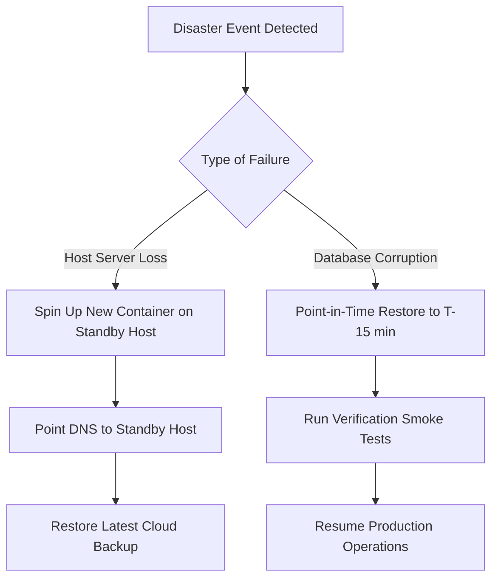

# AgencyOS Database Backup & Disaster Recovery Guide

This guide establishes the backup strategy, retention policies, restore workflows, and disaster recovery (DR) protocols for the AgencyOS MongoDB datastore.

---

## 1. Backup Strategy & Recovery Objectives

| Metric | Target | Rationale |
| :--- | :--- | :--- |
| **Recovery Point Objective (RPO)** | $\le 1\text{ hour}$ | Maximum acceptable loss of freshly ingested leads or audit records. |
| **Recovery Time Objective (RTO)** | $\le 30\text{ minutes}$ | Maximum allowable downtime during an automated restore procedure. |
| **Retention Policy** | 30 days daily, 12 weeks weekly | Complies with agency audit trails and operational reviews. |

---

## 2. Automated MongoDB Backup Procedures

### A. Managed Cloud Backups (MongoDB Atlas)
When deployed on MongoDB Atlas:
1. Enable **Continuous Cloud Backups** (Point-in-Time Recovery with 1-minute granularity).
2. Configure daily automated snapshots retained for 30 days.
3. Enable cross-region snapshot replication for geo-redundant DR.

### B. Self-Hosted / Dockerized MongoDB Backups
For Docker or VPS deployments running self-hosted MongoDB:

```bash
# Automated dump script (runs via cron or orchestration container)
#!/usr/bin/env bash
set -eo pipefail

BACKUP_DATE=$(date +%Y%m%d_%H%M%S)
BACKUP_DIR="/backups/mongodb"
mkdir -p "${BACKUP_DIR}"

# Execute mongodump inside the container or against the connection URI
mongodump \
  --uri="${MONGODB_URI}" \
  --gzip \
  --archive="${BACKUP_DIR}/agencyos_backup_${BACKUP_DATE}.gz"

# Rotate backups older than 30 days
find "${BACKUP_DIR}" -type f -name "agencyos_backup_*.gz" -mtime +30 -delete

echo "Backup completed: ${BACKUP_DIR}/agencyos_backup_${BACKUP_DATE}.gz"
```

---

## 3. Database Restore & Verification Procedures

### Complete Database Restoration

To restore from a gzip archive:

```bash
# Stop application traffic to prevent race conditions
docker stop agencyos-web

# Restore database from archive with drop flag to replace corrupted state
mongorestore \
  --uri="${MONGODB_URI}" \
  --gzip \
  --drop \
  --archive=/backups/mongodb/agencyos_backup_20261029_120000.gz

# Restart application container
docker start agencyos-web

# Verify application health
curl -s http://localhost:3000/api/health
```

---

## 4. Disaster Recovery Scenarios



### Regular Disaster Recovery Drill Schedule
1. **Quarterly Simulated Restore:** Restore production snapshot into a staging cluster; execute test suite `npm run test` against staging DB.
2. **Key Verification:** Ensure cryptographic tokens (`JWT_SECRET`) match previous decryption expectations.
3. **Data Integrity Audit:** Query lead and client document counts to verify zero data loss.

