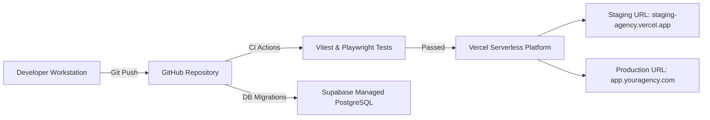

# Staging & Production Deployment Guide — Autonomous Agency OS

---

## 1. Deployment Topology



---

## 2. CI/CD Release Pipeline & Quality Gates

Every push to `staging` or `main` triggers automated GitHub Actions executing four sequential gates:
1. **Gate 1 (Static Analysis):** `npm run lint` and `npm run type-check` (zero TypeScript or ESLint errors allowed).
2. **Gate 2 (Unit & Integration Tests):** `npm run test` against mock Supabase instances (100% pass required).
3. **Gate 3 (Security & Secret Scan):** `gitleaks detect` scans commits for exposed API keys or credentials.
4. **Gate 4 (Build Verification):** `npm run build` generates Next.js production build artifacts.

---

## 3. Database Migration Deployment Runbook

1. **Local Migration Creation:**
   ```bash
   supabase migration new add_feature_tables
   ```
2. **Testing Locally:**
   ```bash
   supabase db reset
   ```
3. **Deploying to Staging / Production:**
   ```bash
   supabase link --project-ref <PROJECT_ID>
   supabase db push
   ```
4. **Migration Safety Rules:**
   - All migrations must be purely additive. Never drop columns or tables without a two-release deprecation cycle.
   - Column additions must include default values or allow `NULL` to avoid table locks.

---

## 4. Rollback & Disaster Recovery Procedures

1. **Frontend / Application Rollback:**
   - In the Vercel dashboard, navigate to **Deployments** $\rightarrow$ select the previous healthy deployment $\rightarrow$ click **Instant Rollback**. Takes <10 seconds.
2. **Database Rollback:**
   - If a migration causes data anomalies, execute the corresponding down-migration script via Supabase SQL Editor.
   - For severe corruption, restore from the automated daily Point-in-Time Recovery (PITR) snapshot.
3. **Emergency Disconnect:**
   - Flip the Emergency Kill Switch in `system_settings` to immediately freeze all automated asynchronous jobs.
