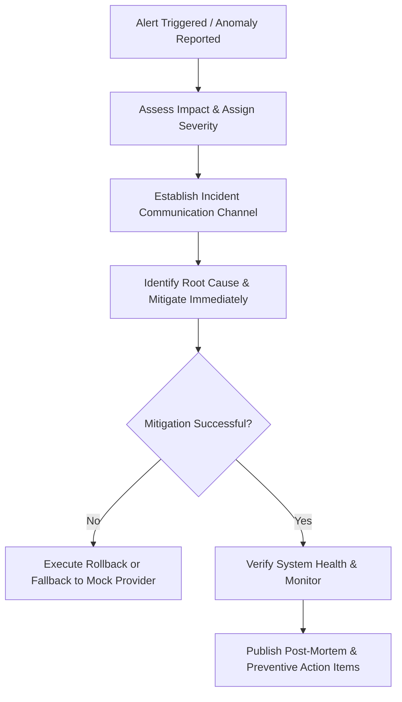

# AgencyOS Incident Response Runbook

This runbook outlines operational procedures, severity classifications, and immediate mitigation workflows for system degradation, security anomalies, and integration outages.

---

## 1. Incident Severity Levels

| Severity | Definition | Response SLA | Escalation Target |
| :--- | :--- | :--- | :--- |
| **SEV-1 (Critical)** | Core web application offline, database down, or critical security breach / credential leakage. | $< 15\text{ minutes}$ | Engineering Lead & Founder |
| **SEV-2 (Major)** | Major module degraded (e.g., outreach queue blocked, AI audits failing for all leads, email bounces $> 8\%$). | $< 1\text{ hour}$ | On-Call Engineer |
| **SEV-3 (Minor)** | Non-blocking defect (e.g., map styling issue, single non-critical chart rendering glitch). | $< 24\text{ hours}$ | Sprint Backlog / Triage |

---

## 2. Standard Triage Workflow



---

## 3. Playbooks for Common Outages

### Playbook A: Database Connection Failure (`MONGODB_URI` Unreachable)
1. **Symptom:** `/api/health` returns HTTP 503; API endpoints return 500 with `MongooseServerSelectionError`.
2. **Action:**
   - Verify network connectivity to MongoDB cluster:
     ```bash
     nc -zv <mongo-host> 27017
     ```
   - Check if IP Access List in MongoDB Atlas has blocked the container's current public IP.
   - Restart the local MongoDB service if running via Docker:
     ```bash
     docker compose -f infra/docker-compose.yml restart mongodb
     ```

### Playbook B: AI Provider Rate Limiting or Outage
1. **Symptom:** Audit runs fail with HTTP 429 (Too Many Requests) or 503 from OpenAI/Gemini.
2. **Action:**
   - Switch active provider dynamically or via environment variable:
     ```env
     # Toggle between Gemini and OpenAI or fall back to mock
     AI_RESEARCH_PROVIDER="mock"
     ```
   - Restart web process to activate mock provider fallback so users can continue testing and onboarding without crashing the dashboard.

### Playbook C: Excessive Outbound Email Bounce or Spam Flagging
1. **Symptom:** Resend webhook reports bounce rate $> 5\%$ or spam complaint rate $> 0.1\%$.
2. **Action:**
   - **Immediately Halt Outreach Campaigns:**
     - Toggle `EMAIL_PROVIDER="mock"` in environment variables.
     - In Outreach settings, set all active campaigns to `PAUSED`.
   - Audit suppression list to verify TRAI TCCCPR and DND compliance.
   - Clean lead email lists with a strict verification validator before resuming.

### Playbook D: Security Compromise / Key Rotation
1. **Symptom:** An API secret, database credential, or `JWT_SECRET` is suspected of being exposed.
2. **Action:**
   - Immediately regenerate the compromised secret in the respective provider console (MongoDB Atlas, Resend, Gemini, OpenAI).
   - Generate a new `JWT_SECRET` (`openssl rand -base64 32`).
   - Update environment variables in the production secrets manager.
   - Redeploy the application. All existing user sessions will be invalidated and required to re-authenticate.
   - Audit database logs for unauthorized read/write operations during the exposure window.

