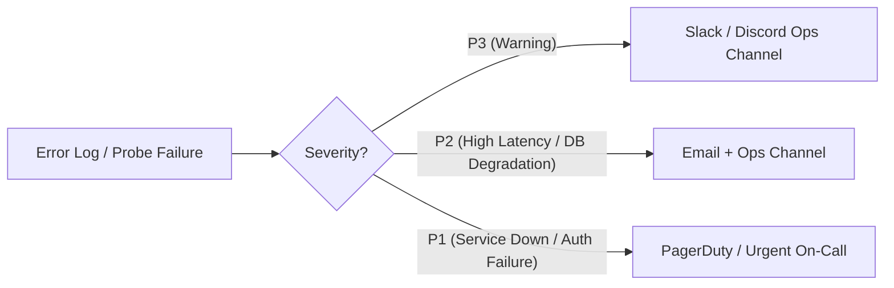

# AgencyOS Monitoring, Health Checks & Observability

This document establishes the observability architecture, health probe endpoints, key performance indicators (KPIs), and alerting thresholds for AgencyOS in production.

---

## 1. Health Probe Endpoint

AgencyOS exposes a standard health probe route at `/api/health`.

### GET `/api/health`

**Sample Request:**
```bash
curl -s http://localhost:3000/api/health
```

**Expected Response (200 OK):**
```json
{
  "status": "ok",
  "uptime": 14238.45,
  "timestamp": "2026-10-29T21:55:00.000Z",
  "database": {
    "status": "connected",
    "latencyMs": 4
  },
  "environment": "production",
  "version": "1.0.0"
}
```

**Status Code Semantics:**
- `200 OK`: Core application runtime and database connection are healthy.
- `503 Service Unavailable`: Database connection is broken or unreachable. Container orchestrator / load balancer should mark the instance unhealthy and cycle traffic.

---

## 2. Key Metrics & Service Level Objectives (SLOs)

| Metric | Target (SLO) | Warning Threshold | Critical Incident Threshold |
| :--- | :---: | :---: | :---: |
| **API Availability** | $\ge 99.9\%$ | $< 99.5\%$ over 15 min | $< 98.0\%$ over 5 min |
| **API Latency (p95)** | $< 350\text{ ms}$ | $> 800\text{ ms}$ | $> 2000\text{ ms}$ |
| **Database Query Latency** | $< 50\text{ ms}$ | $> 200\text{ ms}$ | $> 500\text{ ms}$ |
| **Failed Background Jobs** | $< 1\%$ | $> 5\%$ in 1 hour | $> 15\%$ in 1 hour |
| **Outbound Email Bounces** | $< 2\%$ | $> 5\%$ | $> 8\%$ (immediate pause) |

---

## 3. Log Aggregation & Format

All backend API logs adhere to structured JSON logging in production:

```json
{
  "timestamp": "2026-10-29T21:55:12.102Z",
  "level": "info",
  "service": "agencyos-api",
  "traceId": "c8f1e9a2-4b3d-4c8e-bf91-a1b2c3d4e5f6",
  "route": "/api/leads",
  "method": "POST",
  "statusCode": 201,
  "durationMs": 42,
  "tenantId": "usr_68f01a89b"
}
```

### Sensitive Data Masking
The logger automatically masks:
- Authorization headers (`Bearer [REDACTED]`)
- Passwords and secret keys in request payloads
- PII (personal phone numbers, personal email addresses in stack traces)

---

## 4. Alert Routing Matrix



- **P1 (Critical):** `/api/health` returns 503 for $>2$ minutes; database unreachable; critical authentication error. Trigger on-call immediately.
- **P2 (Elevated):** AI provider rate-limiting exceeded; background worker backlog $> 500$ jobs; outbound email bounce rate $>5\%$.
- **P3 (Informational/Warning):** Degraded client response time $> 800\text{ms}$; occasional 404/400 errors from external crawlers.

