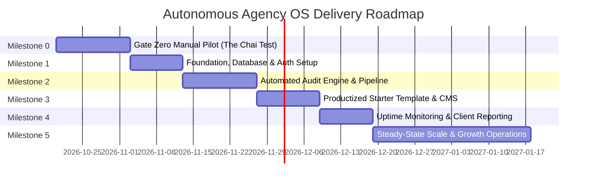

# Milestone Implementation Roadmap — Autonomous Agency OS

**Roadmap Version:** 1.0.0-draft  
**Execution Strategy:** Phase-Gated, Lean-Validation First (Gate Zero before OS scale)  

---

## Roadmap Overview

---

## Detailed Milestone Descriptions

### Milestone 0: Gate Zero — The Manual Validation Pilot ("The Chai Test")
- **Primary Objective:** Close 2–3 paying pilot clients manually in Vijay Nagar, Indore before writing internal automation code.
- **Entry Criteria:** Completed research dossier and standardized pricing pitch sheet.
- **Exit Criteria:** Minimum ₹25,000 received in advance across pilot clients; verified delivery bottlenecks.
- **Key Deliverable:** Manual audit PDFs, closed client contracts, baseline copy templates.

### Milestone 1: Core Foundation, Database Schema & Authentication
- **Primary Objective:** Establish the Supabase PostgreSQL data layer, RLS policies, Next.js 15 admin shell, and security perimeter.
- **Entry Criteria:** Milestone 0 exit signoff.
- **Exit Criteria:** Database migrations applied cleanly; RLS test suite passing 100%; authenticated session management verified.
- **Key Deliverable:** Migrations, `.env.example`, Supabase client, base layout.

### Milestone 2: Automated Audit Engine & Kanban Pipeline
- **Primary Objective:** Automate headless Core Web Vitals checks, DOM inspection (WhatsApp CTA), PDF audit dossier rendering, and lead pipeline tracking.
- **Entry Criteria:** Milestone 1 verified.
- **Exit Criteria:** Audit job executes in <90 seconds; PDF dossier generated and stored in Supabase Storage; Kanban pipeline transitions operational.
- **Key Deliverable:** n8n audit workflow, PDF generation template, Lead Fit scoring function.

### Milestone 3: Productized Website Starter Template & Headless CMS
- **Primary Objective:** Build the reusable client delivery template (`agency-starter-funnel`) with sub-second mobile page loads and locked-down Sanity/Supabase CMS.
- **Entry Criteria:** Milestone 2 verified.
- **Exit Criteria:** 95+ Mobile PageSpeed score; WhatsApp lead routing verified; client staff can edit batch dates without touching code.
- **Key Deliverable:** Reusable Next.js client starter repository, CMS schema, deployment documentation.

### Milestone 4: Maintenance Operations, Uptime Monitoring & SLA Reporting
- **Primary Objective:** Automate ongoing retainer value delivery through scheduled 6-hour uptime/SSL checks and monthly performance reporting.
- **Entry Criteria:** Milestone 3 verified.
- **Exit Criteria:** Automated ping job operational; failure alerts dispatch to founder; monthly client report generator functional.
- **Key Deliverable:** Scheduled n8n monitoring workflow, monthly report template.

### Milestone 5: Steady-State Optimization & Growth
- **Primary Objective:** Scale agency client load to 8–12 active retainers while maintaining 15–20 hours/week founder engineering capacity.
- **Entry Criteria:** Milestone 4 verified; at least 3 active retainer clients onboarded.
- **Exit Criteria:** Consistent ₹90,000+ monthly net operating profit; <5 support tickets/month per client.
