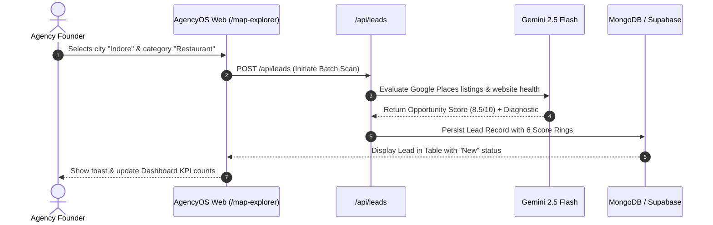
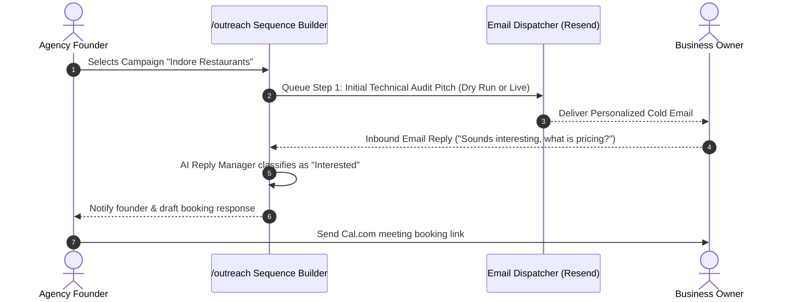
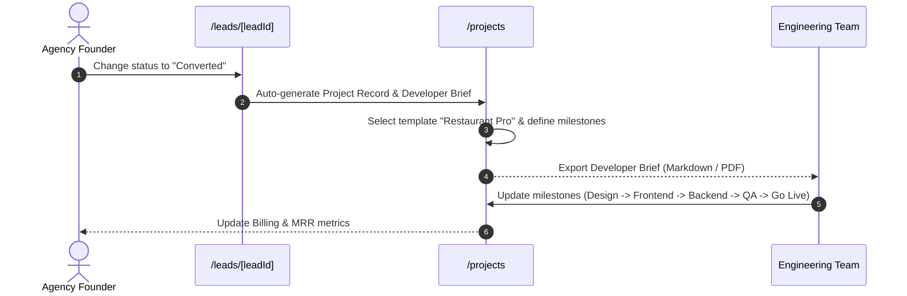

# AgencyOS End-to-End Operational Workflows

This document outlines the standard operating procedures and technical workflows across the full agency lifecycle.

---

## Workflow 1: Market Prospecting to Qualified Lead Dossier

---

## Workflow 2: Outreach Campaign to Meeting Scheduled

---

## Workflow 3: Converted Client to Website Delivery Handoff

---

## Exception Handling & Safeguards

1. **Suppression List Guard:** If a business owner requests "Unsubscribe", the AI Reply Manager immediately changes their status to `Archived`, updates the suppression list, and cancels all pending sequence steps.
2. **AI Rate Limiting / Budget Guard:** If monthly LLM token spend exceeds `$250` (or configured budget in `/settings`), background agents pause automatically, preventing unexpected billing spikes.
3. **Dry-Run Default:** All outbound connectors remain in simulation mode unless explicitly enabled in workspace settings.

