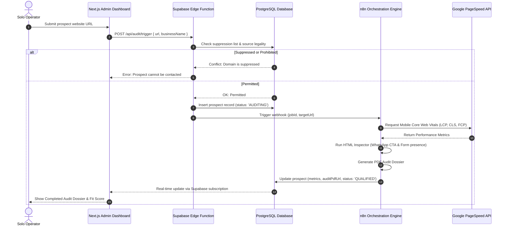
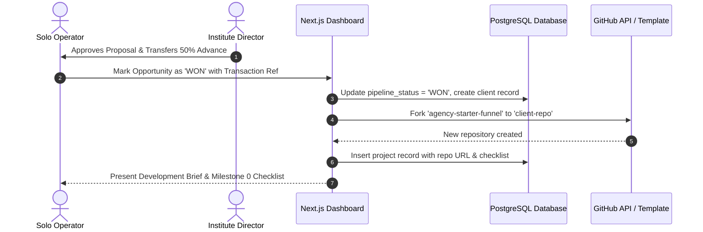

# End-to-End User Workflows — Autonomous Agency OS

This document maps the primary operator workflows, automated system processes, and client interactions across the agency lifecycle.

---

## 1. High-Level Lifecycle Flow

```mermaid
flowchart TD
    subgraph Phase 1: Ingestion & Auditing
        A1[Enter Permitted Prospect URL / Locality] --> A2{Source Allowed & Not Suppressed?}
        A2 -->|No / Blacklisted| A3[Reject & Log Reason]
        A2 -->|Yes| A4[Trigger Headless Audit Job]
        A4 --> A5[PageSpeed API: Mobile Core Web Vitals]
        A4 --> A6[DOM Inspector: WhatsApp Link & Form Check]
        A5 & A6 --> A7[Compile Visual PDF Audit Dossier]
        A7 --> A8[Compute Lead Fit Score]
    end

    subgraph Phase 2: Qualification & Founder Outreach
        A8 --> B1[Review Audit in Operator Dashboard]
        B1 --> B2{Lead Fit Score >= 65?}
        B2 -->|No| B3[Archive / Defer]
        B2 -->|Yes| B4[Stage Outreach Dossier]
        B4 --> B5[Founder Delivers Audit via LinkedIn / In-Person Visit]
    end

    subgraph Phase 3: Sales, Proposal & Closing
        B5 --> C1[Discovery Conversation / Chai Meeting]
        C1 --> C2{Client Interested?}
        C2 -->|No| C3[Log Feedback & Mark Lost]
        C2 -->|Yes| C4[Generate Standardized SOW / Proposal]
        C4 --> C5[Client Signs & Pays 50% Advance]
    end

    subgraph Phase 4: Productized Delivery & Handoff
        C5 --> D1[Initialize Next.js + Headless CMS Template]
        D1 --> D2[Configure Course Data & WhatsApp Routing]
        D2 --> D3[Founder Technical QA & Speed Test]
        D3 --> D4[Client Review on Staging Domain]
        D4 --> D5[Client Pays Balance & Approves Production Launch]
        D5 --> D6[Deploy to Client Custom Domain]
    end

    subgraph Phase 5: Ongoing Retention & Monitoring
        D6 --> E1[Activate Scheduled 6-Hour Uptime / SSL Check]
        E1 --> E2[Quarterly Batch Update & SEO Review]
        E2 --> E3[Quarterly Retainer Renewal]
    end
```

---

## 2. Sequence Diagram: Programmatic Audit Execution



---

## 3. Sequence Diagram: Client Onboarding to Development Handoff


