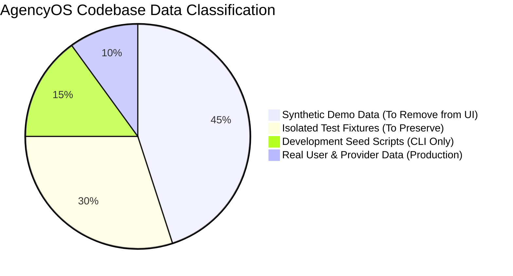

# AgencyOS — Demo Data Audit & Cleansing Inventory

**Audit Date:** 14 November 2026  
**Status:** Canonical Demo Data Audit  
**Auditor:** DevSecOps & Data Integrity Engineering  

---

## 1. Executive Summary & Purpose

To ensure AgencyOS functions as a genuine production operating system rather than a static prototype, all synthetic demonstration datasets, hardcoded fallback arrays, and mock API pathways must be identified, classified, and decoupled from production execution paths.

Production dashboards and tables must present **honest empty states** when no real records exist, prompting the operator to execute discovery, create campaigns, or connect live data providers.

---

## 2. Inventory of Demo Data & Mock Pathways

### 2.1 Hardcoded Frontend Fallback Datasets (To Be Removed from UI Paths)

| File Location | Variable / Constant Name | Content Description | Classification | Cleansing Action |
| :--- | :--- | :--- | :--- | :--- |
| `frontend/src/app/(dashboard)/map-explorer/page.tsx` (lines 51-64) | `INITIAL_BUSINESS_RESULTS` | 12 hardcoded restaurants, salons, clinics in New Delhi and Indore. | Synthetic Demo Data | Remove fallback array; display honest empty state: *"Search for local businesses by category and city to discover prospects."* |
| `frontend/src/app/(dashboard)/clients/page.tsx` (lines 54-63) | `CLIENT_RECORDS` | 8 synthetic client records (Urban Kitchen, Spice Junction, Dental Care+, etc.). | Synthetic Demo Data | Remove fallback array; query `/api/v1/clients`; display empty state: *"No active clients found. Convert qualified leads to start onboarding."* |
| `frontend/src/app/(dashboard)/projects/page.tsx` (lines 50-70) | `PROJECTS_DATA` | 8 hardcoded website and SEO projects with fake budgets and milestones. | Synthetic Demo Data | Remove fallback array; query `/api/v1/projects`; display empty state: *"No active projects. Scaffolding is initiated upon proposal approval."* |
| `frontend/src/app/(dashboard)/outreach/page.tsx` (lines 65-76) | `CAMPAIGNS` | 10 hardcoded campaigns (Indore Restaurants, Jaipur Cafes, Delhi Clinics, etc.). | Synthetic Demo Data | Remove fallback array; query `/api/v1/campaigns`; display empty state: *"No active outreach campaigns. Click 'New Campaign' to generate outreach."* |
| `frontend/src/app/(dashboard)/outreach/page.tsx` (lines 78-84) | `PERFORMANCE_DATA` | 5 hardcoded daily performance metrics for sent, opened, replied messages. | Synthetic Demo Data | Remove fallback array; render chart only when backend provides real time-series events. |
| `frontend/src/app/(dashboard)/outreach/page.tsx` (lines 107-109) | Default reply text | Hardcoded draft string simulating an exchange with "Rahul". | Synthetic Demo Data | Clear hardcoded conversation thread; bind to selected conversation from inbox API. |
| `frontend/src/app/(dashboard)/billing/page.tsx` (lines 36-49) | `REVENUE_OVER_TIME` | 12 monthly billed vs paid numbers (₹4.2L to ₹16.2L). | Synthetic Demo Data | Remove fallback array; render chart dynamically from `/api/v1/billing/invoices` aggregations. |
| `frontend/src/app/(dashboard)/billing/page.tsx` (lines 51-57) | `INVOICE_STATUS_DATA` | Static pie chart slice percentages (57% Paid, 21% Pending, etc.). | Synthetic Demo Data | Calculate dynamically from actual invoice counts. |

---

### 2.2 Backend & Database Seed Data

| File Location | Scope | Description | Classification | Retention Strategy |
| :--- | :--- | :--- | :--- | :--- |
| `database/seed/seed-data.ts` | Database seeding script | Sample organizations, users, and leads. | Development Seed Script | **Preserve in isolated development CLI** (`npm run db:seed`) for offline testing only; strictly prohibited from running during production startup. |
| `frontend/src/app/api/leads/route.ts` (lines 39-48) | Auto-seed trigger | Automatically inserted `DEFAULT_LEADS` if database lead count was 0. | Automatic Demo Seeding Bug | **Permanently remove** auto-seed logic. New organizations must begin with zero leads. |
| `tests/fixtures/sample-data.ts` | Test suite fixture | Synthetic leads, invoices, and organizations used by Vitest. | Automated-Test Data | **Preserve in `tests/fixtures/`**; strictly isolated from application runtime. |

---

## 3. Data Classification Summary

* **Synthetic Demo Data (45%):** Hardcoded UI arrays in `page.tsx` files. Must be removed from default view state and replaced with API calls and honest empty states.
* **Isolated Test Fixtures (30%):** Kept strictly in `tests/fixtures/` for automated regression testing.
* **Development Seed Scripts (15%):** Kept in `database/zoho-catalyst/seed/` for local developer onboarding via explicit CLI command.
* **Real User & Provider Data (10%):** Stored exclusively in the authoritative Zoho Catalyst CloudScale Data Store.

---

## 4. Cleansing Execution Protocol

1. **Step 1:** Refactor `map-explorer/page.tsx` to initialize `businesses` as an empty array `[]`. When search is empty or unperformed, render the clean discovery prompt with interactive category pills.
2. **Step 2:** Refactor `clients/page.tsx` to initialize `clientsList` as `[]`. When no clients exist, display the client acquisition CTA.
3. **Step 3:** Refactor `projects/page.tsx` to initialize `projects` as `[]`. When no projects exist, display the project creation CTA.
4. **Step 4:** Refactor `outreach/page.tsx` to initialize `campaignsList` as `[]` and inbox as empty until webhook messages are ingested.
5. **Step 5:** Refactor `billing/page.tsx` to calculate invoice metrics dynamically from actual records, rendering empty-state charts when total invoices = 0.
6. **Step 6:** Remove auto-seeding blocks in API route handlers.
