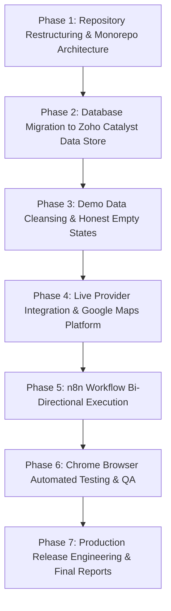

# AgencyOS — Master Engineering & Execution Roadmap

**Document Version:** 1.0.0  
**Status:** Approved Master Roadmap  
**Date:** 14 November 2026  
**Execution Cycle:** End-to-End Autonomous Transformation  

---

## 1. Execution Philosophy: The Continuous Loop

AgencyOS follows the continuous engineering loop defined in Section 22:
$$\text{PLAN} \rightarrow \text{INSPECT} \rightarrow \text{IMPLEMENT} \rightarrow \text{BUILD} \rightarrow \text{CONNECT} \rightarrow \text{EXECUTE} \rightarrow \text{CHROME TEST} \rightarrow \text{OBSERVE} \rightarrow \text{DEBUG} \rightarrow \text{FIX} \rightarrow \text{RETEST} \rightarrow \text{SECURITY CHECK} \rightarrow \text{DOCUMENT} \rightarrow \text{ACCEPT}$$

---

## 2. Seven Execution Phases

---

### Phase 1: Repository Restructuring & Monorepo Alignment (Section 3)
* **Objective:** Align the monorepo to the exact canonical layout specified in Section 3.
* **Actions:**
  1. Organize `database/zoho-catalyst/` with subdirectories: `schema/`, `manifests/`, `migrations/`, `provisioning/`, `indexes/`, `constraints/`, `seed/`, `validation/`, `backup/`, and `README.md`.
  2. Organize `database/storage/` and `database/cache/`.
  3. Organize `backend/src/infrastructure/` with subdirectories: `persistence/zoho-catalyst/`, `n8n/`, `google-maps/`, `ai-providers/`, `email/`, `calendar/`, `payments/`, `hosting/`.
  4. Organize `infra/` with subdirectories: `cloudflare-pages/`, `zoho-appsail/`, `n8n/`, `storage/`, `monitoring/`, `ci-cd/`.
  5. Create `release/` with subdirectories: `frontend/`, `backend/`, `database/`, `n8n/`.
  6. Create `tests/browser/` for Playwright end-to-end browser journeys.
  7. Add `Dockerfile` and `.env.example` in `frontend/` and `backend/`.

---

### Phase 2: Complete Database Migration to Zoho Catalyst (Section 5)
* **Objective:** Eliminate MongoDB and Mongoose completely as the application business database; implement Zoho Catalyst CloudScale Data Store with ZCQL.
* **Actions:**
  1. Install `zcatalyst-sdk-node` in `backend/`.
  2. Remove `mongoose` dependency from `backend/package.json` and root `package.json`.
  3. Create table manifests and ZCQL schemas for all 17 tables in `database/zoho-catalyst/manifests/tables.json`.
  4. Implement Zoho Catalyst Data Store client & ZCQL query engine under `backend/src/infrastructure/persistence/zoho-catalyst/`:
     * Dual-mode operational adapter: native `zcatalyst-sdk-node` when running in Zoho AppSail / with Catalyst OAuth credentials, plus a zero-dependency in-memory ZCQL query emulator for local offline testing and CI.
  5. Replace legacy Mongoose models with pure TypeScript domain entities and Zod validators.
  6. Update backend services to execute ZCQL queries (`SELECT`, `INSERT`, `UPDATE`, `DELETE`).
  7. Update all unit and contract tests to assert against the Catalyst persistence layer.

---

### Phase 3: Demo Data Cleansing & Honest Empty States (Sections 6, 10, 11)
* **Objective:** Remove all hardcoded fake data arrays and auto-seed triggers from frontend views.
* **Actions:**
  1. Remove `INITIAL_BUSINESS_RESULTS` from `frontend/src/app/(dashboard)/map-explorer/page.tsx`.
  2. Remove `CLIENT_RECORDS` fallback from `frontend/src/app/(dashboard)/clients/page.tsx`.
  3. Remove `PROJECTS_DATA` fallback from `frontend/src/app/(dashboard)/projects/page.tsx`.
  4. Remove `CAMPAIGNS` and `PERFORMANCE_DATA` fallbacks from `frontend/src/app/(dashboard)/outreach/page.tsx`.
  5. Remove `REVENUE_OVER_TIME` and `INVOICE_STATUS_DATA` from `frontend/src/app/(dashboard)/billing/page.tsx`.
  6. Remove auto-seeding blocks in API route handlers.
  7. Implement responsive, informative empty states prompting user actions (e.g., "No leads found. Search on Map Explorer or import CSV to discover prospects").

---

### Phase 4: Live Provider Integration & Google Maps Platform (Sections 7, 8, 9)
* **Objective:** Provide genuine provider connectivity and compliant Google Maps discovery.
* **Actions:**
  1. Implement Google Maps Platform Places API (New) integration with Text Search, Place Details, and Autocomplete.
  2. Implement strict TOS Section 3.2.3 compliance (no scraping, ephemeral caching, clear Google attribution).
  3. Implement AI model registry routing based on model capabilities (research, code generation, sentiment triage).
  4. Configure safe mock fallbacks (`dry_run = true`) when live keys are unpopulated.

---

### Phase 5: n8n Multi-Agent Workflow Orchestration (Section 12)
* **Objective:** Ensure all 25 n8n workflows integrate cleanly with the Zoho Catalyst backend.
* **Actions:**
  1. Maintain 25 verified workflow JSON files under `n8n/workflows/`.
  2. Connect bi-directional webhook callbacks using correlation IDs and tenant boundary validation.
  3. Verify automated scheduled sweeps (`daily-summary.json`, `health-check.json`).

---

### Phase 6: Chrome Browser Testing & Mandatory Agentic Verification (Section 14)
* **Objective:** Execute real automated browser testing across all 11 routes using Playwright Chromium.
* **Actions:**
  1. Build end-to-end browser test suites in `tests/browser/agencyos.spec.ts`.
  2. Verify all 11 dashboard routes: navigation, forms, search, filters, modals, error states.
  3. Verify zero console JavaScript errors, zero hydration errors, zero broken layouts.
  4. Generate `docs/reports/CHROME_BROWSER_QA_REPORT.md` documenting route-by-route results.

---

### Phase 7: Production Release Engineering & Final Reports (Sections 17, 24)
* **Objective:** Package production deployment release artifacts and produce the final engineering report suite.
* **Actions:**
  1. Package self-contained release artifacts under `release/frontend/`, `release/backend/`, `release/database/`, `release/n8n/`.
  2. Verify GitHub Actions CI workflow covering typechecks, tests, schema validations, and builds.
  3. Generate final reports in `docs/reports/`:
     * `FINAL_ENGINEERING_REPORT.md`
     * `FINAL_FEATURE_COMPLETION_REPORT.md`
     * `FINAL_AGENT_AND_WORKFLOW_REPORT.md`
     * `FINAL_GOOGLE_MAPS_REPORT.md`
     * `FINAL_CHROME_BROWSER_QA_REPORT.md`
     * `FINAL_SECURITY_REPORT.md`
     * `FINAL_DEPLOYMENT_REPORT.md`
     * `FINAL_BUSINESS_ACCEPTANCE_REPORT.md`
