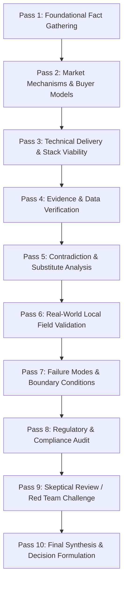

# Research Methodology & Evidence Standards

This document establishes the methodological protocol, search taxonomy, source verification guidelines, and evidence grading matrix utilized by the Multidisciplinary Research Team.

---

## 1. Investigation Protocol: 10-Pass Recursive Loop

The research process operates through ten distinct analytical passes, updating intermediate findings and testing assumptions at each stage:

---

## 2. Evidence Classification System

Every factual claim in the research dossier is assigned an explicit epistemic status based on rigorous empirical evaluation:

| Status Label | Standard Definition | Application Criteria |
| :--- | :--- | :--- |
| **`VERIFIED`** | Directly supported by first-party legal statutes, official documentation, or verified direct local data. | Official government Acts, primary vendor terms, directly observed market pricing sheets. |
| **`CORROBORATED`** | Supported by multiple mutually independent commercial reports, industry benchmarks, or cross-verified local observations. | Common pricing ranges across multiple independent Indore agencies, consistent ERP sales cycles. |
| **`PRELIMINARY`** | Supported by credible indicators or early-stage market reports, but lacking exhaustive sample sizes. | Sub-niche willingness to pay for ongoing SEO retainers; specific conversion rates for audit emails. |
| **`DISPUTED`** | Contradicted by credible opposing sources or divergent market practices. | Effectiveness of cold email vs. in-person walk-ins in Tier-2 Indian commercial hubs. |
| **`INFERRED`** | A reasoned analytical deduction derived logically from verified premises. | Solo-founder client capacity limits based on development and support time-motion math. |
| **`UNKNOWN`** | Insufficient verifiable data currently exists to draw a defensible conclusion. | Exact percentage of Indore institute owners willing to sign an automated annual contract. |
| **`REFUTED`** | Contradicted and disproven by hard empirical, legal, or platform evidence. | Claim that cold WhatsApp blasts or Google Maps scraping are viable, compliant long-term outreach channels. |

---

## 3. Source Selection & Verification Rules

1. **Hierarchy of Sources:**
   - *Primary Evidence:* Statutory legislation (DPDP Act 2023, TRAI TCCCPR), official API terms (WhatsApp Business Policy, Google Maps Platform TOS), published price lists of local service providers, CCPA regulatory enforcement orders.
   - *Secondary Evidence:* Specialized industry studies (EdTech sales analyses, Indian coaching market reports), local business market overviews (Indore educational hub profiles).
   - *Tertiary Evidence:* General articles, blog posts, and forum discussions (used solely to identify hypotheses, never as standalone proof).
2. **Independence Rule:** Multiple articles repeating the same press release, marketing blog, or syndicated agency report do not count as independent confirmation.
3. **No Synthetic Proof:** No URLs, citations, legal clauses, or statistical metrics may be fabricated. Where a document cannot be accessed, the limitation must be explicitly registered.
4. **Temporal Context:** All financial figures and regulatory policies must reflect the 2024–2026 operating environment in India.
