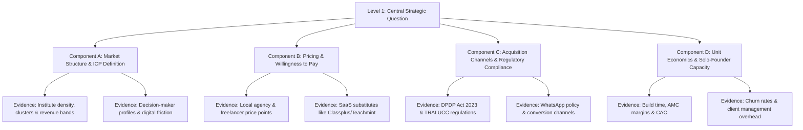

# Research Question Hierarchy

This document maps the five-level question hierarchy governing the market validation of the **Autonomous Agency OS** for independent coaching and skill-training institutes in Indore.

---

## Level 1: Central Strategic Question
> **Is the independent coaching and skill-training institute sector in Indore an economically viable, legally accessible, and operationally scalable beachhead niche for a solo-operator productized agency?**

---

## Level 2: Component Decompositions

### Component A: Market Structure and ICP Segmentation
- **RQ-A1:** What is the total count, geographical concentration, and classification of coaching institutes in Indore?
- **RQ-A2:** How do Test-Prep (UPSC/MPPSC, IIT/NEET, Banking) institutes differ from Skill-Training (IT, Digital Marketing, Coding, English) institutes in their operational model, sales urgency, and digital maturity?
- **RQ-A3:** Who is the exact decision-maker, and what triggers them to invest in web infrastructure?

### Component B: Pricing and Willingness to Pay (WTP)
- **RQ-B1:** What is the prevailing market price for website development, local SEO, and landing pages quoted by local agencies and freelancers in Indore?
- **RQ-B2:** Do institute owners perceive a website as an independent asset, or solely as an enabler for student admissions and lead generation?
- **RQ-B3:** What is the feasible price ceiling for:
  - An initial one-time productized setup?
  - An ongoing monthly maintenance and growth retainer (AMC)?
- **RQ-B4:** How do low-cost SaaS platforms (e.g., Classplus, Teachmint, Proctur) anchoring software at ₹20,000–₹45,000/year influence customer expectations?

### Component C: Acquisition Channels and Regulatory/Platform Compliance
- **RQ-C1:** How does India's **Digital Personal Data Protection (DPDP) Act, 2023** treat B2B cold emailing and automated prospect discovery using publicly published contact info?
- **RQ-C2:** What constraints are imposed by **TRAI's TCCCPR (2018)** regulations regarding commercial outreach via SMS or voice calls?
- **RQ-C3:** What are the operational and policy limitations of using WhatsApp (standard vs. WhatsApp Business App vs. official WhatsApp Business API) for cold prospect outreach?
- **RQ-C4:** Given that scraping Google Maps/Places is prohibited by platform terms, what are the legitimate, high-conversion prospect discovery and outreach channels in Indore?

### Component D: Unit Economics and Solo-Founder Capacity
- **RQ-D1:** What are the realistic Customer Acquisition Cost (CAC) and sales cycle duration for local B2B service deals in Indore?
- **RQ-D2:** What is the maximum concurrent client load a solo developer can sustain while maintaining delivery velocity, technical QA, and client communications?
- **RQ-D3:** What is the expected churn rate for local monthly retainers, and how does that affect Customer Lifetime Value (LTV)?

---

## Level 3: Required Evidence by Component

| Component | Necessary Evidence | Preferred Source Types |
| :--- | :--- | :--- |
| **Market Structure** | Number of active institutes, primary hubs (Bhawar Kuan, Geeta Bhawan, Vijay Nagar), average batch sizes, annual fee turnovers. | Commercial directories, education market studies, field observations, local registry filings. |
| **WTP & Pricing** | Local agency rate cards, freelancer quotes, SaaS pricing models (Classplus, Proctur), marketing spend percentages. | Published agency price sheets, vendor interviews, marketing budget allocation benchmarks. |
| **Acquisition & Law** | Statutory texts of DPDP Act 2023, TRAI UCC guidelines, Meta WhatsApp Business Terms of Service, Google Maps Platform TOS. | Primary legal statutes, regulatory circulars, official developer terms of service. |
| **Unit Economics** | Time-motion breakdown of website delivery, average retainer duration in Tier-2 India, agency gross margins. | Empirical agency benchmarks, project delivery logs, SME operator financial models. |

---

## Level 4: Key Assumptions, Exceptions, and Edge Cases
1. **Assumption:** Institute directors will value a modern, high-speed, SEO-optimized custom web stack (e.g., Next.js/Tailwind or clean architecture) over a cheap ₹8,000 WordPress template.  
   *Failure condition:* The owner only cares about a WhatsApp link and an Instagram presence, rendering custom code irrelevant.
2. **Assumption:** Automated email outreach will produce enough qualified discovery calls.  
   *Failure condition:* Indian coaching institute directors rarely check official emails (`info@` or `director@`) or treat them as junk, requiring high-touch in-person visits or WhatsApp calls.
3. **Assumption:** Monthly retainers (₹3,000–₹5,000/month) will provide predictable recurring revenue.  
   *Failure condition:* High seasonal churn where institutes stop paying retainers outside the primary admission months (March–July).
4. **Exception:** Skill-training institutes (IT/Digital Marketing) have continuous rolling monthly admissions and higher digital literacy than legacy MPPSC centers, making them a distinctly superior sub-niche.

---

## Level 5: Residual and Emerging Questions Post-Investigation
- What exact product bundle (e.g., "Enquiry Engine" vs. "Website + SEO") maximizes perceived ROI and minimizes price resistance?
- Can a hybrid acquisition model (in-person grassroots audit delivery combined with automated CRM follow-up) outperform purely digital cold outreach in Tier-2 hubs like Indore?
- What are the minimum viable contractual terms to prevent scope creep during local website delivery?
