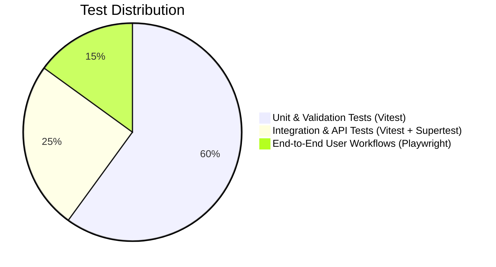

# AgencyOS Test Strategy & Release Gates

---

## 1. Testing Pyramid

1. **Unit & Validation Layer (`tests/unit/`):**
   - Zod schema validation rules (`validations.test.ts`).
   - Auth token generation, bcrypt hashing, and cookie verification (`auth.test.ts`).
   - UI component render and prop binding (`components.test.tsx`).
   - Fast execution: <2.5 seconds.
2. **Integration Layer:**
   - Next.js route handlers (`/api/leads`, `/api/auth/me`).
   - Database operations against memory or isolated test database.
3. **End-to-End Browser Layer (`tests/e2e/`):**
   - Full browser execution via Playwright (`tests/e2e/agencyos.spec.ts`).
   - Validates user login, navigation across all 11 modules, and lead inspection drawer.

---

## 2. Release Gates

Before any PR can be merged into `staging` or `main`:
1. **Gate 1 — Types:** `npm run typecheck` must pass with 0 errors.
2. **Gate 2 — Tests:** `npm run test` must pass 100% of unit tests.
3. **Gate 3 — Compilation:** `npm run build` must compile all 29 routes cleanly.
4. **Gate 4 — Security:** No leaked secrets or violation of platform TOS.

