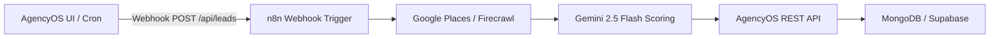

# n8n Workflow Automation Architecture

## Overview

AgencyOS uses **n8n** (self-hosted via Docker or managed n8n cloud) for asynchronous, multi-step background automation that operates outside the synchronous Next.js request lifecycle.

## Workflow Modules

1. **`research/`:** Scheduled and on-demand discovery of local businesses, Firecrawl website audits, and Core Web Vitals scoring.
2. **`outreach/`:** Drip sequences, cold email drafting via Resend, and WhatsApp template dispatch.
3. **`delivery/`:** Automated repository scaffolding, DNS configuration checks, and client onboarding forms.

## Security & Execution Invariants
- **No Credentials in JSON:** All API keys (`GEMINI_API_KEY`, `RESEND_API_KEY`) are managed exclusively via n8n's encrypted credential vault, never committed to repository JSON files.
- **Dry-Run by Default:** All outbound email and messaging nodes default to `dry_run = true` unless active founder gate clearance is provided.
- **Deterministic Validation:** All payloads received by AgencyOS route handlers are strictly parsed via Zod schemas.

